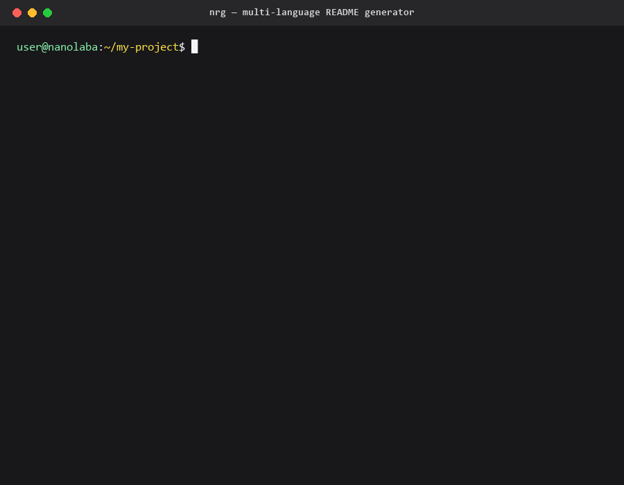

<!-- This file was automatically generated by Nanolaba Readme Generator (NRG) from README.src.md -->
<!-- Do not edit it by hand: change README.src.md and regenerate. See https://github.com/nanolaba/readme-generator -->


[ **en** | [ru](README.ru.md) ]

[](https://github.com/nanolaba/readme-generator/actions/workflows/ci.yml)
[](https://central.sonatype.com/artifact/com.nanolaba/readme-generator)
[](https://javadoc.io/doc/com.nanolaba/readme-generator/1.4)
[](https://adoptium.net/)
[](https://www.apache.org/licenses/LICENSE-2.0)
[](https://www.bestpractices.dev/projects/17011)
[](https://github.com/nanolaba/readme-generator)

# Nanolaba Readme Generator (NRG): one template for README in every language, for AI coding agents and CI

**NRG** generates `README.md`, `README.ru.md` and a file for every other language from one `README.src.md` template.
A translation sits on the line next to its original, versions are read from `pom.xml`, `package.json` or `build.gradle`,
and code samples are imported from real source files. When an AI coding agent maintains the docs, it edits one file
instead of one per language: `nrg --validate` names the template line it broke, and `nrg --check` fails CI when a generated
file differs from what its template produces. Under Claude Code a hook refuses an edit of a generated file and names the template to change.

NRG runs on Java 8+ and ships as a [CLI](#using-the-command-line-interface), a [Maven plugin](#use-as-maven-plugin),
a [GitHub Action](#use-as-a-github-action) and a [Java library](#use-as-a-java-library). A template is Markdown with
language markers, `${…}` variables and widgets: table of contents, import, badges, `if` blocks, alerts, math and others.
This README and its [Russian translation](README.ru.md) are generated from [`README.src.md`](README.src.md).

**Questions and feedback:** [Discussions](https://github.com/nanolaba/readme-generator/discussions) · **bugs:** [Issues](https://github.com/nanolaba/readme-generator/issues/new/choose) · English or Russian



## Try it

Download `readme-generator-1.4.zip` from [the release page](https://github.com/nanolaba/readme-generator/releases/tag/v1.4) and unzip it; it needs only Java 8+. Then write `README.src.md`:

```markdown
<!--@nrg.languages=en,ru-->

${widget:languages}

# ${en:'Hello', ru:'Привет'}

Install with `make install`.<!--en-->
Установка: `make install`.<!--ru-->
```

```bash
nrg -f README.src.md
```

NRG writes `README.md` and `README.ru.md` next to the template. Here is `README.md`; `README.ru.md` is the same with the Russian lines:

```markdown
<!-- This file was automatically generated by Nanolaba Readme Generator (NRG) from README.src.md -->
<!-- Do not edit it by hand: change README.src.md and regenerate. See https://github.com/nanolaba/readme-generator -->

[ **en** | [ru](README.ru.md) ]

# Hello

Install with `make install`.
```

The header names the template, so an agent that opens `README.md` first learns where the change belongs. If it edits `README.md` anyway, or changes the English line and leaves the Russian one, a command catches it:

```text
$ nrg --check -f README.src.md
--- README.md (on disk)
+++ README.md (generated)
@@ line 8 @@
 
 # Hello
 
-Install with `make install PREFIX=~`.
+Install with `make install`.
 
Regenerate with: nrg -f /home/me/hello/README.src.md

$ nrg --stale-translations HEAD -f README.src.md
README.src.md:7-8: 'en' changed since HEAD, 'ru' did not
    en was: Install with `make install`.
    en now: Install with `make install PREFIX=~`.
Update the other languages, or mark an intentional one-sided edit with <!--nrg.translation.ok-->
```

Both commands exit with `1`, so CI fails on either mistake. Under Claude Code the [plugin](#claude-code-plugin-and-the-nrg-skill) stops the edit of a generated file before it happens and hands the agent this message:

```text
README.ru.md is generated by NRG from README.src.md. Edit README.src.md (or the fragment it imports; nrg --locate README.ru.md:LINE names the line) and regenerate with: nrg -f README.src.md
```

More in [Quick start](#quick-start) and [Agent-driven development](#agent-driven-development).

## Why NRG

- **One file to edit, not one per language.** Every language lives in one `.src.md`, each translation on the line next to its original, so an agent reads and edits them together and one diff shows both. Lines without a language marker are shared: code blocks, tables and links are written once. See [Multilanguage support](#multilanguage-support).
- **Facts come from the build, not from memory.** `${pom.version}`, `${npm.version}` and `${gradle.version}` are read from the build descriptor on every generation, and `${widget:import(path='…', region='…')}` embeds a region of a source file that is compiled and tested. No version number in the README is typed by hand or recalled from memory. See [Maven POM values](#maven-pom-values) and [Widget 'import'](#widget-import).
- **A hand edit does not reach `main`.** `nrg --check` exits with `1` and prints a unified diff when a generated file differs from what its template produces; the GitHub Action does the same with `mode: check`. See [Verifying generated files](#verifying-generated-files-ci-mode).
- **The agent checks its own work.** `--validate` writes nothing and prints `ERROR: README.src.md:3: unknown widget 'language'; did you mean 'languages'?`. The exit code says what to do next: `1` regenerate, `2` fix the template, `64` fix the command. `--format json` returns the same diagnostics with a stable `code` and a `hint`. See [The agent loop](#the-agent-loop).
- **Translations that fell behind are listed.** `nrg --stale-translations origin/main` names every place where one language changed since that revision and another did not, with the old and the new text: the work list for updating the translation. See [Translations that fell behind](#translations-that-fell-behind).
- **Agent instructions are generated too.** `nrg --agent-rules --write AGENTS.md` writes the block that tells an agent which files are generated, which templates to edit and which commands to run, from the real configuration; with `--check` CI keeps it current. See [Instructions for the agent](#instructions-for-the-agent).
- **A template is untrusted data.** Every path it names stays inside the project root, `exec` runs commands only with `--allow-exec`, and `--sandbox` hides environment variables and closes the network, for pull requests from strangers and agents that run unattended. See [Untrusted templates](#untrusted-templates).
- **Twelve widgets.** Table of contents, import of a file or a region, badges, `if` blocks, collapsible sections, alerts, LaTeX math, file trees, command output, dates, TODOs and the language switcher. A widget of your own is one Java class. See [Widgets](#widgets).
- **Output of other tools survives regeneration.** A frozen region keeps what contributors-readme-action, a sponsors widget or an RSS feed wrote into the generated file. See [Frozen regions](#frozen-regions).
- **The same NRG everywhere.** The `nrgw` wrapper pins a release and its sha256 in the repository, as `mvnw` does for Maven, so a contributor, a CI job and an agent in a fresh sandbox run the same version with nothing installed but Java. See [Pinned wrapper: nrgw](#pinned-wrapper-nrgw).

How NRG compares with multilingual-markdown, doctoc, embedme, cog, markdown-magic and others: [Related projects](#related-projects).

The latest stable version is **1.4**; the version under development is **1.5-SNAPSHOT** (see [Changelog](#changelog)).


## Table of contents
- 1 [Installation](#installation)
- 2 [Quick start](#quick-start)
- 3 [Agent-driven development](#agent-driven-development)
	- 3.1 [The agent loop](#the-agent-loop)
	- 3.2 [Instructions for the agent](#instructions-for-the-agent)
	- 3.3 [Claude Code plugin and the NRG skill](#claude-code-plugin-and-the-nrg-skill)
	- 3.4 [Other agents](#other-agents)
	- 3.5 [Guarding generated files with a hook](#guarding-generated-files-with-a-hook)
	- 3.6 [One template for every agent](#one-template-for-every-agent)
	- 3.7 [Reviewing translations](#reviewing-translations)
	- 3.8 [Running unattended](#running-unattended)
- 4 [Usage](#usage)
	- 4.1 [Using the Command Line Interface](#using-the-command-line-interface)
		- 4.1.1 [Pinned wrapper: nrgw](#pinned-wrapper-nrgw)
		- 4.1.2 [Verifying generated files (CI mode)](#verifying-generated-files-ci-mode)
		- 4.1.3 [Validating source templates](#validating-source-templates)
		- 4.1.4 [Translations that fell behind](#translations-that-fell-behind)
		- 4.1.5 [Print to stdout](#print-to-stdout)
		- 4.1.6 [Machine-readable output](#machine-readable-output)
		- 4.1.7 [Exit codes](#exit-codes)
		- 4.1.8 [What a template writes and reads](#what-a-template-writes-and-reads)
		- 4.1.9 [Logging verbosity](#logging-verbosity)
		- 4.1.10 [Customising output filenames](#customising-output-filenames)
		- 4.1.11 [Project root](#project-root)
		- 4.1.12 [Untrusted templates](#untrusted-templates)
		- 4.1.13 [Line endings](#line-endings)
		- 4.1.14 [Header customisation](#header-customisation)
		- 4.1.15 [Multiple files and glob patterns](#multiple-files-and-glob-patterns)
	- 4.2 [Use as maven plugin](#use-as-maven-plugin)
	- 4.3 [Use as a GitHub Action](#use-as-a-github-action)
		- 4.3.1 [Quickstart](#quickstart)
		- 4.3.2 [Inputs](#inputs)
		- 4.3.3 [Outputs](#outputs)
		- 4.3.4 [Examples](#examples)
			- 4.3.4.1 [Basic generate](#basic-generate)
			- 4.3.4.2 [Drift check on PR](#drift-check-on-pr)
			- 4.3.4.3 [Drift check on a subset of outputs](#drift-check-on-a-subset-of-outputs)
		- 4.3.5 [Multi-file projects](#multi-file-projects)
		- 4.3.6 [Skipping the built-in setup-java](#skipping-the-built-in-setup-java)
		- 4.3.7 [Pinning the action version](#pinning-the-action-version)
		- 4.3.8 [Troubleshooting](#troubleshooting)
	- 4.4 [Use as a java-library](#use-as-a-java-library)
- 5 [Template syntax](#template-syntax)
	- 5.1 [Variables](#variables)
	- 5.2 [Backslash escapes](#backslash-escapes)
	- 5.3 [Properties](#properties)
	- 5.4 [Per-language overrides](#per-language-overrides)
	- 5.5 [Environment variables](#environment-variables)
	- 5.6 [Maven POM values](#maven-pom-values)
	- 5.7 [npm package values](#npm-package-values)
	- 5.8 [Gradle values](#gradle-values)
	- 5.9 [Multilanguage support](#multilanguage-support)
	- 5.10 [Output variants](#output-variants)
	- 5.11 [Ignoring content](#ignoring-content)
	- 5.12 [Frozen regions](#frozen-regions)
	- 5.13 [Widgets](#widgets)
		- 5.13.1 [Widget 'languages'](#widget-languages)
		- 5.13.2 [Widget 'import'](#widget-import)
		- 5.13.3 [Widget 'tableOfContents'](#widget-tableofcontents)
		- 5.13.4 [Widget 'date'](#widget-date)
		- 5.13.5 [Widget 'todo'](#widget-todo)
		- 5.13.6 [Widget 'alert'](#widget-alert)
		- 5.13.7 [Widget 'badge'](#widget-badge)
		- 5.13.8 [Widget 'math'](#widget-math)
		- 5.13.9 [Widget 'exec'](#widget-exec)
		- 5.13.10 [Widget 'if'](#widget-if)
		- 5.13.11 [Widget 'fileTree'](#widget-filetree)
		- 5.13.12 [Widget 'details'](#widget-details)
- 6 [Advanced features](#advanced-features)
	- 6.1 [Creating a widget](#creating-a-widget)
- 7 [Related projects](#related-projects)
	- 7.1 [When another tool fits better](#when-another-tool-fits-better)
- 8 [Changelog](#changelog)
- 9 [Contributing](#contributing)
- 10 [License](#license)


## Installation

NRG needs Java 8 or newer ([download](https://adoptium.net/)). Pick the way that fits where it runs:

| Where | How | Details |
|---|---|---|
| Command line | unzip `readme-generator-1.4.zip` from [the release page](https://github.com/nanolaba/readme-generator/releases/tag/v1.4) and run `nrg.sh` / `nrg.bat` | [CLI](#using-the-command-line-interface) |
| A repository: CI, contributors, agents | `nrg --init-wrapper`, then commit `nrgw`, `nrgw.cmd` and `.nrg/` | [nrgw](#pinned-wrapper-nrgw) |
| A Maven build | `com.nanolaba:nrg-maven-plugin:1.4`, goal `create-files` | [Maven plugin](#use-as-maven-plugin) |
| GitHub Actions | `uses: nanolaba/nrg-action@v1` | [GitHub Action](#use-as-a-github-action) |
| Java code | `com.nanolaba:readme-generator:1.4` | [Java library](#use-as-a-java-library) |
| Claude Code | `/plugin marketplace add nanolaba/readme-generator`, then `/plugin install nrg@nanolaba` | [Plugin](#claude-code-plugin-and-the-nrg-skill) |

## Quick start

**Step 1: write the template (`README.src.md`)**

```markdown
<!--@nrg.languages=en,ru-->

# Hello<!--en-->
# Привет<!--ru-->

English text<!--en-->
Русский текст<!--ru-->

The same line in both files.
```

Lines tagged `<!--en-->` go to `README.md`, lines tagged `<!--ru-->` go to `README.ru.md`, and untagged lines go to both.

**Step 2: generate the files**

With the CLI:

```bash
nrg -f README.src.md
```

Or in a Maven build (the full configuration is in [Maven plugin](#use-as-maven-plugin)):

```xml
<plugin>
    <groupId>com.nanolaba</groupId>
    <artifactId>nrg-maven-plugin</artifactId>
    <version>1.4</version>
    <configuration>
        <file><item>README.src.md</item></file>
    </configuration>
    <executions>
        <execution>
            <phase>compile</phase>
            <goals><goal>create-files</goal></goals>
        </execution>
    </executions>
</plugin>
```

Two files appear next to the template:

<table>
<tr><th><b>README.md</b></th><th><b>README.ru.md</b></th></tr>
<tr><td>

```markdown
# Hello

English text

The same line in both files.
```

</td><td>

```markdown
# Привет

Русский текст

The same line in both files.
```

</td></tr></table>

**Step 3: check in CI**

Commit the template together with the generated files, and add a check to CI that fails when someone edits `README.md` by hand or forgets to regenerate:

```yaml
- uses: nanolaba/nrg-action@v1
  with:
    file: README.src.md
    mode: check
```

Outside GitHub Actions the same check is `nrg --check -f README.src.md`, see [Verifying generated files](#verifying-generated-files-ci-mode).

**Step 4: tell the coding agent**

```bash
nrg --agent-rules --write AGENTS.md
```

This adds a block to `AGENTS.md` that names the generated files, the templates to edit, the languages and the commands to run after a change. Use `CLAUDE.md`, `GEMINI.md` or `.github/copilot-instructions.md` for other agents, see [Agent-driven development](#agent-driven-development).

**What comes next**

- Variables, language constructs and escapes: [Template syntax](#template-syntax).
- Built-in widgets (table of contents, import, languages, date, todo, alert, badge, math, exec, if, fileTree, details): [Widgets](#widgets).

<details>
<summary><b>Full template example (all widgets)</b></summary>

```markdown
<!--@nrg.languages=en,ru-->
<!--@nrg.defaultLanguage=en-->

<!--@title=**${en:'Hello, World!', ru:'Привет, Мир!'}**-->
<!--@version=1.0-->

${widget:languages}

${widget:badge(type='maven-central', coordinates='com.example:my-project')}

# ${title}<!--toc.ignore-->

Last updated: ${widget:date}

${widget:tableOfContents(title = "${en:'Table of contents', ru:'Содержание'}", ordered = "true")}

## Part 1<!--toc.ignore-->

### Chapter 1<!--toc.ignore-->

English text<!--en-->
Русский текст<!--ru-->

${widget:alert(type='note', text='${en:'Heads up!', ru:'Обратите внимание!'}')}

The area of a circle is ${widget:math(expr='\\pi r^2')}.

${widget:todo(text="${en:'Document the next chapter', ru:'Описать следующую главу'}")}

${widget:if(cond='endsWith(${version}, -SNAPSHOT)')}
This is a development build.
${widget:endIf}

${widget:exec(cmd='git rev-parse --short HEAD', codeblock='text')}

${widget:fileTree(path='src/main/java', depth='2', exclude='target,*.class')}

${widget:import(path='path/to/your/file/another-info.src.md')}

${widget:details(summary='Advanced configuration')}
Hidden inner markdown — ${widget:date(pattern='yyyy')} still works in here.
${widget:endDetails}

${widget:details(summary='Click', content='Short hidden text', open='true')}
```

</details>

<a name="using-nrg-with-ai-coding-agents"></a>

## Agent-driven development

When a coding agent (Claude Code, Codex, Cursor, Copilot and others) maintains the docs, it makes the same few mistakes: it updates `README.md` and leaves `README.ru.md` as it was, quotes a version number from memory, pastes a code sample that stops compiling a week later, or fixes a generated file directly. With **Nanolaba Readme Generator (NRG)** the README is a build artifact, so each of these mistakes either cannot happen or is caught by a command the agent runs itself.

| What goes wrong | What NRG does about it |
|---|---|
| One language is updated, the others are forgotten | All languages live in one `.src.md` with translations on adjacent lines: the agent reads and edits them together, and one diff shows both. `--stale-translations` lists what was left behind |
| Versions and coordinates quoted from memory | `${pom.version}`, `${npm.version}`, `${gradle.version}` are read from the build descriptor on every generation |
| Code samples that no longer match the code | `${widget:import(path='…', region='…')}` embeds a region of a real source file, one that is compiled and tested |
| A generated file is edited by hand | The header of the file names its template; the Claude Code hook refuses the edit; `--check` exits with `1` and prints a unified diff, so CI fails |
| A mistake in template syntax | `--validate` prints `ERROR: file.src.md:LINE: message` and writes nothing |
| The whole README is loaded to change one section | The template is split into fragments joined by `import`, and the agent opens only the one it needs. `--locate README.md:LINE` names the template line behind a line of the output |

The repository is maintained the same way: [AGENTS.md](AGENTS.md) describes the build, the invariants and the test requirements (JUnit and a 100% mutation-coverage gate), and CI runs `--validate` over this README's templates and `--check` over the syntax card and `llms.txt`.

### The agent loop

Three commands let an agent check its own work. Each ends with an exit code and a message that says where to look:

```bash
nrg --validate -f README.src.md   # template mistakes: ERROR: README.src.md:3: unknown widget 'language'; did you mean 'languages'?
nrg -f README.src.md              # regenerate every language
nrg --check -f README.src.md      # exit 1 and a unified diff when files on disk are stale
```

`--validate`, `--check` and `--stdout` never write files. The exit code tells the agent what to do next: `1` regenerate, `2` fix the template, `64` fix the command ([Exit codes](#exit-codes)). With `--format json` the files and the diagnostics, each with a stable `code` and a `hint` naming the fix, come as one JSON document instead of log lines, see [Machine-readable output](#machine-readable-output). Details: [Validating source templates](#validating-source-templates), [Verifying generated files](#verifying-generated-files-ci-mode).

*1.5-SNAPSHOT:* NRG logs through [nanolog](https://github.com/nanolaba/nanolog). The command-line tool keeps nanolog's agent mode off, so an agent that runs `nrg` sees only what NRG prints; `NANOLOG_AGENT=on` turns it on to debug NRG itself, with a `[NANOLOG]` line and a run summary on stderr and the full log in `.nanolog/` (`target/nanolog/` in a Maven or Gradle project). The Maven plugin runs NRG inside the build and leaves agent mode to it: when an agent starts the build, the `[NANOLOG]` line appears among Maven's output and the log goes to `target/nanolog/`; `NANOLOG_AGENT=off` turns this off.

### Instructions for the agent

An agent does not know that `README.md` is generated until something tells it. Put this into `AGENTS.md`, `CLAUDE.md` or whichever instruction file your agent reads:

```markdown
## Documentation

- `README.md` and `README.*.md` are generated by NRG from `README.src.md`. Never edit them by hand.
- Change the `.src.md` template. A line tagged `<!--en-->` has a counterpart for every other
  language right next to it — update all of them.
- After a change run `./nrgw --validate -f README.src.md && ./nrgw -f README.src.md`
  (`nrgw.cmd` on Windows).
- Commit the template together with the regenerated files.
```

Or let NRG write the block from the real configuration: which outputs exist, which templates and fragments to edit, which source files are embedded, the languages and the exact commands:

```bash
nrg --agent-rules --write AGENTS.md            # insert or update the block, keep the rest of the file
nrg --agent-rules --write AGENTS.md --check    # exit 1 and a diff when the block is out of date
```

For the template from [Try it](#try-it) the block reads:

```markdown
<!-- nrg:agent-rules:begin -->
## Generated documentation (NRG)

_This block is generated by `nrg --agent-rules`; do not edit it by hand._

- Generated by NRG, never edit by hand: `README.md`, `README.ru.md` (from `README.src.md`).
- Edit the templates instead: `README.src.md`.
- Languages: `en`, `ru`. A line tagged `<!--en-->` has a counterpart for `<!--ru-->` next to it; update all of them, and give every `${en:'...'}` construct an entry for each language.
- After a change: `nrg --validate README.src.md && nrg README.src.md`. Commit the templates together with the regenerated files.
<!-- nrg:agent-rules:end -->
```

The block sits between `<!-- nrg:agent-rules:begin -->` and `<!-- nrg:agent-rules:end -->`; `--agent-rules` alone prints it. Run the `--check` form in CI, and the instructions can no longer drift from the templates.

`./nrgw` is the [pinned wrapper](#pinned-wrapper-nrgw): commit it once (`nrg --init-wrapper`), and the instruction works in any sandbox that has Java, with no NRG installed.

An agent that opens `README.md` first is sent to the right file by the header of the generated file. It names the template and says to regenerate instead of editing:

```markdown
<!-- This file was automatically generated by Nanolaba Readme Generator (NRG) from README.src.md -->
<!-- Do not edit it by hand: change README.src.md and regenerate. See https://github.com/nanolaba/readme-generator -->
```

To put the exact command there, use `nrg.headerText` with the `<source>` placeholder, see [Header customisation](#header-customisation).

### Claude Code plugin and the NRG skill

This repository is also a Claude Code plugin marketplace. The plugin brings the NRG [Agent Skill](skills/nrg/SKILL.md) (when to use NRG, the rules, the commands and the full [syntax card](skills/nrg/SYNTAX.md)) and two hooks. Before an `Edit` / `Write` of a generated file, one refuses the edit and names the template to change; after a template or an imported file changes, the other runs `--validate`, regenerates the outputs and feeds errors back to the agent.

```text
/plugin marketplace add nanolaba/readme-generator
/plugin install nrg@nanolaba
```

The hooks need NRG 1.4 or newer: `nrg` from `PATH`, or the command line in the `NRG_HOOK_COMMAND` environment variable (for example `java -jar /opt/nrg/nrg.jar`). They run in every project you open, so they never execute anything the project supplies, not even its `./nrgw`: a repository you clone must not be able to run code through an installed plugin. In a project without `*.src.md` files they do nothing and start no JVM. `nrg --help syntax` prints the same syntax card offline, for the installed version; other tools find the docs through [llms.txt](llms.txt).

### Other agents

Each agent reads its instructions from its own file; `--agent-rules --write` keeps the NRG block in any of them:

| Agent | Instructions file | Command |
|---|---|---|
| Codex, Jules, Aider, Zed | `AGENTS.md` | `nrg --agent-rules --write AGENTS.md` |
| Claude Code | `CLAUDE.md` | `nrg --agent-rules --write CLAUDE.md` |
| GitHub Copilot | `.github/copilot-instructions.md` | `nrg --agent-rules --write .github/copilot-instructions.md` |
| Cursor | `.cursor/rules/nrg.mdc` | `nrg --agent-rules --write .cursor/rules/nrg.mdc` |
| Gemini CLI | `GEMINI.md` | `nrg --agent-rules --write GEMINI.md` |

For Cursor, start the `.mdc` file with its front matter (`description`, `globs: "**/*.src.md, **/*.md"`) before the first `--write`; the block is appended after it and updated in place afterwards.

### Guarding generated files with a hook

An agent may miss an instruction; a hook runs on every edit. Without the plugin, the same two hooks go into the project's `.claude/settings.json`. `--claude-hook` reads the hook event from stdin, so nothing else, `jq` included, is needed:

```json
{
  "hooks": {
    "PreToolUse": [{
      "matcher": "Edit|Write",
      "hooks": [{"type": "command", "command": "\"$CLAUDE_PROJECT_DIR/nrgw\" --claude-hook pre-edit"}]
    }],
    "PostToolUse": [{
      "matcher": "Edit|Write",
      "hooks": [{"type": "command", "command": "\"$CLAUDE_PROJECT_DIR/nrgw\" --claude-hook post-edit"}]
    }]
  }
}
```

`pre-edit` exits with `2` for a generated file, which blocks the edit and hands the agent the name of the template. `post-edit` validates the templates that read the edited file and regenerates them; validation errors reach the agent the same way:

```text
NRG: the edit leaves a template invalid; fix it before going on:
ERROR: README.src.md:3: unknown widget 'language'; did you mean 'languages'?
```

For other harnesses, `--is-generated` and `nrg $(nrg --affected <file>)` are the building blocks, see [What a template writes and reads](#what-a-template-writes-and-reads).

### One template for every agent

Agents read different files, `AGENTS.md`, `CLAUDE.md`, `GEMINI.md`, `.github/copilot-instructions.md`, and their content is mostly the same. Declare them as [output variants](#output-variants) of one template:

```markdown
<!--@nrg.variants=agents,claude,gemini,copilot-->
<!--@nrg.fileNamePattern=<VARIANT>.md-->
<!--@nrg.variant.copilot.file=.github/copilot-instructions.md-->

# Project rules

${widget:import(path='docs/build.md')}

A note for Claude Code and Gemini CLI.<!--variant:claude,gemini-->
Everyone except Copilot.<!--variant:!copilot-->
```

`nrg -f AGENTS.src.md` writes all four files: untagged lines go to every variant, tagged lines to the variants they name. With `import`, the instruction files and the README can share a fragment, the build commands for instance, and stop contradicting each other. Variants combine with languages, so a translated `AGENTS.ru.md` is one more language in `nrg.languages`.

### Reviewing translations

An agent that rewrites a paragraph tends to rewrite it in one language. `nrg --stale-translations origin/main` makes "keep the translations in sync" a failing check instead of an instruction the agent may forget. It lists every group and construct where one language changed and another did not, with the old and the new text, which is the context needed to update the translation. See [Translations that fell behind](#translations-that-fell-behind).

### Running unattended

An agent runs commands on templates it did not write: a pull request, a freshly cloned repository. **Nanolaba Readme Generator (NRG)** treats a template as untrusted data. Every path it names must stay inside the [project root](#project-root), and no command is executed unless `--allow-exec` is given on the command line.

`--sandbox` closes two more channels: `${env.NAME}` can read any environment variable of the process, and a template can switch remote imports on for itself (`nrg.allowRemoteImports`). With `--sandbox` no variable is visible and no connection is opened, see [Untrusted templates](#untrusted-templates). An agent harness can pass it on every run that touches a pull request.

## Usage

### Using the Command Line Interface

**Nanolaba Readme Generator (NRG)** is written in Java and requires **Java 8** or higher to run.
[Install](https://www.java.com/en/download/) Java if it’s not already present on your system.

[Download](https://github.com/nanolaba/readme-generator/releases/tag/v1.4) the latest
stable version.

Unzip the downloaded archive. On a Unix-like system, make `nrg.sh` executable:

```bash
chmod +x nrg.sh  
```

Run the program to generate the files:

```bash
nrg -f /path/to/README.src.md
```

To list the available options, type:

```bash
nrg --help
```

#### Pinned wrapper: nrgw

`nrg --init-wrapper` writes three files into the current directory: `nrgw`, `nrgw.cmd` and
`.nrg/wrapper.properties` with the release version and the sha256 of its zip. Commit them, and
anyone who clones the repository (a contributor, a CI job, a coding agent in a fresh sandbox)
runs that exact NRG with one command and nothing installed but Java, the same idea as `mvnw` / `gradlew`:

```bash
nrg --init-wrapper --wrapper-version 1.4
./nrgw -f README.src.md        # nrgw.cmd -f README.src.md on Windows
```

On the first run the wrapper downloads the release zip from GitHub into `~/.nrg/wrapper/<version>/`
(`NRG_WRAPPER_HOME` overrides the location), checks it against the pinned sha256 and runs it;
later runs work offline. A missing Java, a failed download or a checksum mismatch stops it with
exit code `69`; otherwise it exits with NRG's own code. `--wrapper-version` defaults to the running
NRG's version, and the checksum is taken from the `.sha256` file published with the release unless
`--wrapper-sha256 <hex>` names it. Run `--init-wrapper` again to move to another release.

#### Verifying generated files (CI mode)

`--check` verifies that files on disk match what NRG would
generate right now. The flag is meant for CI / pre-commit hooks:
no files are written, a missing or out-of-date target file prints
a diff to stderr, and the process exits with status `1`.

The diff shows generated content, so anything a template pulls in, including values of `${env.NAME}`, ends up in the CI log when the check fails. Keep secrets out of templates.

```bash
nrg --check -f README.src.md && echo "README is up to date"
```

`--check` validates every language configured via `nrg.languages`
and is mutually exclusive with `--stdout`.

`--check-paths <pattern>` (repeatable) limits the check to outputs whose
path matches one of the supplied glob patterns. Patterns use the same
`glob:` syntax as source file globs (`**/` matches zero or more
directories) and are resolved against the current working directory.
Outputs that don't match any pattern are left out of both the diff and
the missing-file check — useful when only some generated files are tracked
in git and the rest are regenerated by a bot. A pattern that matches
nothing prints a stderr `WARN` (still exits `0`) so typos do not silently
disable the check. `--check-paths` requires `--check`.

```bash
nrg --check --check-paths README.md -f README.src.md
```

#### Validating source templates

`--validate` scans the template (and every reachable
`${widget:import}`-imported template) for authoring mistakes without
generating any output. Errors:

- unregistered widget names (`${widget:doesNotExist}`),
- parameters a built-in widget does not have (`${widget:toc(maxDepth='2')}` — the parameter is `max-depth`),
- language markers `<!--xx-->` whose code is not in `nrg.languages`,
- `${widget:import(path='...')}` paths that do not exist on disk or leave the project root,
- unbalanced `<!--nrg.ignore.begin-->` / `<!--nrg.ignore.end-->` pairs,
- unclosed or stray block widgets (`${widget:if(...)}` without `${widget:endIf}`, a lone `${widget:endDetails}`),
- a `${name}` reference that is not declared but is one or two edits away from a property that is (`${stableVerison}`),
- a missing translation: a run of language-tagged lines (blank lines do not end it) that has no line for one of the languages, or a `${en:'…'}` construct without an entry for a language the line is shown in, or with an entry for an undeclared one.

Warnings (reported, but the exit status stays `0`):

- translations whose structure differs: inside a run of tagged lines one language has a heading, list item, table row, code block or paragraph that another one lacks (a warning, because translations legitimately wrap text differently),
- any other undefined `${name}` — it stays in the output as written, which is right for a shell example like `${HOME}` and wrong for a forgotten property,
- `${pom.…}` / `${npm.…}` / `${gradle.…}` without a `:fallback` that the descriptor does not define, so it renders empty,
- <code>&lt;!--&#92;@nrg.languages=...--&gt;</code> and other `nrg.*` keys written with the cosmetic `\@` escape — such a line still declares the property (see [Backslash escapes](#backslash-escapes)); write <code>&lt;&#92;!--@...--&gt;</code> to show it in an example.

```bash
nrg --validate -f README.src.md && echo "Template is clean"
```

Each diagnostic is printed as `ERROR: file.src.md:LINE: message` or
`WARNING: file.src.md:LINE: message`; where there is an obvious fix, the
message ends with it (`unknown widget 'tocc'; did you mean 'toc'?`).
With no diagnostics, NRG exits silently with status `0`. All diagnostics
go to stderr; the process exits with status `2` when at least one of them
is an error. An import with `run-generator='false'` is only checked for
existence; its content is not a template. `--validate` is mutually
exclusive with `--check` and `--stdout`.

A line meant for one language only is left out of the translation checks with
`<!--nrg.parity.ignore-->` (the marker is removed from the output);
`<!--@nrg.validate.parity=false-->` turns them off for a template and the files it imports.

#### Translations that fell behind

`--validate` notices a missing translation, not an outdated one: the English sentence is
rewritten, the Russian line next to it stays as it was, and every check is green.
`--stale-translations <git-ref>` compares each template and the template fragments it imports
with their version at a git revision (typically the base of a pull request) and reports every
translation group, and every `${en:'…', ru:'…'}` construct, where some languages changed and
others did not, with the old and the new text of the changed side:

```text
$ nrg --stale-translations origin/main -f README.src.md
docs/Overview.src.md:22-25: 'en' changed since origin/main, 'ru' did not
    en was: Fast README generator
    en now: Fast and safe README generator
```

The run exits with `1` when it reports anything, so it works as a pull request gate (the
checkout needs the history: `fetch-depth: 0`). A one-sided edit that needs no counterpart (a
typo fix) is acknowledged with `<!--nrg.translation.ok-->` on the line (removed from the output).
`--format json` prints `{"findings": [{"file", "line", "lastLine", "kind", "changed", "unchanged", "old", "new"}]}`.

#### Print to stdout

`--stdout` prints the generated output to standard output instead
of writing files to disk. With `--language <code>` it prints
only that language; without it, every language is printed,
prefixed with a separator line like `=== README.ru.md ===`
so the output can be split by downstream tools. For a template with
[output variants](#output-variants), `--variant <name>` prints only that variant;
a name the template does not declare is reported on stderr and the file is skipped.

```bash
nrg --stdout -f README.src.md
nrg --stdout --language en -f README.src.md
nrg --stdout --variant claude -f AGENTS.src.md
```

`--language` and `--variant` work only with `--stdout`; on their own they
log a warning and are ignored.

#### Machine-readable output

`--format json` turns a run into one JSON document on stdout — for coding agents,
hooks and CI steps that need to know what happened without parsing log lines.
Logging moves to stderr (the `--check` diff stays there too). It works with
generation, `--check` and `--validate`, and cannot be combined with `--stdout`.

```bash
nrg --check --format json -f README.src.md
```

```json
{
  "version": "1.5-SNAPSHOT",
  "mode": "check",
  "ok": false,
  "exitCode": 1,
  "files": [
    {"source": "README.src.md", "output": "README.md", "language": "en", "status": "ok"},
    {"source": "README.src.md", "output": "README.ru.md", "language": "ru", "status": "stale"}
  ],
  "diagnostics": [
    {"severity": "error", "code": "unknown-widget", "file": "docs/Widgets.src.md", "line": 12, "message": "unknown widget 'tocc'", "hint": "did you mean 'toc'?"}
  ]
}
```

- `files[].status`: `written` / `unchanged` (generation), `ok` / `stale` / `missing` (`--check`), `ok` / `invalid` (`--validate`, one entry per source file).
- `diagnostics[].code` is stable — match on it, not on `message`: `unknown-widget`, `unknown-parameter`, `undeclared-language`, `import-not-found`, `import-unreadable`, `import-outside-root`, `unbalanced-ignore`, `unbalanced-block`, `undefined-variable`, `unresolved-reference`, `cosmetic-escape`, `missing-translation`, `language-construct`, `structure-mismatch`, `freeze-block`, `file-name-pattern`, `generation-failed`, `source-not-found`, `check-paths-unmatched`, `config-error`, `descriptor-error`. `hint` is the suggested fix or `null`.
- Paths are relative to the working directory, with `/` separators.
- On a usage error (exit code `64`) nothing is written to stdout; the message is on stderr.

`--format github` prints the same findings as GitHub Actions workflow commands
(`::error file=…,line=…::…`, `::warning …`), so a CI step shows them next to the
offending lines of a pull request; a stale or missing output is reported on the output file.

```bash
nrg --validate --format github "**/*.src.md"
```

#### Exit codes

| Code | Meaning |
|:-:|---|
| `0` | Success. Warnings alone do not change it. |
| `1` | `--check`: a generated file differs from the template or is missing — regenerate. |
| `2` | A template is invalid (`--validate` found an error) or generation failed — fix the template. |
| `64` | The command line is wrong: unknown or conflicting options, a source file that does not exist, patterns that match nothing. |

With several source files the run exits with the highest code among them. A failed
text-mode `--check` ends with the command that fixes it (`Regenerate with: nrg -f README.src.md`).

#### What a template writes and reads

Four read-only queries answer what a tool has to know before it edits a file:

```bash
nrg --manifest                          # outputs and inputs of every template
nrg --is-generated README.ru.md         # exit 0 and print README.src.md; exit 1 for a file NRG does not write
nrg --affected docs/Overview.src.md     # templates to regenerate after this file changed
nrg --locate README.ru.md:340           # the template line that produces line 340
```

`--locate FILE:LINE` (or `FILE:FIRST-LAST`) renders the template behind the file and prints, for
each line, where it comes from — the line to edit and the chain of imports that led there:

```text
README.ru.md:340: docs/Launching.src.md:45 <- imported at README.src.md:36
README.ru.md:64: README.src.md:32 (widget tableOfContents)
README.ru.md:1: head comment
```

A line a widget produced and that cannot be traced further names the widget's own line;
lines of a frozen region name its opening marker. `--format json` prints
`{"lines": [{"line", "text", "origin": {"file", "line", "widget", "note", "importChain"}}]}`.
The position refers to the file as NRG would generate it now, so regenerate first if it is stale.

- `--manifest` lists, for each template, the output file of every language and its inputs: the template, every file it imports (transitively), the directories `fileTree` lists and the descriptors behind `${pom.…}` / `${npm.…}` / `${gradle.…}`. What cannot be listed as a file is reported as `dynamic`: `url:…` (remote import), `exec:…`, `env:NAME`, `date`. `--format json` prints `{"templates": [{"source", "outputs", "inputs", "dynamic"}]}`.
- `--is-generated <file>` exits `0` and prints the template when the file is an output, `1` otherwise.
- `--affected <file>…` prints the templates that read any of the files; a file inside a directory listed by `fileTree` counts. The output can be passed straight back to NRG: `nrg $(nrg --affected docs/Overview.src.md)`.

The templates are the source files given with `-f` or as arguments; without them NRG takes every
`*.src.md` below the current directory that no other template imports (hidden directories,
`node_modules`, `target` and `build` are skipped).

#### Logging verbosity

`--log-level` sets how much NRG prints to the console. Accepted
values are `trace`, `debug`, `info` (default), `warn`, and `error`;
each level suppresses messages below it. Without `--log-level`, NRG reads
the environment variable `NRG_LOG_LEVEL`, which
is convenient for CI and the Maven plugin. An invalid value stops the
run with a usage error on stderr.

```bash
nrg --log-level warn -f /path/to/README.src.md
NRG_LOG_LEVEL=warn nrg -f /path/to/README.src.md
```

#### Customising output filenames

`--file-name-pattern <PATTERN>` overrides the output filename layout.
Placeholders: `<base>` (source filename without `.src.md`), `<lang>` (language
code as written), `<LANG>` (uppercased). Patterns may contain `/` separators;
intermediate directories are created on demand. Equivalent to setting
`<!--@nrg.fileNamePattern=PATTERN-->` in the template; the CLI flag wins.
Use `--default-language-file-name-pattern <PATTERN>` to override the default
language only (mirrors `<!--@nrg.defaultLanguageFileNamePattern=PATTERN-->`).
Per-language overrides (`<!--@nrg.fileNamePattern.<lang>=...-->`) are
template-only.

```bash
nrg --file-name-pattern '<base>_<LANG>.md' -f README.src.md
nrg --file-name-pattern 'docs/<lang>/<base>.md' --default-language-file-name-pattern '<base>.md' -f README.src.md
```

#### Project root

A template is confined to a **project root**: every path it names must stay inside that directory — the output files it asks for, the files it imports (`import`), the directories it lists (`fileTree`), and the descriptors behind `${pom.*}` / `${npm.*}` / `${gradle.*}` (`nrg.pom.path`, `nrg.npm.path`, `nrg.gradle.path`).
The root is the nearest ancestor of the source file that contains a `.git` entry, or the source file's own directory when there is none. It is never taken from the template.
A path that resolves outside the root (for example `../../somewhere/<base>.md` as a file name pattern, or `path='../../other-project/file.md'` in an import) stops the run with an error; nothing is read from there and nothing is written. `--validate` reports such imports as errors without opening the files.
This is what keeps a template you did not write (a pull request, a freshly cloned repository) from copying your files into a README or overwriting files on your machine. Environment variables are a different matter: `${env.NAME}` reads any variable of the process, so run untrusted templates with `--sandbox` (see [Untrusted templates](#untrusted-templates)).
If your layout legitimately needs a wider root, name it explicitly with `--root <dir>` (Maven plugin: `<root>`, GitHub Action: `root`).

```bash
nrg --root /path/to/workspace -f docs/README.src.md
```

#### Untrusted templates

The project root keeps a template away from your files. Two switches, set on the command line
only (no template property can turn them off), close the remaining channels when you run NRG on
a template you did not write, such as a pull request:

- `--no-env` — templates cannot read environment variables: every `${env.NAME}` renders its fallback or nothing. `--env-allow NAME,PREFIX_*` makes only the listed variables visible.
- `--offline` — remote imports are refused even when the template sets `nrg.allowRemoteImports=true`; a `sha256`-pinned URL that is already in the cache with matching bytes is still served from it.
- `--sandbox` — both of the above; it cannot be combined with `--allow-exec`.

```bash
nrg --check --sandbox -f README.src.md
nrg --env-allow 'CI,GITHUB_*' -f README.src.md
```

Maven plugin: `<sandbox>`, `<noEnv>`, `<envAllow>`, `<offline>`; GitHub Action: `sandbox: true`.

#### Line endings

`--line-ending=auto|lf|crlf` controls the line-ending convention of the
generated output. Default `auto` preserves the existing on-disk file's
convention (CRLF stays CRLF, LF stays LF) and falls back to the platform
default for first-time generation. Use `lf` or `crlf` to pin the output
unconditionally — useful for Windows contributors regenerating LF
repositories and vice versa.

```bash
nrg --line-ending lf -f README.src.md
nrg --line-ending crlf -f README.src.md
```

In `--check` mode, `auto` ignores differences from the on-disk file that are
only in line endings (regeneration would have kept the existing convention anyway), so
contributors on different operating systems do not trip CI. An explicit `lf` / `crlf` does
flag a mismatch: the user asked for that convention.

#### Header customisation

By default every generated file opens with two HTML comment lines that name
the template it was generated from and ask not to hand-edit the output:

```markdown
<!-- This file was automatically generated by Nanolaba Readme Generator (NRG) from README.src.md -->
<!-- Do not edit it by hand: change README.src.md and regenerate. See https://github.com/nanolaba/readme-generator -->
```

The template path is relative to the generated file (`../../README.src.md` for
`docs/ru/README.md`), so a reader or a coding agent that opens the output first
goes straight to the file to edit. The NRG version is not part of the default
header, so upgrading NRG does not change every generated file.

Two flags override the header: `--no-header` strips the comment entirely;
`--header-text "..."` replaces it with arbitrary text (use `\n` for line breaks,
also `\r`, `\t`, `\\`). The text may contain the placeholders `<source>` (the
template path, as above), `<lang>` (language code) and `<version>` (NRG version).
The two flags are mutually exclusive. The template properties
`<!--@nrg.noHeader=true-->` and `<!--@nrg.headerText=...-->` do the
same; the CLI flag wins when both are set.

```bash
nrg --no-header -f README.src.md
nrg --header-text '<!-- Generated from <source> by NRG <version> -->\n<!-- See /wiki for editing rules -->' -f README.src.md
```

A property marker ends at the first `-->`, so a header that is itself an HTML
comment is written in the template with both ends escaped — <code>&lt;&#92;!--</code> and <code>--&#92;&gt;</code>:

<code>&lt;!--@nrg.headerText=&lt;&#92;!-- Generated from &lt;source&gt;; edit the template, not this file --&#92;&gt;--&gt;</code>

#### Multiple files and glob patterns

Pass several source files in one invocation, either as explicit positional
arguments or as `glob:`-style patterns:

```bash
nrg README.src.md docs/Guide.src.md
nrg "docs/**/*.src.md"
```

Glob expansion uses `java.nio.file.PathMatcher` with `glob:` syntax, so
behavior is identical on Windows, Linux, and macOS regardless of the shell.
Quote the pattern so the shell does not expand it first.
The `-f <file>` flag names exactly one file, without glob expansion, and
is mutually exclusive with positional arguments; passing both prints
an error and exits with status `64`.

By default each input is processed independently: an error on one file
is logged but the rest still run, and the overall exit code is the most
severe one of all files (see [Exit codes](#exit-codes)). Pass `--fail-fast` to stop on the first non-zero result.

```bash
nrg --fail-fast "docs/**/*.src.md"
```

A pattern that matches no files logs a warning. If the entire input set
matches nothing, the run exits with status `64` and the message
`No source files matched any of the supplied patterns`.

### Use as maven plugin

Add the following code to your `pom.xml`:

```xml

<plugins>
    <plugin>
        <groupId>com.nanolaba</groupId>
        <artifactId>nrg-maven-plugin</artifactId>
        <version>1.4</version>
        <configuration>
            <file>
                <item>README.src.md</item>
                <item>another-file.src.md</item>
            </file>
            <logLevel>warn</logLevel>
            <widgets>
                <widget>com.example.MyWidget</widget>
                <widget>com.example.OtherWidget</widget>
            </widgets>
            <check>false</check>
            <failFast>false</failFast>
            <lineEnding>auto</lineEnding>
            <noHeader>false</noHeader>
        </configuration>
        <dependencies>
            <dependency>
                <groupId>com.example</groupId>
                <artifactId>my-widgets</artifactId>
                <version>1.0.0</version>
            </dependency>
        </dependencies>
        <executions>
            <execution>
                <phase>compile</phase>
                <goals>
                    <goal>create-files</goal>
                </goals>
            </execution>
        </executions>
    </plugin>
</plugins>
```

Each `<file>` entry can be a literal path or a glob pattern (same `glob:`
syntax as the CLI). Multi-doc projects can replace a long list with
`<file>**/*.src.md</file>` and let NRG expand it. Set
`<failFast>true</failFast>` (or `-DfailFast=true`) to abort on the first
non-zero result; with the default `false`, diagnostics are aggregated
across every matched file.

`<noHeader>true</noHeader>` (or `-DnoHeader=true`) drops the auto-generated
two-line head comment from every output file; `<headerText>...</headerText>`
(or `-DheaderText="..."`) replaces it with arbitrary text. Use `\n` for
line breaks. The two parameters are mutually exclusive — passing both
fails the build with a CLI parse error.

> [!NOTE]
> **Multi-module (aggregator) projects:** the `create-files` goal is declared
> with `inheritByDefault = false`, so child modules of a `<packaging>pom</packaging>`
> aggregator do not re-run NRG in their own working directory by default
> (where `README.src.md` typically does not exist). Declare the plugin once in
> the parent POM and the goal runs only at the root. A child module that
> needs its own README opts in with
> `<inherited>true</inherited>` in its own POM.


The `<widgets>` entries must name public classes that implement `NRGWidget`
and declare a public no-argument constructor, and their artifact must be
listed under the plugin's own `<dependencies>` so Maven can resolve them.
On a name collision, POM-declared widgets override those declared via the
`nrg.widgets` template property.

Set `<check>true</check>` (or pass `-Dcheck=true` on the command line)
to run the plugin in verification mode: no files are written, and the
build fails with a `MojoExecutionException` and a diff in the log when
the generated output differs from the files on disk. Handy for a
`mvn verify` step in CI to guard against stale READMEs.

`<validate>true</validate>` (or `-Dvalidate=true`) scans
the templates for authoring mistakes (the checks listed in
[Validating source templates](#validating-source-templates)) without
generating any output. The build fails with a `MojoExecutionException`
when an error is reported; warnings are only logged. Mutually exclusive with `<check>`.

`<format>json</format>` (or `-Dformat=json`) passes `--format` through; see
[Machine-readable output](#machine-readable-output). The build fails on exit code `1`
(`<check>`), `2` and `64` with a message that names which of them it was.

`<fileNamePattern>` and `<defaultLanguageFileNamePattern>` (or
`-DfileNamePattern=...` / `-DdefaultLanguageFileNamePattern=...`) mirror
the `--file-name-pattern` / `--default-language-file-name-pattern` CLI flags
and override `nrg.fileNamePattern` / `nrg.defaultLanguageFileNamePattern`
template properties when set.

To use SNAPSHOT versions, also add the following to your `pom.xml`:

```xml

<pluginRepositories>
    <pluginRepository>
        <id>central.sonatype.com-snapshot</id>
        <url>https://central.sonatype.com/repository/maven-snapshots</url>
        <releases>
            <enabled>false</enabled>
        </releases>
        <snapshots>
            <enabled>true</enabled>
            <updatePolicy>always</updatePolicy>
        </snapshots>
    </pluginRepository>
</pluginRepositories>
```

### Use as a GitHub Action

NRG ships as a composite GitHub Action so any repository can regenerate
multi-language README files in CI without installing Maven or Java
locally. The action optionally sets up Java, downloads the requested NRG
release zip, extracts `nrg.jar`, and runs it against the templates you
list.

#### Quickstart

```yaml
- uses: actions/checkout@v4
- uses: nanolaba/nrg-action@v1
  with:
    file: README.src.md
```

#### Inputs

| Name | Description | Default |
|---|---|---|
| `file` | Path to the `.src.md` template (relative to `working-directory`). Use `files` for multiple. | — |
| `files` | Multi-line list of templates (one per line). Mutually exclusive with `file`. | — |
| `charset` | Source file encoding. | `UTF-8` |
| `mode` | Operation mode: `generate`, `check`, or `validate`. | `generate` |
| `check-paths` | Multi-line list of glob patterns (one per line) limiting which generated outputs `mode: check` compares against on-disk files. Requires `mode: check`. | — |
| `root` | Directory the templates are confined to — see [Project root](#project-root). Needs NRG `v1.3` or newer. | nearest ancestor with `.git` |
| `stale-translations-base` | Git revision to compare the templates with (e.g. `${{ github.event.pull_request.base.sha }}`); fails the step when some languages changed since it and others did not — see [Translations that fell behind](#translations-that-fell-behind). Needs `fetch-depth: 0` on checkout and NRG `v1.4` or newer. | |
| `sandbox` | `"true"` for templates you do not trust, e.g. on `pull_request` from forks: no environment variables, no remote imports — see [Untrusted templates](#untrusted-templates). Needs NRG `v1.4` or newer. | `false` |
| `nrg-version` | NRG release tag (e.g. `v1.0`) or `latest`. | `latest` |
| `nrg-sha256` | Expected sha256 of the downloaded release zip; a mismatch fails the run before the jar is executed. Use with a fixed `nrg-version`. | — |
| `java-version` | JDK version for `actions/setup-java`. Ignored when `setup-java=false`. | `17` |
| `java-distribution` | JDK distribution for `actions/setup-java`. | `temurin` |
| `setup-java` | Whether the action should install Java itself. Set to `"false"` if Java is already set up earlier in the job. | `true` |
| `log-level` | NRG log verbosity: `trace`, `debug`, `info`, `warn`, or `error`. | `info` |
| `working-directory` | Directory in which NRG runs. | `.` |

`mode` semantics:

- `generate` writes `README.md`, `README.ru.md`, … to disk (default).
- `check` is a read-only verification: if files on disk differ from what NRG would generate, it exits with a non-zero status and prints a unified diff. Use this on pull requests.
- `validate` scans the template for authoring mistakes (unknown widgets and widget parameters, undeclared language markers, missing imports, unbalanced ignore-blocks and block widgets, misspelt variables — see [Validating source templates](#validating-source-templates)). Fails on errors, not on warnings. No files are written.

#### Outputs

| Name | Description |
|---|---|
| `version` | Resolved NRG version (e.g. `v1.0`). Useful with `nrg-version=latest`. |
| `changed-files` | Newline-separated list of files written or modified by NRG. |

#### Examples

##### Basic generate

Regenerate the README on every push to `main`:

```yaml
name: Regenerate README
on:
  push:
    branches: [main]
permissions:
  contents: read
jobs:
  regenerate:
    runs-on: ubuntu-latest
    steps:
      - uses: actions/checkout@v4
      - uses: nanolaba/nrg-action@v1
        with:
          file: README.src.md
```

##### Drift check on PR

Fail the build when a contributor edits `README.md` directly instead of regenerating it from `README.src.md`:

```yaml
name: README drift check
on:
  pull_request:
    paths: ['**/*.src.md', '**/*.md']
permissions:
  contents: read
jobs:
  check:
    runs-on: ubuntu-latest
    steps:
      - uses: actions/checkout@v4
      - uses: nanolaba/nrg-action@v1
        with:
          file: README.src.md
          mode: check
```

##### Drift check on a subset of outputs

When only some generated files are tracked in git (e.g. only the canonical `README.md` is committed and translations are bot-managed), `check-paths` limits the comparison to those files. Patterns are `glob:` patterns relative to the working directory (`**/` matches zero or more directories). If no generated output matches them, NRG prints a `WARN` to stderr, so a typo does not silently disable the check; the exit code stays `0`:

```yaml
- uses: nanolaba/nrg-action@v1
  with:
    file: README.src.md
    mode: check
    check-paths: |
      README.md
      docs/canonical/*.md
```

An auto-commit-via-PR recipe is in the [`nrg-action/examples`](https://github.com/nanolaba/readme-generator/tree/main/nrg-action/examples) directory of this repository.

#### Multi-file projects

Pass a multi-line list to the `files:` input (one path per line). All files are processed in a single action invocation; the jar is downloaded only once. `file` and `files` are mutually exclusive — set exactly one.

```yaml
- uses: nanolaba/nrg-action@v1
  with:
    files: |
      README.src.md
      docs/CONTRIBUTING.src.md
```

#### Skipping the built-in setup-java

If the surrounding workflow already installs Java (for example, for a Maven build), opt out of the built-in `actions/setup-java` step. Composite-action inputs are strings, so use the quoted `"false"`, not the YAML boolean:

```yaml
- uses: actions/setup-java@v4
  with:
    distribution: temurin
    java-version: '21'
- uses: nanolaba/nrg-action@v1
  with:
    file: README.src.md
    setup-java: 'false'
```

#### Pinning the action version

Use `@v1` for auto-updates within the v1 major (recommended), `@v1.0` to lock to a single minor, or `@<full-sha>` to pin a specific commit (most secure; required by some supply-chain policies).

Pinning the action does not pin the NRG jar it downloads. For that, fix `nrg-version` to a release tag and give the expected checksum of the release zip in `nrg-sha256` — any other content then fails the run before the jar is executed:

```yaml
- uses: nanolaba/nrg-action@v1
  with:
    file: README.src.md
    nrg-version: v1.4
    nrg-sha256: ff9ccd7efee599299c4d02f847a36bb3c3471720722837b0d87a56f039aff38a
```

Without `nrg-sha256` the action checks the download against the `.sha256` file published with the release (NRG `v1.3` and later); for older releases it prints the checksum of what it downloaded so you can pin it.

#### Troubleshooting

Most CI failures fall into three buckets: download issues (verify the `nrg-version` exists on the [Releases](https://github.com/nanolaba/readme-generator/releases) page), zip-layout regressions (file an issue if `nrg.jar not found inside …` appears), and platform quirks. The most common quirk is line-ending drift on `windows-latest` — `mode: check` reports diffs that do not appear locally.

- **Line-ending drift on Windows runners** — add a `.gitattributes` line `* text=auto eol=lf` and re-commit the regenerated files.
- **Windows: `unzip: command not found`** — git-bash on `windows-latest` normally ships `unzip`; on rare images install it via `choco install unzip` in a preceding step.

The action is published as a standalone repository [`nanolaba/nrg-action`](https://github.com/nanolaba/nrg-action) (tags `v1.0` and rolling `v1`) — that is the address consumers reference via `uses:`. The `nrg-action/` directory of this repository holds the action and its regression tests; releases are mirrored to the standalone repo. The action is not listed on GitHub Marketplace yet.


### Use as a java-library

**Maven (pom.xml)**

```xml

<dependency>
    <groupId>com.nanolaba</groupId>
    <artifactId>readme-generator</artifactId>
    <version>1.4</version>
</dependency>  
```

**Gradle (build.gradle)**

```groovy
implementation 'com.nanolaba:readme-generator:1.4'
```

**Manual download**

Get the JAR from [Maven Central](https://repo1.maven.org/maven2/com/nanolaba/readme-generator/1.4).
Add it to your project's classpath.

Then call NRG from your code with 
the same arguments as on the command line, for example:

```java
int exitCode = NRG.run("-f", "path-to-file", "--charset", "UTF-8");
```

`NRG.run` returns the [exit code](#exit-codes). Don't call `NRG.main` from an application: like the command line, it ends the JVM with `System.exit` when the run fails.

The `Generator` class gives more control 
over the configuration:

```java
package com.nanolaba.nrg.examples;

import com.nanolaba.nrg.core.GenerationResult;
import com.nanolaba.nrg.core.Generator;
import org.apache.commons.io.FileUtils;

import java.io.File;
import java.io.IOException;
import java.nio.charset.StandardCharsets;

public class GeneratorExample {

    public static void main(String[] args) throws IOException {

        Generator generator = new Generator(new File("template.md"), StandardCharsets.UTF_8);

        for (GenerationResult generationResult : generator.getResults()) {

            FileUtils.write(
                    new File("result." + generationResult.getLanguage() + ".md"),
                    generationResult.getContent(),
                    StandardCharsets.UTF_8);
        }
    }
}

```

## Template syntax

### Variables

A variable is defined like this:

```markdown
<!--@variable_name=variable value-->
```

A variable's value is output like this:

```markdown
${variable_name}
```

To display a construct like *${...}* without replacing it with 
the variable's value, precede it with the '\\' character:

```markdown
\${variable_name}
```

<table>
<tr><th>Usage example</th><th>Result</th></tr>
<tr><td>

```markdown
<!--@app_name=My Application-->
<!--@app_version=**1.0.1**-->
<!--@app_descr=This is *${app_name}* version ${app_version}-->
${app_name} version ${app_version}
${app_descr}
\${app_descr}
```

</td><td>

```markdown
My Application version **1.0.1**
This is *My Application* version **1.0.1**
${app_descr}
```

</td></tr>
</table>

### Backslash escapes

After every substitution and widget has run, the root generator does one final pass over the
output and strips a backslash in only these three patterns; every other `\\X` reaches the
output verbatim.

| In your template | In the output | Use it to |
|---|---|---|
| <code>&#92;$</code>        | <code>$</code>        | suppress any `\${…}` reference (property / language / env / pom / npm / gradle / widget). Applies to **any** `\$`, not only `\${…}`. |
| <code>&lt;&#92;!--</code>  | <code>&lt;!--</code>  | suppress any HTML-comment marker — language tag, `nrg.ignore`, `nrg.freeze`, property declaration. Use it to put a literal `<!--…-->` into the output. |
| <code>&lt;!--&#92;@</code> | <code>&lt;!--@</code> | render `<!--@key=value-->` cleanly inside an example — **cosmetic only**, does **not** stop NRG from parsing the line as a real property declaration. To suppress parsing, escape the comment opener with rule 2: <code>&lt;&#92;!--@key=value--&gt;</code>. |

Markdown's own escape sequences (`\(`, `\)`, `\_`, `\*`, `\\`, `` \` ``, etc.) are not on this
list — NRG passes them to the Markdown renderer unchanged.

> [!TIP]
> Rule 1 strips the backslash from **any** `\$`, not only `\${…}`. To keep a literal `\$` in the
> output (e.g. to render `[\$]` in a markdown link without triggering a property lookup), write
> `\\$` in the template — the trailing `\$` becomes `$`, the leading `\` survives.


### Properties

The same syntax sets application properties, for example:

```markdown
<!--@nrg.languages=en,ru-->
<!--@nrg.defaultLanguage=en-->
```

**Available properties:**

***nrg.languages***

The languages to generate files for. For each language except the default one, NRG writes a file
named *source.language.md*, where *source* is the name of the source file and *language* is the
language code. The default value of this property is "en".

***nrg.defaultLanguage***

The language of the main documentation file. It must be one of the languages in
*nrg.languages*. The default value of this property is the first element of *nrg.languages*.

***nrg.widgets***

Comma-separated fully-qualified class names of custom `NRGWidget` implementations
to register alongside the built-ins. Each class must be on the runtime classpath
and declare a public no-argument constructor. Equivalent to the CLI
`--widgets <FQCN,FQCN,...>` flag and the `<widgets>` parameter of the Maven plugin.

***nrg.pom.path***

Override the `pom.xml` location used by `${pom.NAME}` substitution. Relative
paths are resolved against the source-file directory; absolute paths are used
as-is. Defaults to `pom.xml` next to the source file. Only consulted when the
template uses `${pom.…}` references.

***nrg.npm.path***

Override the `package.json` location used by `${npm.NAME}` substitution. Relative
paths are resolved against the source-file directory; absolute paths are used
as-is. Defaults to `package.json` next to the source file. Only consulted when
the template uses `${npm.…}` references.

***nrg.gradle.path***

Override the Gradle location used by `${gradle.NAME}` substitution. May point at
either a directory (containing `gradle.properties` and/or `build.gradle{,.kts}`)
or an explicit build script file. Relative paths are resolved against the
source-file directory; absolute paths are used as-is. Defaults to the source-file
directory. Only consulted when the template uses `${gradle.…}` references.

***nrg.fileNamePattern***

Output filename pattern applied to all languages. Placeholders: `<base>` (source
filename without `.src.md`), `<lang>` (language code as written), `<LANG>` (language
code upper-cased). May include `/` separators — intermediate directories are created
on demand. Defaults to `<base>.md` for the default language and `<base>.<lang>.md`
for the others. Examples: `<base>_<LANG>.md`, `<base>-<lang>.md`, `docs/<lang>/<base>.md`.

***nrg.defaultLanguageFileNamePattern***

Override `nrg.fileNamePattern` for the default language only. Useful when the
default language should keep the bare `README.md` while other languages get a
suffix: `nrg.fileNamePattern=<base>_<LANG>.md` plus `nrg.defaultLanguageFileNamePattern=<base>.md`.

***nrg.fileNamePattern.&lt;lang&gt;***

Per-language override (e.g. `nrg.fileNamePattern.zh-CN=README_<LANG>.md`). Beats both
`nrg.fileNamePattern` and `nrg.defaultLanguageFileNamePattern` for that exact language.
Most-specific-first resolution: per-language → default-language → global → built-in.
If two configured languages would resolve to the same output path, generation aborts.

### Per-language overrides

Any property can be overridden for one language by suffixing its name with `.<lang>`.
When the template is rendered for a specific language, `${name}` first resolves to the value of `name.<lang>` if defined,
otherwise it falls back to the bare `name`. If neither is defined, the literal `${name}` is left in the output.

```markdown
<!--@nrg.languages=en,ru,ja-->
<!--@screenshot.en=./public/show-en.png-->
<!--@screenshot.ru=./public/show-ru.png-->
<!--@screenshot=./public/show.png-->


```

Result for `en`: ``<br>
Result for `ru`: ``<br>
Result for `ja` (no per-language override): ``

Built-in NRG properties such as `nrg.fileNamePattern.<lang>` follow the same convention.

### Environment variables

Inside any `${…}` reference, the reserved `env.` namespace pulls a value
from the process environment. Resolution happens before language and
property substitution, so `${env.NAME}` works in raw body text, inside
`<!--@key=value-->` declaration values, and inside widget parameters.

```markdown
${env.BUILD_NUMBER}
${env.RELEASE_URL:https://github.com/nanolaba/readme-generator/releases}
<!--@buildNumber=${env.BUILD}-->
${widget:badge(type='custom', label='build', message='${env.BUILD_NUMBER:unknown}', color='blue')}
```

Behaviour:

- `${env.NAME}` — substitutes the value of `NAME` from the environment. If unset, logs one warning per distinct name per generation and renders an empty string.
- `${env.NAME:default}` — substitutes the env value when set (even if empty), otherwise the literal default after the first `:`.
- Names must match the POSIX identifier pattern `[A-Za-z_][A-Za-z0-9_]*`. Dotted names like `${env.app.version}` fall through to the regular property resolver.
- Backslash escapes work as for any other `${…}` reference: `\\${env.NAME}` renders as the literal text.


> [!WARNING]
> The substitution reads whatever `System.getenv()` exposes. On shared CI
> machines, treat the generated README as exposing every environment
> variable it references — do not template `${env.AWS_SECRET_…}` into a
> public document.


### Maven POM values

The reserved `pom.` namespace inside `${…}` reads values from
the project's `pom.xml`. Resolution happens after env substitution but
before language and property substitution, so the same `${pom.…}`
reference works in body text, in `<!--@key=value-->` declaration values,
and inside widget parameters.

```markdown
${pom.version}
${pom.groupId}:${pom.artifactId}:${pom.version}
${pom.scm.url}
${pom.parent.version}
${pom.properties.java.version}
${pom.version:0.0.0-SNAPSHOT}
<!--@coords=${pom.groupId}:${pom.artifactId}-->
```

Behaviour:

- The path is interpreted as a walk from the implicit `<project>` root: `pom.X` reads `<X>`, `pom.X.Y` reads `<X><Y>`, and so on.
- `pom.properties.KEY` is a flat-map lookup: the remainder of the path is used verbatim as the `<properties>` child element name (so dotted keys like `java.version` work).
- `pom.parent.X` reads the local `<parent>` block as written. NRG does not read the parent POM file itself.
- For unqualified `pom.groupId`, `pom.version`, and `pom.name`: if the element is absent under `<project>`, the value is taken from `<project><parent>` (Maven's standard inheritance rules).
- POM values may themselves reference `${prop}`, `${project.X}`, and `${env.NAME}` / `${env.NAME:default}` — NRG resolves them in a single pass against the same POM and the template-level env provider.
- `${pom.path:default}` substitutes the literal default after the first `:` when the path is missing. Without a default, the substitution renders empty and one warning per distinct path is logged.
- Backslash escapes work as for any other `${…}` reference: `\\${pom.version}` renders as the literal text.
- The `pom.xml` location defaults to the source-file directory; override with `<!--@nrg.pom.path=relative/or/absolute/pom.xml-->`.


### npm package values

The reserved `npm.` namespace inside `${…}` reads values from
the project's `package.json`. Resolution happens after pom substitution but
before language and property substitution, so the same `${npm.…}` reference
works in body text, in `<!--@key=value-->` declaration values, and inside
widget parameters.

```markdown
${npm.version}
${npm.name}
${npm.dependencies.lodash}
${npm.version:0.0.0-SNAPSHOT}
<!--@coords=${npm.name}@${npm.version}-->
```

Behaviour:

- The path is interpreted as a walk from the JSON root: `npm.X` reads the top-level field, `npm.X.Y` walks into the nested object, and so on.
- String, number, and boolean leaves are stringified. Object, array, and `null` leaves render empty (with a warning).
- `${npm.path:default}` substitutes the literal default after the first `:` when the path is missing. Without a default, the substitution renders empty and one warning per distinct path is logged.
- Backslash escapes work as for any other `${…}` reference: `\\${npm.version}` renders as the literal text.
- The `package.json` location defaults to the source-file directory; override with `<!--@nrg.npm.path=relative/or/absolute/package.json-->`.


### Gradle values

The reserved `gradle.` namespace inside `${…}` reads values from the project's
`gradle.properties` (flat key=value lookup) and falls back to regex extraction
of `version` / `group` from `build.gradle` or `build.gradle.kts`. Resolution
happens after npm substitution but before language and property substitution.

```markdown
${gradle.version}
${gradle.group}
${gradle.kotlin.version}
${gradle.version:0.0.0-SNAPSHOT}
```

Behaviour:

- `gradle.X` first looks up the verbatim key `X` in `gradle.properties`. If not found and `X` is `version` or `group`, NRG regex-extracts `X = '...'` from the build script (works for both Groovy and Kotlin DSLs).
- Other Gradle DSL constructs are intentionally not parsed — define values in `gradle.properties` if you need them in the README.
- `${gradle.path:default}`, backslash escapes, and the single warning per missing path work as for `${pom.…}` and `${npm.…}`.
- Override the Gradle location with `<!--@nrg.gradle.path=core/-->` (a directory) or `<!--@nrg.gradle.path=core/build.gradle.kts-->` (an explicit file).


### Multilanguage support

There are two ways to write text in different languages.
The first is a comment at the end of the line, for example:

```markdown
Some text<!--en-->
Некоторый текст<!--ru-->
```

The second is a special construct:

```markdown
${en:"Some text", ru:"Некоторый текст"}
${en:'Some text', ru:'Некоторый текст'} 
```

To escape a quote, double it, for example:

- `${en:'It''s working'}` → `It's working`
- `${en:"Text with ""quotes"""}` → `Text with "quotes"`

`--validate` checks that the languages stay together (see [Validating source templates](#validating-source-templates)): every run of language-tagged lines must have lines for each language in `nrg.languages`, and every `${en:…, ru:…}` construct must name each language the line is shown in. A line meant for one language only is marked with `<!--nrg.parity.ignore-->` (the marker is removed from the output); `<!--@nrg.validate.parity=false-->` turns these checks off for a template.

### Output variants

Languages are one axis of a template; `nrg.variants` adds a second one — several documents that
share most of their text, such as instruction files for different coding agents or a user and a
contributor edition of a guide. The template is generated once per variant, each time in every
language:

```markdown
<!--@nrg.variants=user,dev-->

Shown in every variant.
Only in the dev edition.<!--variant:dev-->
Everywhere but the dev edition.<!--variant:!dev-->
This is the ${nrg.variant} edition.
```

- `<!--variant:a,b-->` keeps a line in variants `a` and `b`; `<!--variant:!c-->` keeps it everywhere but `c`. The markers are removed from the output and work in imported fragments too.
- `${nrg.variant}` is the variant being generated — also in conditions: `${widget:if(cond='${nrg.variant} == dev')}`.
- Output names: without a pattern `<base>.<variant>.md` and `<base>.<variant>.<lang>.md`; file name patterns accept `<variant>` / `<VARIANT>`; `<!--@nrg.variant.<name>.file=path-->` names the file of one variant. Two variants that would write the same file stop the run.
- `--stdout --variant <name>` prints one variant; `--validate` reports markers that name an undeclared variant; `--manifest` lists every variant's outputs.

### Ignoring content

To mark a fragment as an author note that must not appear in any generated file,
use the `nrg.ignore` markers. They work in the root template and inside imported files.

- `<!--nrg.ignore-->` — drops the entire line containing the marker.
- `<!--nrg.ignore.begin-->` ... `<!--nrg.ignore.end-->` — drops all lines of the block, including the markers themselves.

If an `<!--nrg.ignore.begin-->` has no matching `<!--nrg.ignore.end-->`, an error is
logged and everything from the opening marker to the end of the file is dropped. A lone
`<!--nrg.ignore.end-->` without a preceding begin is also logged as an error and
removed from the output.

<table>
<tr><th>Usage example</th><th>Result</th></tr>
<tr><td>

```markdown
Visible line.
This is a TODO<!--nrg.ignore-->
<!--nrg.ignore.begin-->
Author notes that should not leak
into the generated README.
<!--nrg.ignore.end-->
Another visible line.
```

</td><td>

```markdown
Visible line.
Another visible line.
```

</td></tr>
</table>

### Frozen regions

Frozen regions let NRG-generated files coexist with third-party tools that
mutate the **generated** file directly — for example
[`akhilmhdh/contributors-readme-action`](https://github.com/akhilmhdh/contributors-readme-action),
GitHub Sponsors widgets, or RSS embedders. On regeneration, NRG copies the
current on-disk content between the freeze markers into the freshly-generated
output instead of what the template has in that place.

```markdown
## Contributors

<!--nrg.freeze id="contributors"-->
<!-- readme: contributors -start -->
<!-- contents managed by akhilmhdh/contributors-readme-action -->
<!-- readme: contributors -end -->
<!--/nrg.freeze-->
```

The block content in the template is a **bootstrap placeholder**: it lands in the
output only the first time the file is generated (when no on-disk version exists).
On every subsequent run, NRG reads the existing output file, finds the matching
`id`, and splices its current content into the new output — so any external
edits inside the block survive regeneration. Edits *outside* the block are still
overwritten as usual.

**Attributes:**

***id*** — required, non-empty, must be unique within a template.

***source-lang*** — ${en:'optional. Names a single language declared in `nrg.languages`. When present, the block content for *every* language is sourced from that one language\\'s output file.', ru:'необязательный. Указывает один язык из `nrg.languages`. Когда указан, содержимое блока для *каждого* языка берётся из выходного файла этого языка.'}

The `source-lang` mode covers the common case where an external tool only
writes to one language's output (e.g. contributors-action only knows about
`README.md`), but the resulting content (an HTML table of avatars, etc.) is
language-agnostic and should appear in every language file:

```markdown
<!--nrg.freeze id="contributors" source-lang="en"-->
placeholder
<!--/nrg.freeze-->
```

**Modes:**

| Attributes              | Behaviour |
|------------------------------------------------|----------------------------------|
| `id="X"`                                       | Each language file is independent: when generating `README.md` NRG reads the freeze content from `README.md`, when generating `README.ru.md` from `README.ru.md`. |
| `id="X" source-lang="en"`                      | The block appears in every language file, but the content for all of them is sourced from the `en` output (`README.md`). |

**Restricting a freeze to one language:**

`<!--nrg.freeze-->` itself has no `lang` attribute. To make a freeze block
appear only in one language, wrap it in a `${widget:if}` block driven by a
per-language property:

```markdown
<!--@onlyEn.en=1-->

${widget:if(cond='${onlyEn}')}
<!--nrg.freeze id="en-only-block"-->
placeholder
<!--/nrg.freeze-->
${widget:endIf}
```

When generating `README.md` (`en`), `${onlyEn}` resolves to `1` (truthy) and
the block stays. When generating `README.ru.md`, `${onlyEn}` resolves to the
empty string (falsy) and the entire block is dropped before NRG even sees the
freeze markers.

**Details:**

- Open and close markers must each be on their own line.
- Markers must not nest. Nesting is a validation error.
- Disk content is opaque to NRG: `${...}` references and `<!--@key=value-->` declarations *inside* the freeze block content from disk are not interpreted. Only the bootstrap placeholder in the template goes through the rendering pipeline (once, at first generation).
- Markers themselves are written to the output verbatim, including original whitespace — they have to be there for the next regeneration to find the block.
- Freeze blocks work through `${widget:import(...)}`: markers in imported files reach the root output and are resolved against the root output file.

**Validation:**

The following are **template authoring errors** — they fail generation with
exit code 2 and are reported by `--validate`:

- missing or empty `id`;
- duplicate `id` within the same template;
- unbalanced markers (open without close, or stray close);
- nested freeze blocks;
- `source-lang` referencing a language not declared in `nrg.languages`;
- unknown attributes (only `id` and `source-lang` are allowed).

The following are **on-disk anomalies** caused by the external tool or manual
edits — they emit `LOG.warn` once and fall back to the bootstrap placeholder,
without aborting generation:

- `id` declared in the template not found in the on-disk file;
- malformed disk block (e.g. missing close);
- duplicate `id` on disk — the first occurrence wins;
- `source-lang` file does not exist on disk yet (treated as bootstrap).

### Widgets

Widgets insert programmatically generated text into a document.
If you use **Nanolaba Readme Generator (NRG)** as a Java library, you can write your own widget; see [Advanced Features](#advanced-features).

Widget parameters are written as `name='value'` pairs separated by commas (a space after the comma is optional); a value is quoted with either `'` or `"`. Everything between the quotes belongs to the value, including parentheses and the other quote character: `cond='endsWith(${version}, -SNAPSHOT)'`, `text="it's done (really)"`.

When a widget that produces several lines (`import`, `alert`, `fileTree`, `exec`, `tableOfContents`, …) is the first thing on an indented line, every line of its output is indented the same way — which keeps the output inside a list item. Blank lines are left empty. Nothing is added when other text precedes the widget on its line.

#### Widget 'languages'

This component generates links to the versions of the document in other languages.

<table>
<tr>
<th>Usage example</th>
<th>Result</th>
<th>Displayed result</th>
</tr>
<tr><td>

```markdown
${widget:languages} 
```

</td><td>

```markdown
[ **en** | [ru](README.ru.md) ]
```

</td>
<td>

[ **en** | [ru](README.ru.md) ]

</td>
</tr>
</table>

---

#### Widget 'import'

This component imports text from another document, code file, or template.
It can select a fragment by line range or named region and wrap the result in a fenced code block.

<table>
<tr><th>Basic usage example</th></tr>
<tr><td>

``` 
${widget:import(path='path/to/your/file/document.txt')} 
${widget:import(path='path/to/your/file/document.txt', charset='windows-1251')} 
${widget:import(path='path/to/your/file/template.src.md')} 
${widget:import(path='path/to/your/file/template.src.md', run-generator='false')}
```

</td></tr>
</table>

<table>
<tr><th>Code import example</th></tr>
<tr><td>

``` 
${widget:import(path='Foo.java', region='example', wrap='true')} 
${widget:import(path='Foo.java', lines='10-20', wrap='true')} 
${widget:import(path='Foo.java', lines='10-20,30-35', wrap='true')} 
${widget:import(path='Foo.java', lang='go', wrap='true')} 
${widget:import(path='Foo.java', region='example', wrap='true', dedent='false')}
```

</td></tr>
</table>

Widget parameters:

| Name | Description                                                                                                                                            | Default value |
|:-------------------------------:|-------------------------------------------------------------------------------------------------------------------------------------------------------------------------------|:-------------------------------------------------:|
|              path               | Path to the imported file, relative to the importing file. Must lie inside the [project root](#project-root) |                                                   |
|             charset             | File encoding                                                                                                                 |                      `UTF-8`                      |
|          run-generator          | Whether to process the imported text as a template                          |                      `true`                       |
|              lines              | Line range(s) to extract: e.g. `10-20`, `10-`, `-20`, `15`, `10-20,30-35` |                                                   |
|             region              | Name of a region marked in the source file                                                                  |                                                   |
|              wrap               | Wrap output in a code fence: `true`, `false`                                                               |                      `false`                      |
|              lang               | Language tag for the fence; `auto` detects from file extension                                       |                      `auto`                       |
|             dedent              | Strip common leading whitespace: `auto`, `true`, `false`                                                          |                      `auto`                       |
|         heading-offset          | Shift ATX heading levels by an integer (clamped to 1..6); cannot combine with wrap='true' |                       `0`                         |
|               url               | HTTP(S) URL to fetch (mutually exclusive with `path`); requires `nrg.allowRemoteImports=true` |                                                   |
|              cache              | Cache TTL: `<int>{s,m,h,d}` or `none` (e.g. `1h`, `7d`)                                             |                      `none`                       |
|             timeout             | HTTP timeout: `<int>{s,m,h,d}` (cannot be `none`)                                                        |                      `60s`                        |
|             sha256              | 64 hex chars; verifies fetched bytes; recommended for reproducibility |                                                   |

An imported template is rendered with the variables declared in the parent file,
so variables from the root file are available in every imported template.

**Wrapping in a code fence**

By default (`wrap='false'`), the widget emits the selected content as-is.
To wrap a code fragment in a fenced block, set `wrap='true'`. The fence language is taken from `lang`, or detected from the file extension when `lang='auto'` (the default).

The widget can sit on an indented line, for example inside a list item: every emitted line — both fences and the code between them — gets the indentation of the widget line, so the block stays inside the item.

**Auto-dedent**

When `dedent='auto'` (the default), common leading whitespace is stripped if `lines` or `region` is set, and left untouched otherwise.
Use `dedent='true'` or `dedent='false'` to force the behavior.

**Region markers**

Mark a region in the source file using `nrg:begin:NAME` and `nrg:end:NAME` tokens inside any comment.
Any comment syntax works:

<table>
<tr><th>Comment style examples</th></tr>
<tr><td>

```
// nrg:begin:example          (Java, JavaScript, Kotlin, Go, Rust, C, C++, C#)
<!-- nrg:begin:example -->    (HTML, XML, Markdown)
/* nrg:begin:example */       (CSS, C-style block comments)
-- nrg:begin:example          (SQL, Lua, Haskell)
# nrg:begin:example           (Python, Ruby, Bash, YAML, TOML)
```

</td></tr>
</table>

Region names match the pattern `[A-Za-z0-9_-]+`. Region markers are stripped from the output.
Nested regions are supported — when extracting an outer region, inner region markers are also stripped from the output.

**Heading offset**

`heading-offset='N'` shifts every ATX heading (`#`, `##`, …, `######`) in the imported content by `N` levels — useful when an imported `.src.md` has its own heading hierarchy but is included under a parent section.
Levels are clamped to `[1, 6]`; an import that clamps any heading logs one warning.
Lines inside fenced code blocks (```` ``` ```` or `~~~`) are not shifted, so a `# bash comment` inside a fence stays a `# bash comment`. A fence line may carry a language marker (`` ```<!--en--> ``); the marker is ignored when fences are matched.
Setext-style headings (`====` / `----`) and indented (4-space) code blocks are not detected — prefer ATX headings and fenced code blocks in imports that use this parameter.
Combining `heading-offset` with a non-zero value and `wrap='true'` fails the build.

**Remote imports**

The `url` parameter fetches content over HTTP(S) and is mutually exclusive with `path`.
Remote imports are opt-in: the template must set `nrg.allowRemoteImports=true`, otherwise any `url=` call fails the build.

The cache directory defaults to `~/.nrg/cache`; the template property `nrg.cacheDir` sets another path.
The `cache` parameter sets the TTL in the form `<int>{s,m,h,d}` (or `none` to disable caching), and `timeout` accepts the same form but cannot be `none` (default `60s`).

The `sha256` parameter (64 hex chars) is recommended: it pins the fetched bytes, so the build is reproducible and fails if the content on the server changes.
When `sha256` is omitted, NRG logs an INFO line with the actual hash so it can be copied back into the widget call.
For CI gates, set the system property `-Dnrg.requireSha256ForRemote=true` (default `false`) — remote imports without `sha256` will then fail the build.

A remote **template** is a special case: when the fetched text is rendered as a template (`run-generator='true'`, which is the default for URLs ending in `.src.md`), `sha256` is mandatory. A template can import your files, read your project descriptors and environment variables, so without a pin whoever controls the URL or the connection would decide what ends up in your README. Either add `sha256`, or pass `run-generator='false'` to embed the remote text as is. The `exec` widget never runs inside a remote template.

The download itself is bounded: `timeout` covers the whole exchange (connection, redirects and body), a response larger than 16 MiB is refused, a redirect may only lead to another `http(s)` URL and never from `https` down to `http`. Fetching over plain `http://` without `sha256` logs a warning.

If the network is unreachable but a cached response exists, NRG uses it (even if stale relative to `cache` TTL) and logs a warning; without any cache entry the build fails.

<table>
<tr><th>Secure remote import example</th></tr>
<tr><td>

```
${widget:import(url='https://raw.githubusercontent.com/myorg/shared-docs/main/CONTRIBUTING.md',
                 cache='1h',
                 sha256='abc123...')}
```

</td></tr>
</table>

**Error semantics**

All import errors — both local and remote — fail the build with a non-zero exit code.
In earlier NRG versions a failed local import silently produced empty content.
Two cases only log a warning: the network is unreachable and a stale cache entry exists (NRG uses it), or a cache entry cannot be read or written (NRG skips the cache and fetches).

---

#### Widget 'tableOfContents'

This component generates a table of contents for the document.
It is built from the headings that start with the hash sign (`#`).
Headings above the widget are ignored.

The short name `${widget:toc(...)}` works the same way.

To exclude a heading from the table of contents,
mark it with the comment `<!--toc.ignore-->`.

Lines that look like headings but are part of a fenced code block (opened with three or more backticks or tildes), of an indented code block (4+ leading spaces), of an inline code span, or of a backslash-escaped heading are not treated as headings and do not appear in the table of contents. A fence line may carry a language marker (`` ```<!--en--> ``, or a wrapped `import` on a line tagged with one): the marker is ignored when fences are matched, exactly as in the generated file.

<table>
<tr><th>Usage example (README.src.md)</th></tr>
<tr><td>

```markdown
# Title of the document

## Abstract

${widget:tableOfContents(title = "${en:'Table of contents', ru:'Содержание'}", ordered = "true")}

## Part 1

### Chapter 1

### Chapter 2

### Chapter 3

### Ignored Chapter<!--toc.ignore-->

## Part 2

## Part 3
```

</td></tr>
<tr><th>Result (README.md)</th></tr>
<tr><td>

```markdown 
# Title of the document

## Abstract

## Table of contents

1. [Part 1](#part-1)
    1. [Chapter 1](#chapter-1)
    2. [Chapter 2](#chapter-2)
    3. [Chapter 3](#chapter-3)
2. [Part 2](#part-2)
3. [Part 3](#part-3)

## Part 1

### Chapter 1

### Chapter 2

### Chapter 3

### Ignored Chapter

## Part 2

## Part 3
```

</td></tr>
</table>


Widget parameters:

| Name | Description                                                                                                                                                                                                                                                                                                                                                                                                                                                                                                                                    | Default value |
|:-------------------------------:|-----------------------------------------------------------------------------------------------------------------------------------------------------------------------------------------------------------------------------------------------------------------------------------------------------------------------------------------------------------------------------------------------------------------------------------------------------------------------------------------------------------------------------------------------------------------------|:-------------------------------------------------:|
|              title              | Title of the table of contents                                                                                                                                                                                                                                                                                                                                                                                                                                                                                                      |                                                   |
|             ordered             | Whether to number the items of the table of contents                                                                                                                                                                                                                                                                                                                                                                                                                                                    |                      `false`                      |
|            min-depth            | Minimum heading level to include (1–6). Headings shallower than this are skipped. 1 includes top-level `#` headings.                                                                                                                                                                                                                                                                                                |                        `2`                        |
|            max-depth            | Maximum heading level to include (1–6). Headings deeper than this are skipped.                                                                                                                                                                                                                                                                                                                                                                                      |                        `6`                        |
|            min-items            | Minimum number of headings (after depth and `<!--toc.ignore-->` filters) required to render the widget. Below this threshold the widget produces no output (no title, no items).                                                                                                                                                                        |                        `1`                        |
|          anchor-style           | Anchor-slugification style: `github` (default), `gitlab`, or `bitbucket`. `github` and `gitlab` follow the same rules: punctuation is dropped, letters, digits, `-` and `_` are kept, and every space becomes a hyphen, so `Feedback & Support` links to `#feedback--support`; Bitbucket prefixes anchors with `markdown-header-`, drops underscores and collapses runs of hyphens. An unknown value logs an error and causes the widget to render nothing. |                     `github`                      |
|         numbering-style         | Counter-prefix style when `ordered=true`: `default` (plain `1.` markers, the same output as omitting the parameter), hierarchical `dotted` (`1`, `1.1`, `1.1.1`), `legal` (`1.`, `1.1.`, `1.1.1.`), `appendix` (`A`, `A.1`, `A.1.1`), or flat global counters `arabic` / `roman` / `roman-upper` / `alpha` / `alpha-upper`. Unknown values log an error and fall back to `default`. No effect when `ordered=false`.                                                                                                                                                                                                                                                                                                                                                                                                                                                                                                                                                                                                                                                                                                                              |                     `default`                     |
|              start              | First top-level counter value. Type-matched to `numbering-style`: digits for `dotted` / `legal` / `arabic`, roman numeral for `roman` / `roman-upper`, single letter for `alpha` / `alpha-upper` / `appendix`. Invalid input logs an error and falls back to the natural first value. Ignored when `numbering-style=default`.                                                                                                                                                                                                                                                                                                                                                                                                                                                                                                                                                                                                                                                                                                                                                                              |                                                   |

Numbering styles:

Set `numbering-style=...` (with `ordered="true"`) to pick a counter shape — hierarchical for outline-style references, flat for short summaries.

<table>
<tr><th>Usage — `numbering-style="dotted"` (README.src.md)</th></tr>
<tr><td>

```markdown
${widget:tableOfContents(ordered = "true", numbering-style = "dotted", min-depth = "1")}

# Introduction

## Setup

## Usage
```

</td></tr>
<tr><th>Result (README.md)</th></tr>
<tr><td>

```markdown
- 1 [Introduction](#introduction)
    - 1.1 [Setup](#setup)
    - 1.2 [Usage](#usage)
```

</td></tr>
<tr><th>Usage — `numbering-style="legal"` (README.src.md)</th></tr>
<tr><td>

```markdown
${widget:tableOfContents(ordered = "true", numbering-style = "legal", min-depth = "1")}

# Introduction

## Setup

## Usage
```

</td></tr>
<tr><th>Result (README.md)</th></tr>
<tr><td>

```markdown
- 1. [Introduction](#introduction)
    - 1.1. [Setup](#setup)
    - 1.2. [Usage](#usage)
```

</td></tr>
<tr><th>Usage — `numbering-style="appendix"` (README.src.md)</th></tr>
<tr><td>

```markdown
${widget:tableOfContents(ordered = "true", numbering-style = "appendix", min-depth = "1")}

# Appendix One

## Tables

# Appendix Two
```

</td></tr>
<tr><th>Result (README.md)</th></tr>
<tr><td>

```markdown
- A [Appendix One](#appendix-one)
    - A.1 [Tables](#tables)
- B [Appendix Two](#appendix-two)
```

</td></tr>
<tr><th>Usage — `numbering-style="arabic"` (README.src.md)</th></tr>
<tr><td>

```markdown
${widget:tableOfContents(ordered = "true", numbering-style = "arabic")}

## Introduction

## Setup

## Usage
```

</td></tr>
<tr><th>Result (README.md)</th></tr>
<tr><td>

```markdown
- 1 [Introduction](#introduction)
- 2 [Setup](#setup)
- 3 [Usage](#usage)
```

</td></tr>
</table>

---

#### Widget 'date'

This component inserts the current date into a document.

<table>
<tr><th>Usage example</th><th>Result</th></tr>
<tr><td>

```markdown
Last updated: ${widget:date}
```

</td><td>

```markdown
Last updated: 22.11.2026 20:03:59
```

</td></tr>
<tr><td>

```markdown
${widget:date(pattern = 'dd.MM.yyyy')}
```

</td><td>

```markdown
22.11.2026
```

</td></tr>
</table>

Widget parameters:

| Name | Description                                                                                              | Default value |
|:-------------------------------:|---------------------------------------------------------------------------------------------------------------------------------|:-------------------------------------------------:|
|             pattern             | Pattern the date is formatted with                                         |               `dd.MM.yyyy HH:mm:ss`               |

You can read more about date pattern syntax in the
[Java documentation](https://docs.oracle.com/javase/8/docs/api/java/text/SimpleDateFormat.html).

---

#### Widget 'todo'

This component inserts prominently highlighted text into the document
to mark a fragment that is not finished yet.


<table>
<tr><th>Usage example</th></tr>
<tr><td>

```markdown
${widget:todo(text="${en:'Example message', ru:'Пример сообщения'}")}
```

</td></tr>
<tr><th>Result</th></tr>
<tr><td>

```markdown
<pre>📌 ⌛ Example message</pre>
```

</td></tr>
<tr><th>Displayed result</th></tr>
<tr><td>
<pre>📌 ⌛ Example message</pre>
</td></tr>
</table>


Widget parameters:

| Name | Description              | Default value |
|:-------------------------------:|-------------------------------------------------|:-------------------------------------------------:|
|              text               | Displayed text |                 `Not done yet...`                 |

#### Widget 'alert'

This component renders a GitHub-flavored alert block
(`> [!NOTE]`, `> [!WARNING]`, and so on) so you don't have to
hand-type blockquote syntax in your source templates.

<table>
<tr><th>Usage example</th><th>Result</th></tr>
<tr><td>

```markdown
${widget:alert(type = 'note', text = 'Hello')}
```

</td><td>

```markdown
> [!NOTE]
> Hello
```

</td></tr>
<tr><td>

```markdown
${widget:alert(type = 'warning', text = 'Line 1\nLine 2')}
```

</td><td>

```markdown
> [!WARNING]
> Line 1
> Line 2
```

</td></tr>
</table>

Widget parameters:

| Name | Description                                                                                                                                                                                                                                                                                                                                                                                                                       | Default value |
|:-------------------------------:|----------------------------------------------------------------------------------------------------------------------------------------------------------------------------------------------------------------------------------------------------------------------------------------------------------------------------------------------------------------------------------------------------------------------------------------------------------|:-------------------------------------------------:|
|              type               | Alert kind: `note`, `tip`, `important`, `warning`, or `caution` (case-insensitive). Unknown values log an error and produce empty output.                                                                                                                                                      |                                                   |
|              text               | Body of the alert. Use `\n` to split into multiple quoted lines and `\\` for a literal backslash. Language-substitution constructs in the outer template are resolved before the widget runs, so per-language text works.           |                       `''`                        |

---

#### Widget 'badge'

This component generates Markdown image links for shields.io badges
of common project-status flavors (Maven Central version, license,
GitHub release / stars / workflow) and a free-form `custom` variant.

Usage example:

```markdown
${widget:badge(type = 'maven-central', coordinates = 'com.nanolaba:readme-generator')}
```

Result:

[](https://central.sonatype.com/artifact/com.nanolaba/readme-generator)

Supported types and their parameters:

|       type        | Required parameters                                                                                                                                                                                           | Optional parameters                                                                                                                                                                                                        |
|:-----------------:|----------------------------------------------------------------------------------------------------------------------------------------------------------------------------------------------------------------------------------------------------|-------------------------------------------------------------------------------------------------------------------------------------------------------------------------------------------------------------------------------------------------------------------|
|  `maven-central`  | `coordinates` — Maven coordinates `groupId:artifactId`.                                                                                                                                       | `alt` — override the default alt-text `Maven Central`.                                                                                                                                      |
|     `license`     | `value` — license identifier (e.g. `Apache-2.0`).                                                                                                                                   | `url` — link target; without it the badge is not clickable.  `alt` — override the default alt-text `License: <value>`.      |
| `github-release`  | `repo` — repository `owner/name`.                                                                                                                                                                          | `alt` — override the default alt-text `GitHub release`.                                                                                                                                    |
|  `github-stars`   | `repo` — repository `owner/name`.                                                                                                                                                                          | `alt` — override the default alt-text `GitHub stars`.                                                                                                                                        |
| `github-workflow` | `repo` — repository `owner/name`;  `workflow` — workflow filename (e.g. `ci.yml`).                                                                 | `name` — alt text; defaults to the workflow filename without extension.  `branch` — filter by branch, appended as `?branch=...`.  `alt` — override the alt-text (wins over `name`). |
|     `custom`      | `label` — left side of the badge;  `message` — right side of the badge;  `color` — shields.io color keyword or hex. | `url` — link target; without it the badge is not clickable.  `alt` — override the default alt-text (defaults to `label`).      |

The optional `alt` parameter sets the Markdown image alt-text without
changing the visible badge label rendered by shields.io. Search engines
and screen readers see phrases like
`NRG continuous integration build status` instead of bare labels like
`CI`. Empty `alt=''` falls back to the type's default.

Unknown `type` values and missing required parameters log an error
and produce no output.

---

#### Widget 'math'

This component renders LaTeX math formulas. GitHub's inline `$…$` /
block `$$…$$` support can be flaky around `\text`, punctuation, or
table cells — in those cases switch to the SVG renderer, which emits an
image rendered by a LaTeX-to-SVG service.

Inline LaTeX with the default native renderer:

```markdown
${widget:math(expr = '\\pi r^2')}
```

---

Block-level LaTeX (use `display = 'block'` to wrap with `$$…$$`):

```markdown
${widget:math(expr = '\\sum_{i=0}^{n} x_i', display = 'block')}
```

---

SVG fallback (`renderer = 'svg'`) for cases where GitHub's native MathJax mis-parses the formula. The full time-dependent Schrödinger equation, with nested fractions, partial derivatives, and Greek letters, renders as a single image that GitHub displays inline:

```markdown
${widget:math(expr = 'i\\hbar\\,\\frac{\\partial\\Psi}{\\partial t}=-\\frac{\\hbar^2}{2m}\\,\\nabla^2\\Psi+V\\Psi', renderer = 'svg', display = 'block')}
```

Rendered result:


Widget parameters:

| Name | Description                                                                                                                                                                                                                                                                                                                                                                                                                             | Default value |
|:-------------------------------:|----------------------------------------------------------------------------------------------------------------------------------------------------------------------------------------------------------------------------------------------------------------------------------------------------------------------------------------------------------------------------------------------------------------------------------------------------------------|:-------------------------------------------------:|
|              expr               | LaTeX source. Every backslash must be doubled (so `\\pi` produces a single `\pi`, `\\sum` produces `\sum`, and so on). Missing or empty values log an error and produce no output.                                                                                      |                                                   |
|             display             | `inline` renders `$…$`; `block` renders `$$…$$` for the native renderer, or prepends `\\displaystyle` for the svg renderer. Unknown values log an error and produce no output.                                                                                         |                     `inline`                      |
|            renderer             | `native` emits GitHub MathJax delimiters. `svg` emits a Markdown image that links to a LaTeX-to-SVG service — use it when native rendering mis-parses the formula. Unknown values log an error and produce no output. |                     `native`                      |
|               alt               | Alt text used by the svg renderer. Defaults to the raw expression.                                                                                                                                                                                                                                                                                                                   |                      `expr`                       |
|             service             | URL prefix of the LaTeX-to-SVG endpoint; the URL-encoded expression is appended to it. Used only by the svg renderer.                                                                                                                                                                                                       |      `https://latex.codecogs.com/svg.image?`      |

Tips / caveats:

- Curly braces `{` / `}` inside `expr` work as in LaTeX (subscripts, superscripts, `\\text{…}`, `\\frac{…}{…}`).
- Parentheses `(` / `)` inside the quoted `expr` are part of the value — write `f(x) = (a + b)^2` as is. (Up to 1.2 the first `)` ended the widget tag, so `\\left(` / `\\right)` was the only way to group.)
- The svg renderer depends on an external service, so generated images break if the endpoint disappears. Self-host or pin a known-good URL via `service` for long-lived docs.
- Pre-rendering, MathML output, and LaTeX linting are out of scope.


---

#### Widget 'exec'

This component runs an external command and embeds its stdout
into the generated document — useful for pasting in `--help` output,
version dumps, a CLI banner, or whatever else a build tool will print.

> [!WARNING]
> Execution is disabled by default.
> The widget only runs commands when the caller explicitly asks for it
> via the `--allow-exec` CLI flag (or `<allowExec>true</allowExec>` in
> the Maven plugin). Running `nrg` over an untrusted template without
> that flag is safe: every `${widget:exec(...)}` call logs an error and
> renders empty output.


<table>
<tr><th>Usage example</th><th>Behaviour</th></tr>
<tr><td>

```markdown
${widget:exec(cmd = 'java -jar nrg.jar --help')}
```

</td><td>

Runs `java -jar nrg.jar --help`, inlines stdout verbatim (with trailing whitespace trimmed).

</td></tr>
<tr><td>

```markdown
${widget:exec(cmd = 'git rev-parse --short HEAD', codeblock = 'text')}
```

</td><td>

Runs the command and wraps stdout in a fenced code block tagged `text`.

</td></tr>
<tr><td>

```markdown
${widget:exec(cmd = './scripts/list-langs.sh', cwd = 'docs', timeout = '5')}
```

</td><td>

Runs the script from the `docs/` sub-directory of the source file and kills it if it runs longer than 5 seconds.

</td></tr>
</table>

Widget parameters:

| Name | Description                                                                                                                                                                                                                                                                                                                                                                                                                |      Default value       |
|:-------------------------------:|---------------------------------------------------------------------------------------------------------------------------------------------------------------------------------------------------------------------------------------------------------------------------------------------------------------------------------------------------------------------------------------------------------------------------------------------------|:------------------------------------------------------------:|
|               cmd               | Command line. Whitespace-split into argv; **no shell interpolation**, so pipes, redirects, and variable expansion do not work. Missing or blank values log an error and produce no output. |                                                              |
|               cwd               | Working directory. Relative paths are resolved against the source-file directory; absolute paths are used as-is. Missing directory logs an error and produces no output.                                                                                 | source-file directory  |
|             timeout             | Maximum duration in seconds (positive integer). The subprocess is force-killed on timeout and a warning is logged; output is empty.                                                                                                                                                   |                             `30`                             |
|              trim               | `true` strips trailing whitespace/newlines from stdout; `false` preserves them.                                                                                                                                                                                                                                                         |                            `true`                            |
|            codeblock            | When present, wraps stdout in a fenced code block with this language tag (`codeblock=""` wraps without a tag). When absent, stdout is inlined raw.                                                                                                                          | absent (no wrapping) |

Enabling execution:

- CLI: pass the `--allow-exec` flag to the `nrg` command.
- Maven: add `<allowExec>true</allowExec>` to the `nrg-maven-plugin` configuration (or set the `-DallowExec=true` property).
- Library: call `generator.getConfig().setExecAllowed(true)` before the first `getResult(...)` call.

The permission covers the template you run NRG on and every **local** file it imports. It never extends to a template fetched with `import(url=…)`: `exec` inside remote content is refused even when the import is pinned with `sha256`. A command runs once per generated language, also when the document has a table of contents.

Error handling:

- Non-zero exit → error in the log (with exit code and stderr snippet) + empty output.
- Command not found / IO error → error in the log + empty output.
- Timeout → warning in the log + empty output.
- Invalid `timeout` or `trim` → error in the log + empty output (command is not run).


---

#### Widget 'if'

This widget keeps or drops content depending on a condition.
It comes in two forms. The **block form** is an opening `${widget:if(cond='…')}` tag
and a matching `${widget:endIf}` tag; the lines between them appear in the output only
when the condition is truthy. When it is false, the entire block, including inner widgets, is
dropped before the per-line pipeline runs, so widgets in dead branches never execute.
The **inline form** `${widget:if(cond='…', text='…')}` emits `text` on one line when
the condition is truthy, or an empty string otherwise.

The block is kept when `${devVersion}` ends with `-SNAPSHOT`; otherwise the entire block (the markers and the body) is removed:

```markdown
${widget:if(cond='endsWith(${devVersion}, -SNAPSHOT)')}
> Snapshot build — expect breaking changes.
${widget:endIf}
```

Combines short-circuit `&&` with `!=` and `!` — the right side is not even resolved when the left is false:

```markdown
${widget:if(cond='${env.CI}!=true && !${dryRun}')}
This message only appears outside CI and outside dry runs.
${widget:endIf}
```

`startsWith` / `endsWith` are case-sensitive; an empty needle is always true:

```markdown
${widget:if(cond='startsWith(${repoUrl}, https://github.com/) || startsWith(${repoUrl}, git@github.com:)')}
Hosted on GitHub.
${widget:endIf}
```

Inline form — short conditional snippet on one line:

```markdown
${widget:if(cond='endsWith(${devVersion}, -SNAPSHOT)', text='Snapshot build — expect breaking changes.')}
```

`\n` and `\\` inside `text=` are interpreted (`\n` → real newline, `\\` → single backslash). Property and language substitution against the outer template happen before the widget runs, so `${var}` and language constructs inside `text=` work as usual.

Condition grammar (precedence low → high):

| Form | Meaning                                                                                                                    |
|--------------------------|------------------------------------------------------------------------------------------------------------------------------------------------|
| `X`                      | truthy — true iff `X.trim()` is non-empty                                               |
| `!X`                     | falsy — true iff `X.trim()` is empty                                                        |
| `X == Y`                 | equality (trim each side; quoted strings preserve whitespace) |
| `X != Y`                 | inequality                                                                                                           |
| `A && B`                 | and (short-circuit)                                                                                            |
| `A \|\| B`               | or (short-circuit)                                                                                           |
| `(expr)`                 | grouping                                                                                                             |
| `startsWith(h, n)`       | true iff `h.startsWith(n)`; case-sensitive                                        |
| `endsWith(h, n)`         | true iff `h.endsWith(n)`; case-sensitive                                            |

Operands are placeholders (`${…}`), quoted strings (`'…'` or `"…"` with doubled-quote escape), or bare strings. Quoted strings preserve whitespace and protect operator characters; placeholders inside quoted strings are still resolved.

Type rules:

- Every value is a string; there are no numbers, booleans, or null.
- A `${msg}` resolving to `a && b` is treated as opaque text — operators inside placeholder values are *not* reinterpreted as boolean operators.
- No implicit case folding or numeric coercion: `${env.CI}==True` does not match the env value `true`. Normalise upstream.


Errors:

- An unclosed `${widget:if}` block is reported via `LOG.error` and everything from the outermost open marker to EOF is dropped from the output.
- A stray `${widget:endIf}` (no matching open) is reported via `LOG.error` and the marker line is dropped.
- A malformed condition (unbalanced parens, trailing operators, unknown function names) is reported via `LOG.error` and the block is treated as if the condition were false.


Not supported: numeric comparisons (`>`, `<`, …), regex matching, `else`/`elif`, scripting engines, `${…}` resolution inside the *default* of `${env.X:default}` references on the right-hand side of an `==`.

---

#### Widget 'fileTree'

This component renders a `tree -L`-style directory listing with Unicode
box-drawing characters. Use it to embed an always-current view of a
folder's structure into the README without hand-maintaining ASCII art.

Lists the directory contents one level deep, wrapped in a fenced code block:

```markdown
${widget:fileTree(path = 'nrg/src/main/java/com/nanolaba/nrg/widgets', depth = '1')}
```

Two-level listing with build artefacts and IDE folders excluded via comma-separated globs:

```markdown
${widget:fileTree(path = '.', depth = '2', exclude = 'target,.idea,.git,*.class')}
```

Three-level directory-only outline, emitted raw without a code fence:

```markdown
${widget:fileTree(path = 'nrg/src', depth = '3', dirsOnly = 'true', codeblock = 'false')}
```

Live example — `${widget:fileTree(path='../../nrg/src/', dirsOnly = 'true', depth='3')}`:

```
src
├── main
│   ├── assembly
│   ├── java
│   │   └── com
│   ├── resources
│   └── wrapper
└── test
    ├── java
    │   └── com
    └── resources
        ├── ImportWidgetTest
        ├── LanguagesWidgetTest
        └── fixtures
```

Widget parameters:

| Name | Description                                                                                                                                                                                                                                                                                                                                                          | Default value |
|:-------------------------------:|---------------------------------------------------------------------------------------------------------------------------------------------------------------------------------------------------------------------------------------------------------------------------------------------------------------------------------------------------------------------------------------------|:-------------------------------------------------:|
|              path               | Directory to list. Relative paths are resolved against the source-file directory; absolute paths are used as-is. The directory must lie inside the [project root](#project-root), otherwise the run fails. Missing or non-directory paths log an error and produce no output. |                                                   |
|              depth              | Recursion limit (positive integer). `1` lists only direct children; `2` descends one level deeper, and so on.                                                                                                                                                  |                       `2`                         |
|             exclude             | Comma-separated glob patterns. Each pattern is matched against both the entry name and the entry's path relative to `path` — so `target` skips a folder named `target` anywhere, and `sub/drop.txt` targets one specific file. |                  (none)      |
|            dirsOnly             | `true` lists directories only; files are hidden.                                                                                                                                                                                                                                                                          |                     `false`                       |
|            codeblock            | `true` wraps the output in a fenced code block; `false` emits raw text.                                                                                                                                                                                                                                          |                      `true`                       |

Behaviour:

- Entries are sorted directories-first, then alphabetically within each group, for stable byte-exact output that survives `--check`.
- Glob syntax follows `java.nio.file.PathMatcher` (`*`, `?`, `**`, `{a,b}`, `[abc]`).
- Symbolic links are followed as regular directories or files; cycles are not detected — keep `depth` finite.


---

#### Widget 'details'

This component renders a collapsible block
(`<details><summary>…</summary>…</details>`) so verbose tables, long examples,
and troubleshooting sections can hide behind a click without hand-writing HTML.
Two forms are supported: a **block form** with paired markers around inner
markdown (which keeps rendering through the normal pipeline — nested widgets,
variables, and language tags work inside), and a **single-tag form** for
one-liners where the body fits in a `content=` parameter.

<table>
<tr><th>Usage example</th><th>Result</th></tr>
<tr><td>

```markdown
${widget:details(summary='Advanced')}
inner *markdown* and ${widget:date}
${widget:endDetails}
```

</td><td>

```markdown
<details>
<summary>Advanced</summary>

inner *markdown* and 22.11.2026 20:03:59

</details>
```

</td></tr>
<tr><td>

```markdown
${widget:details(summary='Click', content='Hidden', open='true')}
```

</td><td>

```markdown
<details open><summary>Click</summary>Hidden</details>
```

</td></tr>
</table>

Widget parameters:

| Name | Description                                                                                                                                                                                                                                                                                                                                                                                                                                                                                                                                                              | Default value |
|:-------------------------------:|-----------------------------------------------------------------------------------------------------------------------------------------------------------------------------------------------------------------------------------------------------------------------------------------------------------------------------------------------------------------------------------------------------------------------------------------------------------------------------------------------------------------------------------------------------------------------------------------------|:-------------------------------------------------:|
|             summary             | Always-visible title text. `${var}` substitution is applied in both forms.                                                                                                                                                                                                                                                                                                                                                                                                                              |                                                   |
|              open               | Initial state. `'true'` emits `<details open>`; any other value (including `'false'`, empty, missing) emits plain `<details>`. Parsed via `Boolean.parseBoolean`.                                                                                                                                                                                                                   |                      `false`                      |
|             content             | Single-tag form only. Body of the disclosure block. Setting this parameter selects the single-tag form, so the block form (with `${widget:endDetails}`) must not set it. `\n` and `\\` are interpreted (other backslashes are preserved verbatim). |                                                   |

---


## Advanced features

### Creating a widget

To create a widget, implement the `NRGWidget` interface or 
extend an existing widget (e.g., `DefaultWidget`):

```java
public class ExampleWidget extends DefaultWidget {

    @Override
    public String getName() {
        return "exampleWidget";
    }

    @Override
    public String getBody(WidgetTag widgetTag, GeneratorConfig config, String language) {
        String parameters = widgetTag.getParameters();
        Map<String, String> map = NRGUtil.parseParametersLine(parameters);

        return "Hello, " + map.get("name") + "!";
    }
}
```

Now you can use the widget in your template:

```markdown
${widget:exampleWidget(name='World')}
```

Before running the generator, the widget must be registered with NRG. There are three ways to do this:

**Option 1:** via the `NRG.addWidget` static method:

```java
NRG.addWidget(new ExampleWidget());
NRG.run("--charset", "UTF-8", "-f", "/path/to/your/file.src.md");
```

**Option 2:** via the `Generator` class constructor that accepts a widget list:

```java
import com.nanolaba.nrg.core.GenerationResult;
import com.nanolaba.nrg.core.Generator;

import java.io.File;
import java.nio.charset.StandardCharsets;
import java.util.Collection;
import java.util.Collections;

Generator generator = new Generator(
        new File("README.src.md"),
        StandardCharsets.UTF_8,
        Collections.singletonList(new ExampleWidget()));

Collection<GenerationResult> results = generator.getResults();
```

**Option 3:** register widgets directly from the template via the `nrg.widgets` property, or from the CLI via `--widgets` (with `--classpath` pointing to the JAR that contains the classes):

```markdown
<!--@nrg.widgets=com.acme.widgets.Tag,com.acme.widgets.Banner-->
```

```bash
nrg --classpath my-widgets.jar --widgets com.acme.widgets.Tag,com.acme.widgets.Banner -f README.src.md
```

Each widget class must be public and expose a public no-argument
constructor. NRG prints an error to the console
if the class cannot be found, doesn't implement `NRGWidget`, or throws
during instantiation.

To let `--validate` catch a misspelt parameter of your widget, override
`getParameterNames()` and return the names it understands
(`NRGWidget.parameterNames("name", "greeting")`; an empty set for a widget
without parameters). The default `null` turns the check off for that widget.

## Related projects

Other tools that generate or update Markdown. ✅ = supported, ➖ = partial, ❌ = not supported.

| Feature | **NRG** | [ml-md][ml-md] | [doctoc][doctoc] | [embedme][embedme] | [cog][cog] | [gitdown][gitdown] | [md-magic][md-magic] | [remark][remark] |
|---|:-:|:-:|:-:|:-:|:-:|:-:|:-:|:-:|
| Stack | Java 8 | Python | Node | Node | Python | Node | Node | Node |
| Multi-lang output¹ | ✅ | ✅ | ❌ | ❌ | ❌ | ❌ | ❌ | ❌ |
| File imports | ✅ | ❌ | ❌ | ✅ | ✅ | ✅ | ✅ | ➖ |
| Auto TOC | ✅ | ❌ | ✅ | ❌ | ❌ | ✅ | ✅ | ➖ |
| Variables | ✅ | ➖ | ❌ | ❌ | ✅ | ✅ | ✅ | ➖ |
| Custom widgets | ✅ | ❌ | ❌ | ❌ | ✅² | ✅ | ✅ | ✅ |
| Maven plugin | ✅ | ❌ | ❌ | ❌ | ❌ | ❌ | ❌ | ❌ |
| GitHub Action | ✅ | ❌ | ❌ | ❌ | ❌ | ❌ | ❌ | ❌ |
| Frozen regions³ | ✅ | ❌ | ❌ | ❌ | ❌ | ❌ | ➖ | ❌ |

¹ one source → many language files (`README.md`, `README.ru.md`, …).<br>
² cog runs arbitrary Python — extensible by definition, but no widget API.<br>
³ preserve content written by external tools (contributors-readme-action, sponsors widgets, RSS) across regenerations.

### When another tool fits better

- **A README in one language that only needs a table of contents.** doctoc updates the TOC inside `README.md` itself, with no template and no second file.
- **You want to keep editing `README.md` directly.** embedme, cog and markdown-magic regenerate marked blocks inside the file they live in, so there is no `.src.md`. NRG keeps the source and the output in separate files, and `--check` and the edit hook rely on that.
- **No JVM in the toolchain.** NRG needs Java 8+. multilingual-markdown, in Python, also builds one file per language from one source.
- **Linting and reformatting Markdown.** remark works on the syntax tree, with plugins for lint rules and formatting; NRG only generates.

[ml-md]: https://github.com/ryul1206/multilingual-markdown "multilingual-markdown"
[doctoc]: https://github.com/thlorenz/doctoc "doctoc"
[embedme]: https://github.com/zakhenry/embedme "embedme"
[cog]: https://github.com/nedbat/cog "cog"
[gitdown]: https://github.com/gajus/gitdown "gitdown"
[md-magic]: https://github.com/DavidWells/markdown-magic "markdown-magic"
[remark]: https://github.com/remarkjs/remark "remark + remark-toc + remark-include"

## Changelog

This section summarises the main user-visible changes in each release. For full details, see the git history.

### Unreleased (1.5-SNAPSHOT)

- **Updated runtime dependencies**: `nanolog` 1.1 → 1.5-SNAPSHOT, `commons-lang3` 3.21.0 → 3.22.0. Log output, `--log-level` / `NRG_LOG_LEVEL` and the stderr-only logging of `--format json` are unchanged. The command-line tool, `--claude-hook` included, keeps nanolog's agent mode off, so a coding agent that runs `nrg` sees the same output as before; `NANOLOG_AGENT=on` turns it on to debug NRG itself. The Maven plugin runs NRG inside the build and leaves agent mode to it: when a coding agent starts the build (`AI_AGENT`, `CLAUDECODE` and similar variables), nanolog adds a `[NANOLOG]` notice and a run summary on stderr and keeps a run log in `target/nanolog/`; `NANOLOG_AGENT=off` turns it off. Closes [#88](https://github.com/nanolaba/readme-generator/issues/88).
- **`--validate` says why a template cannot be read**: a root template without read permission was reported as `cannot read the template configuration: null`; the message is now `cannot read README.src.md: access denied` (code `config-error`, as before). An imported template that cannot be read used to be skipped without a word, so `--validate` passed and the generation failed afterwards; it is now an `import-unreadable` error at the line of the import. Closes [#85](https://github.com/nanolaba/readme-generator/issues/85).
- **Block widget errors print the marker as it is written**: the errors of `if`, `details` and custom `BlockWidget` subclasses showed the marker with doubled braces — `unmatched stray ${{widget:endIf}} at line 3` — which is not NRG syntax and cannot be copied back into a template. They now print `${widget:endIf}`. Closes [#84](https://github.com/nanolaba/readme-generator/issues/84).
- **An output directory that cannot be created fails the run**: when the directory of an output file could not be created, NRG logged the error and added a `generation-failed` diagnostic but still exited `0`, and `--format json` reported `"ok": true` next to that error. The run now exits `2`, as for any other write failure; the outputs of the other languages are still written. Closes [#82](https://github.com/nanolaba/readme-generator/issues/82).
- **An invalid glob is a usage error**: a malformed pattern in `--check-paths` (or `<checkPaths>`) or among the source file arguments, such as an unclosed `[` or `{`, crashed NRG with a `PatternSyntaxException` stack trace and exit code `1`, the code `--check` uses for files that are out of date. It is now reported as `Incorrect command line arguments: invalid --check-paths pattern '[': Missing ']'` with exit code `64`. Closes [#83](https://github.com/nanolaba/readme-generator/issues/83).
- **`tableOfContents` anchors match GitHub's**: the default `github` style collapsed runs of hyphens and of spaces, turned `_` into `-` and trimmed hyphens at both ends, while GitHub keeps them all. `## Feedback & Support` linked to `#feedback-support` instead of `#feedback--support`, `## snake_case` to `#snake-case`, and a heading that starts with an emoji lost the leading `-` of its anchor, so these links led nowhere on GitHub. The `github` and `gitlab` styles now follow the rules of GitHub (as github-slugger implements them) and of the GitLab documentation, which are the same: punctuation is dropped, letters, digits, `-` and `_` are kept, and every space becomes a hyphen. `bitbucket` is unchanged. A table of contents changes only where a heading has such characters. Closes [#89](https://github.com/nanolaba/readme-generator/issues/89).
- **Everything NRG prints on stdout is UTF-8**: `--stdout`, the reports of `--format json` and `--format github`, `--help syntax`, the queries (`--manifest`, `--affected`, `--locate`, `--stale-translations`, `--agent-rules` and the others) and the JSON of `--claude-hook post-edit` were written in the platform charset, which Java 8 to 17 use for `System.out`. On Windows, or under `LANG=C` as in many Docker images and CI runners, every character outside it became `?`, so `nrg --stdout README.src.md > README.md` did not produce the file that `nrg README.src.md` writes. They are now UTF-8, like the generated files. Log lines and the messages on stderr keep the platform charset. Closes [#87](https://github.com/nanolaba/readme-generator/issues/87).
- **Template properties in import paths work in `--validate`, `--manifest`, `--affected`, `--agent-rules` and the hook**: generation substitutes properties in widget parameters, so `${widget:import(path='${dir}/part.md')}` imports `docs/part.md`, but the commands that read a template without rendering it took the path as written. `--validate` reported `import-not-found` for a template that generates without an error, so `--claude-hook post-edit` rejected every edit of it, and `--manifest` listed `${dir}/part.md` as an input, so `--affected docs/part.md` named no template. Import and `fileTree` paths now get the same substitution, once per language: a `name.<lang>` property gives one input per language. A path that uses an undefined property is reported as an `undefined-variable` error at the import, not as a missing file. Closes [#86](https://github.com/nanolaba/readme-generator/issues/86).
- **`--agent-rules --write` no longer writes `null` into a file without a line break**: when the target file (`AGENTS.md`, say) held text but no newline, such as a single `# Rules` line, NRG took `null` for its line ending and wrote `# Rulesnullnull<!-- nrg:agent-rules:begin -->`, with another `null` after the block. Such a file now gets the platform line ending, like a new one.
- **The `readme-generator` jar on Maven Central holds only the classes of NRG**: the executable jar with dependencies had taken the place of the main artifact, so the jar on Central carried copies of nanolog, sugar and the commons libraries while its POM declared them as dependencies too. A project that uses NRG as a library got two copies of each class, and the one that won depended on the order of the classpath, so a newer commons-lang3 or nanolog in the project could lose to the old copy inside NRG. `nrg-maven-plugin` ran the nanolog classes copied into NRG at build time instead of the nanolog Maven resolved. The executable `nrg.jar` is still built for the release zip that `nrgw` and the GitHub Action download. Closes [#90](https://github.com/nanolaba/readme-generator/issues/90).
- **GitHub Action sets up Java with `actions/setup-java` 6.3.0** (was 6.2.0). setup-java no longer registers its Java problem matcher by default, so an uncaught Java exception in the log of an NRG step is no longer turned into an annotation. The output itself is unchanged. Reaches users with the next action release.

### 1.4

- **The header of a generated file names its template**: the default comment at the top of every output now reads `This file was automatically generated by Nanolaba Readme Generator (NRG) from README.src.md` and `Do not edit it by hand: change README.src.md and regenerate`, with the template path relative to the output file. Whoever opens the generated file first — a contributor or a coding agent — learns which file to edit. The NRG version is no longer part of the default header, so upgrading NRG no longer changes every generated file and no longer fails `--check`. `--header-text` / `nrg.headerText` / `<headerText>` accept the placeholders `<source>`, `<lang>` and `<version>`, and `--\>` in the header text produces `-->`, so a template can set a header that is itself an HTML comment. **Behaviour change:** the first two lines of every generated file change once — regenerate after upgrading. Closes [#68](https://github.com/nanolaba/readme-generator/issues/68).
- **`--validate` catches near-miss syntax**: new errors for a parameter a built-in widget does not have (`${widget:toc(maxDepth='2')}`), for an unclosed `${widget:if(...)}` / `${widget:details(...)}` block or a stray closer, and for an undefined `${name}` that is one or two edits away from a declared property (`${stableVerison}`). New warnings — reported without failing the run — for other undefined `${name}` references (they stay in the output as written), for `${pom.…}` / `${npm.…}` / `${gradle.…}` references that render empty, and for <code>&lt;!--&#92;@nrg.languages=…--&gt;</code>-style examples, which declare the property for real. Unknown widget names, widget parameters and language markers get a "did you mean …?" hint. Widgets passed with `--widgets` are now known to `--validate`, and an import with `run-generator='false'` is no longer scanned as a template. Custom widgets opt into the parameter check by overriding the new `NRGWidget.getParameterNames()`. Closes [#69](https://github.com/nanolaba/readme-generator/issues/69).
- **`--validate` checks that translations stay together**: a run of language-tagged lines (blank lines do not end it) that has no line for one of the languages in `nrg.languages` is an error, and so is a `${en:'…'}` construct that lacks an entry for a language the line is shown in (it renders empty there) or names an undeclared language (the whole construct is left in the output as written). Inside such a run, a different sequence of headings, list items, table rows, code blocks or paragraphs between languages is reported as a warning. A line meant for one language only is marked with the new `<!--nrg.parity.ignore-->` marker (removed from the output); `nrg.validate.parity=false` turns the checks off. **Behaviour change:** templates with one-language content now fail `--validate` until it is translated or marked. Closes [#70](https://github.com/nanolaba/readme-generator/issues/70).
- **`--format json` and `--format github`**: `--format json` prints one JSON document on stdout — the files a run wrote or checked with their status (`written` / `unchanged` / `ok` / `stale` / `missing` / `invalid`) and every diagnostic with a stable `code` and a separate `hint` — and moves all logging to stderr, so agents, hooks and CI steps no longer parse log lines. `--format github` prints the same findings as GitHub Actions `::error` / `::warning` annotations. Maven plugin: `<format>`. Closes [#71](https://github.com/nanolaba/readme-generator/issues/71).
- **Distinct exit codes**: `1` now means only that `--check` found a stale or missing file; `2` — a template is invalid (`--validate`) or generation failed; `64` — the command line is wrong (unknown or conflicting options, a missing source file, patterns that match nothing). A batch exits with the highest code. An exception thrown while rendering (for example an import outside the project root) no longer escapes `NRG.run` — it fails that file with code `2`. A failed text-mode `--check` ends with `Regenerate with: nrg -f …`. **Behaviour change** for scripts that test for exit code `1` specifically.
- **`nrgw` wrapper**: `nrg --init-wrapper [--wrapper-version X] [--wrapper-sha256 HEX]` writes `nrgw`, `nrgw.cmd` and `.nrg/wrapper.properties` (release version and the sha256 of its zip, taken from the checksum published with the release). Committed to a repository, `./nrgw` downloads that release once into `~/.nrg/wrapper/`, verifies it and runs it — the same command for a contributor, a CI job and a coding agent in a fresh sandbox, with only Java installed. Exit code `69` when the wrapper cannot provide NRG. Closes [#72](https://github.com/nanolaba/readme-generator/issues/72).
- **`--manifest`, `--is-generated`, `--affected`**: read-only queries that answer what a template writes and reads without generating anything. `--manifest` lists each template's output per language and its inputs — imported files (transitively), `fileTree` directories, the descriptors behind `${pom.…}` / `${npm.…}` / `${gradle.…}` — plus `dynamic` sources (remote imports, `exec`, environment variables, the date); `--format json` for tools. `--is-generated <file>` exits `0` and names the template when the file is generated (a hook can block edits to it), `--affected <file>…` prints the templates to regenerate. Without sources, every `*.src.md` that no other template imports is used. Closes [#73](https://github.com/nanolaba/readme-generator/issues/73).
- **`--locate FILE:LINE[-LAST]`**: names the template line that produces a line of a generated file, with the chain of imports that led there — `README.ru.md:340: docs/Launching.src.md:45 <- imported at README.src.md:36` — through ignore blocks, `if` / `details` blocks, imports with `lines=` / `region=` / `wrap=` / `heading-offset=`, and frozen regions; widget output that cannot be traced further names the widget's line. `--format json` for agents. Library users get the same map from `GeneratorConfig.setCollectSourceMap(true)` and `GenerationResult.getSourceMap()`; without it nothing is collected and the output is unchanged. Closes [#74](https://github.com/nanolaba/readme-generator/issues/74).
- **`--agent-rules`**: prints the instruction block for `AGENTS.md` / `CLAUDE.md` computed from the templates — the generated files and their templates, the fragments to edit, the source files embedded in the docs, the languages and the exact validate / generate commands (`./nrgw` when the wrapper is present). `--write AGENTS.md` inserts or replaces the block between `<!-- nrg:agent-rules:begin -->` / `<!-- nrg:agent-rules:end -->` and keeps the rest of the file; with `--check` it exits `1` and prints a diff when the block is out of date. Closes [#75](https://github.com/nanolaba/readme-generator/issues/75).
- **Claude Code plugin, Agent Skill, syntax card and `llms.txt`**: the repository is now a Claude Code plugin marketplace (`/plugin marketplace add nanolaba/readme-generator`, `/plugin install nrg@nanolaba`). The plugin ships the NRG Agent Skill (`skills/nrg/SKILL.md`) with a one-page syntax card (`skills/nrg/SYNTAX.md`, generated by NRG from the widget documentation, so it follows the README), and hooks built on the new `--claude-hook pre-edit|post-edit`: an edit of a generated file is refused with the name of its template, and an edited template is validated and regenerated. `nrg --help syntax` prints the card bundled with the installed version; `llms.txt` points language models to the docs. Closes [#76](https://github.com/nanolaba/readme-generator/issues/76).
- **`--sandbox`, `--no-env`, `--env-allow`, `--offline`** for templates you do not trust: `--no-env` hides every environment variable from `${env.NAME}` (property values included; fallbacks still apply), `--env-allow NAME,PREFIX_*` exposes only the listed ones, `--offline` refuses remote imports even when the template sets `nrg.allowRemoteImports=true` (a `sha256`-pinned URL already in the cache still works), and `--sandbox` is both and rejects `--allow-exec`. Only the caller sets them — no template property can lift them. Maven plugin: `<sandbox>`, `<noEnv>`, `<envAllow>`, `<offline>`; GitHub Action: `sandbox` input. Closes [#77](https://github.com/nanolaba/readme-generator/issues/77).
- **Output variants**: `<!--@nrg.variants=agents,claude,copilot-->` generates one template once per variant and per language — `AGENTS.md`, `CLAUDE.md` and `.github/copilot-instructions.md` from one source, or a user and a developer edition of a guide. `<!--variant:a,b-->` / `<!--variant:!c-->` select lines, `${nrg.variant}` names the current variant, file name patterns accept `<variant>` / `<VARIANT>`, `nrg.variant.<name>.file` sets one variant's file, and variants that would write the same file stop the run. `--stdout --variant <name>`, `--validate`, `--manifest`, `--is-generated` and `--locate` know about variants. Closes [#78](https://github.com/nanolaba/readme-generator/issues/78).
- **`--stale-translations <git-ref>`**: compares each template and the template fragments it imports with their version at a git revision (via `git show`) and reports every translation group and every `${en:'…', ru:'…'}` construct where some languages changed and others did not, with the old and the new text of the changed side; exit code `1` when anything is reported, `--format json` for agents. `<!--nrg.translation.ok-->` acknowledges an intentional one-sided edit. GitHub Action: `stale-translations-base` input. Closes [#79](https://github.com/nanolaba/readme-generator/issues/79).

- **Updated runtime dependencies**: `commons-cli` 1.9.0 → 1.11.0, `commons-lang3` 3.18.0 → 3.21.0, `commons-text` 1.12.0 → 1.15.0, `commons-io` 2.17.0 → 2.22.0, `nanolog` 1.0 → 1.1. Java 8 remains the minimum, and `nrg-maven-plugin` still runs on Maven 3.9.9 and newer.
- **GitHub Action sets up Java with `actions/setup-java` 6.2.0** (was 4.9.1): runs no longer carry the `Node.js 20 is deprecated` and `setup-java v4 is deprecated` warnings. Reaches users with the action release that accompanies NRG 1.4.

### 1.3

- **`details` widget — collapsible `<details>` blocks**: new `${widget:details(summary='…')}` … `${widget:endDetails}` block widget rewrites paired markers into a GitHub-friendly `<details><summary>…</summary>…</details>` block, with the inner markdown still flowing through the normal pipeline — nested widgets, `${var}` substitution, and language tags keep working inside. A single-tag shortcut `${widget:details(summary='…', content='…')}` renders compact inline HTML for short snippets; `open='true'` emits `<details open>` in either form. Removes the need to hand-write HTML inside templates for the long-tables / verbose-troubleshooting / faq-section pattern. Stray `endDetails` and unclosed openers are recovered the same way as `if`/`endIf`. Closes [#31](https://github.com/nanolaba/readme-generator/issues/31).
- **`if` widget — new inline form**: `${widget:if(cond='…', text='…')}` emits `text` on a single line when `cond` is truthy, and empty string otherwise — useful for short conditional snippets where the existing block form (`${widget:if(cond='…')}` … `${widget:endIf}`) is overkill. `\n` and `\\` inside `text=` are interpreted, and property / language substitution against the outer template happens before the widget runs. The block form is unchanged. Internally, both forms now live on a unified `BlockWidget` base class shared with `details`; the standalone `IfBlockProcessor` / `DetailsBlockProcessor` classes are removed (no user-visible effect — internal refactor).
- **`toc` short alias for `tableOfContents`**: `${widget:toc(...)}` now works as a synonym for `${widget:tableOfContents(...)}` — anchor generation, parameters, and rendered output are byte-identical. Primary name stays `tableOfContents`. Aliases are a general widget-system feature: third-party widgets can declare their own via the new `NRGWidget.getAliases()` default method.
- **Parentheses inside quoted widget parameters**: a `)` inside a quoted parameter value no longer ends the widget tag. The documented `${widget:if(cond='endsWith(${devVersion}, -SNAPSHOT)')}` / `startsWith(...)` conditions and `(…)` grouping now work in both the block and the inline form — previously the opener was left in the output as literal text, the block body was always rendered and every `${widget:endIf}` was reported as stray. The same fix lets `math` take `expr='f(x) = (a + b)^2'`, `details` take `summary='Advanced (optional)'`, and `--validate` see such tags. Closes [#55](https://github.com/nanolaba/readme-generator/issues/55).
- **`tableOfContents` no longer loses headings after a fence line with a language marker**: a closing fence followed by a language marker — hand-written (`` ```<!--en--> ``) or produced by `${widget:import(..., wrap='true')}` on a line tagged `<!--en-->` / `<!--ru-->` — was not recognised as a closer, so the next fence flipped the state and every later heading was silently dropped from the table of contents. Fences are now matched on the line as it appears in the generated file. Closes [#56](https://github.com/nanolaba/readme-generator/issues/56).
- **Multi-line widget output keeps the indentation of the widget line**: a widget placed on an indented line (typically inside a list item) used to indent only the first line of its output — for `${widget:import(..., wrap='true')}` that meant an indented opening fence followed by code and a closing fence at column 0, which broke the list in Markdown renderers. Every non-blank line of the output is now prefixed with the leading spaces / tabs of the widget line; this applies to all widgets (`import`, `alert`, `fileTree`, `exec`, `tableOfContents`, custom ones). Output changes only for templates that already had a multi-line widget on an indented line. Closes [#57](https://github.com/nanolaba/readme-generator/issues/57).
- **`import` with `heading-offset` no longer mis-shifts after a fence line with a language marker**: the same fence-matching fix as for `tableOfContents` — in an imported `.src.md`, a closing fence written as `` ```<!--en--> `` was not recognised, so headings after it were left unshifted and `#` lines inside the next code block were shifted instead.
- **Security: a template can no longer write files outside the project**: `nrg.fileNamePattern` (and its per-language / default-language variants) accepted `../`, so a template could create or overwrite any file the process could write — with `nrg.noHeader` the content was fully template-controlled, which amounted to running code without `--allow-exec`. Output files must now stay inside the **project root**: the nearest ancestor of the source file that contains `.git`, or the source file's directory when there is none. A pattern that leaves it fails the run (also in `--check` and `--stdout`) and nothing is written. New `--root <dir>` CLI option, `<root>` Maven plugin parameter and `root` GitHub Action input widen the root for layouts that need it; the root cannot be set from a template.
- **Security: XML external entities are no longer resolved when reading a POM**: the file behind `${pom.*}` is chosen by the template (`nrg.pom.path`), and it was parsed with the JDK defaults — an external entity could pull the content of any local file into the output or open a network connection without `nrg.allowRemoteImports`. A document that declares a `DOCTYPE` is now refused as a whole (`pom reader: failed to parse …`, every `${pom.*}` renders empty). Ordinary `pom.xml` files have no `DOCTYPE` and are unaffected.
- **Security: a template can no longer read files outside the project**: `${widget:import(path='../../…')}`, `${widget:fileTree(path=…)}` (absolute paths included) and the `nrg.pom.path` / `nrg.npm.path` / `nrg.gradle.path` properties reached any file the process could read and copied it into the generated output — for example signing passwords from a `gradle.properties` outside the repository. These paths are now held to the same project root as output files; a path outside it fails the run, and `--validate` reports an escaping import as an error without opening the file. **Behaviour change:** a template that is *not* inside a git repository can no longer import from a parent directory unless `--root` names a wider root; inside a git repository, `../` keeps working as long as it stays in the repository.
- **Security: a remote template must be pinned**: `${widget:import(url='…')}` renders the fetched text as a template when `run-generator='true'` — the default for URLs ending in `.src.md` — and a template can import local files and read descriptors and environment variables. Without a `sha256` pin, whoever controlled the URL or the connection controlled what was read from the build machine into the README. Such an import now fails with a message asking for `sha256='…'` or `run-generator='false'` (embed as plain text). **Behaviour change** for templates that import a remote `.src.md` without `sha256`.
- **Hardened HTTP client for remote imports**: a redirect to a non-`http(s)` URL is refused with a clear error (it used to crash with a `ClassCastException`), as is a redirect from `https` down to `http`; a response larger than 16 MiB is refused instead of being buffered without limit; `timeout` now bounds the whole exchange, so a server that drips data cannot hold the build forever; `timeout='30d'` and other values above ~24 days no longer fail with `timeouts can't be negative`; fetching over plain `http://` without `sha256` logs a warning.
- **Long text inside `${en:'…', ru:'…'}` no longer crashes generation**: a quoted text of roughly two thousand characters or more ended the run with `StackOverflowError`. Any length works now, as does any number of doubled quotes.
- **A property comment no longer swallows the rest of its line**: `<!--@key=value-->` was removed from the output together with everything up to the *last* `-->` on the line, so in `A <!--@p=1--> text <!-- note --> tail` the words `text` and the note silently disappeared; and a line that began with a property comment was dropped entirely when a second comment followed the text — or when the text contained no ASCII letters at all, which hit every non-Latin language (`<!--@p=1--> Привет` produced nothing). Each property comment is now removed on its own, and a line is skipped only when nothing but property definitions is on it.
- **Circular imports are reported**: a template that imports itself — directly or through other files — used to recurse until the stack overflowed; the error was logged and the run still exited with code 0, leaving a broken output file. It now fails immediately with `import: circular import: a.src.md -> b.src.md -> a.src.md`. Importing the same file twice, or a region of the importing file itself, is still fine.
- **Hostile or accidental extremes no longer crash or stall generation**: an `if` condition nested deeper than 64 levels and a `package.json` nested deeper than 512 are reported as ordinary errors instead of ending the run with `StackOverflowError`; a very long widget parameter (hundreds of kilobytes on one line) is parsed in linear time instead of taking minutes; so is a line with thousands of unterminated `<!--@` markers.
- **GitHub Action verifies the NRG release it downloads**: new `nrg-sha256` input pins the expected checksum of the release zip — a mismatch fails the run before the jar is executed. Without it the action checks the download against the `.sha256` file now published with each release, and for older releases prints the checksum so it can be pinned.
- **`exec` widget no longer times out on large output**: the command's output was read only after the process had finished, but a process that writes more than the operating system's pipe buffer (a few kilobytes) blocks until someone reads — so every command with sizeable stdout or stderr hung until the timeout and produced nothing. Both streams are now read while the command runs, and the command's standard input is closed, so a program that waits for input ends immediately instead of hanging.
- **Imported files and the table of contents now see what the main template sees**: a custom widget registered with `--widgets`, `<widgets>`, `NRG.addWidget(...)` or the root template's `nrg.widgets` was unknown inside an imported file (the tag was left in the output as text); `exec` inside an imported local file was refused even with `--allow-exec`; and a document with a table of contents logged `Unknown widget name` and `exec widget: execution is disabled` for widgets that worked fine, because the table of contents scans the document in a second pass that had none of this. All of it is passed down now. A `tableOfContents` inside an imported file no longer fails with a `NullPointerException` for languages other than the first, and `exec` is no longer attempted in the scan pass at all.
- **Widget parameters no longer need a space after the comma**: in `${widget:tableOfContents(title="T",ordered="true")}` both parameters were silently ignored, because everything up to the last `=` — `title="T",ordered` — was read as a single parameter name. A name now ends at a comma, `=` or quote, so `a='1',b='2'` means the same as `a='1', b='2'`. Parameter lists written with spaces are parsed exactly as before.

### 1.2

- **Scope `--check` to specific files**: new `--check-paths` CLI flag, `<checkPaths>` Maven plugin parameter, and `check-paths` GitHub Action input limit drift detection to outputs matching the supplied `glob:` patterns (literal paths or globs, repeatable). Useful for the "only the canonical README is tracked, translations are regenerated by a bot" workflow — currently the choice is "commit every generated file" (drift-check works) or "commit none" (drift-check unusable). Patterns are cwd-relative, follow the same `**/` semantics as multi-file source globs, and a typoed path that matches nothing emits a stderr WARN so silent misconfiguration is visible. `--check-paths` requires `--check`; without the filter, every declared language is checked as before. Closes [#53](https://github.com/nanolaba/readme-generator/issues/53).
- **Customisable head comment**: new `--no-header` CLI flag (and matching `<noHeader>true</noHeader>` Maven plugin parameter) suppresses the auto-generated two-line `<!-- This file was automatically generated... -->` block at the top of every output file; `--header-text "..."` (`<headerText>...</headerText>`) replaces it with arbitrary text — `\n`, `\r`, `\t`, `\\` are interpreted, so a multi-line custom header is one flag away. The two flags are mutually exclusive. Equivalent template properties `<!--@nrg.noHeader=true-->` and `<!--@nrg.headerText=...-->` work identically; CLI / Maven values win on conflict. Lets maintainers running their own auto-doc tooling (e.g. per-file `@LastEditTime` HTML comments) opt out of NRG's signature without forking the generation step. Closes [#51](https://github.com/nanolaba/readme-generator/issues/51).
- **`badge` widget — optional `alt=` parameter**: every type (`maven-central`, `license`, `github-release`, `github-stars`, `github-workflow`, `custom`) now accepts an optional `alt='...'` that overrides the auto-derived Markdown alt-text without changing the visible badge label rendered by shields.io. Useful for SEO and screen-reader accessibility — phrase-style alts like `NRG continuous integration build status` carry semantic signal that bare `CI` does not. Empty `alt=''` falls back to the type's default. Closes [#52](https://github.com/nanolaba/readme-generator/issues/52).
- **Preserve original line endings on regeneration**: NRG now detects the existing on-disk output file's CRLF/LF convention and writes the regenerated content with the same convention, instead of always emitting `System.lineSeparator()`. Mixed-ending files normalise to LF. New CLI flag `--line-ending=auto|lf|crlf` (default `auto`) and matching Maven plugin `<lineEnding>` parameter override detection. In `--check` mode, `auto` ignores LE-only differences so a CRLF-vs-LF contributor mismatch no longer trips CI; explicit `lf` / `crlf` still flag a mismatch (that's the explicitly-requested invariant). Closes [#48](https://github.com/nanolaba/readme-generator/issues/48).
- **`nrg-maven-plugin` no longer inherits its `create-files` execution into child modules by default**: the goal is declared with `inheritByDefault = false`, so multi-module (aggregator) builds run README generation only at the root POM where `README.src.md` lives — child modules no longer re-invoke NRG in their own directory and spam warnings (or fail) over a missing source file. Soft-breaking only for projects that intentionally relied on per-child re-execution; opt back in with `<inherited>true</inherited>` in the child's POM. Closes [#49](https://github.com/nanolaba/readme-generator/issues/49).
- **`tableOfContents` widget — `numbering-style` and `start` parameters**: when `ordered='true'`, pick a counter shape from nine values — `default` (today's `1.` markers, byte-identical to omitting the parameter), hierarchical `dotted` (`1`, `1.1`, `1.1.1`), `legal` (`1.`, `1.1.`, `1.1.1.`), `appendix` (`A`, `A.1`, `A.1.1`), or flat global counters `arabic` / `roman` / `roman-upper` / `alpha` / `alpha-upper`. Optional `start='3'` (or `'C'` for letter-based styles) seeds the top-level counter, useful for appendices following a numbered main body. `min-depth` clipping renumbers from the visible top, so dropping shallow levels never leaves dangling sub-counters. Unknown values log an error and fall back to `default` — typos won't blank out the TOC. Closes [#43](https://github.com/nanolaba/readme-generator/issues/43).

### 1.1

- **Multi-file source input**: the CLI now accepts multiple positional source files and `glob:` patterns (`nrg "docs/**/*.src.md" A.src.md B.src.md`); `-f` remains a single-file alias and is rejected when mixed with positional args. Each input gets its own `Generator`. New `--fail-fast` short-circuits on the first non-zero per-file result; the default aggregates so every file's diagnostics surface in one run. With `--stdout`, per-file separators are emitted whenever the total output count exceeds one. Empty per-pattern matches log a warning; an overall zero-match exits `1`. The Maven plugin's `<file>` entries accept the same glob syntax, and a new `<failFast>` parameter (default `false`) maps to `--fail-fast`. Closes [#32](https://github.com/nanolaba/readme-generator/issues/32).
- **Frozen regions**: `<!--nrg.freeze id="..."-->` … `<!--/nrg.freeze-->` block markers preserve content written by external tools (contributors-action, sponsors widgets, RSS embedders) into the generated readme across NRG regenerations. The template body between markers is a one-time bootstrap placeholder used only when the on-disk output file does not yet exist; subsequent regenerations splice the on-disk content back in. Optional `source-lang="X"` attribute redirects every language's freeze content to one source language's output file. Authoring errors (missing/duplicate id, unbalanced or nested markers, `source-lang` outside `nrg.languages`, unknown attributes) fail the build with exit `1` and are reported by `--validate`. On-disk anomalies (malformed blocks, missing ids) emit a one-time WARN and fall back to the template placeholder. Closes [#41](https://github.com/nanolaba/readme-generator/issues/41).
- Fixed: the `tableOfContents` widget no longer treats `#`-prefixed lines inside fenced code blocks (` ``` ` / `~~~`), inline code spans, indented code blocks, or backslash-escaped headings as real headers, so ordered-list numbering and `getPreviousHeader()` are no longer poisoned by bash comments inside code samples. Closes [#46](https://github.com/nanolaba/readme-generator/issues/46).
- **Per-language variable overrides**: any `<!--@name=value-->` property can now declare a per-language sibling `<!--@name.<lang>=value-->`, and `${name}` rendered for that language picks the language-specific value first, falling back to the bare key. Closes the use case behind issue #42 (per-language image paths) without introducing a new widget. Soft-breaking only for templates that intentionally relied on `name` and `name.<lang>` being independent properties.
- **`${npm.NAME}` / `${gradle.NAME}` substitution**: read values directly from `package.json` (dotted-path lookup like `${npm.version}` or `${npm.dependencies.lodash}`) and from `gradle.properties` + `build.gradle{,.kts}` (`${gradle.version}`, `${gradle.group}`, plus arbitrary keys from `gradle.properties`). Mirrors `${pom.NAME}` semantics: shell-style defaults, warn-once-per-missing-path, backslash escapes. File locations default to the source-file directory and are configurable via `<!--@nrg.npm.path=...-->` / `<!--@nrg.gradle.path=...-->`.
- **Configurable output filenames**: `<!--@nrg.fileNamePattern=PATTERN-->` controls the output filename layout via the placeholders `<base>`, `<lang>`, `<LANG>`. Patterns may contain `/` separators (`docs/<lang>/<base>.md`) — intermediate directories are created on demand. `<!--@nrg.defaultLanguageFileNamePattern=PATTERN-->` overrides the default language only; per-language `<!--@nrg.fileNamePattern.<lang>=PATTERN-->` overrides win for the matching language. Mirrored by `--file-name-pattern` / `--default-language-file-name-pattern` CLI flags and `<fileNamePattern>` / `<defaultLanguageFileNamePattern>` Maven plugin parameters. Generation aborts when two languages collide on the same output path. The `languages` widget now emits relative links so cross-directory layouts work.
- **`import` widget — `heading-offset` parameter**: shifts ATX heading levels in the imported content by an integer (clamped to `[1, 6]`), so an imported `.src.md` can nest cleanly under a parent section without editing its source. Skips fenced code blocks; cannot be combined with `wrap='true'`. Closes [#35](https://github.com/nanolaba/readme-generator/issues/35).

### 1.0

- **`import` widget**: added the `lines`, `region`, `wrap`, `lang`, and `dedent` parameters for fine-grained inclusion of source files.
- Added `<!--nrg.ignore-->` and paired `<!--nrg.ignore.begin-->` / `<!--nrg.ignore.end-->` markers for removing author notes from generated output (also inside imported files).
- **`tableOfContents` widget**: added the `min-depth` and `max-depth` parameters to limit which heading levels appear in the table of contents.
- **`tableOfContents` widget**: added the `min-items` parameter — the widget now skips rendering entirely (title included) when fewer than this many headings survive the filters.
- **`tableOfContents` widget**: added the `anchor-style` parameter (`github` | `gitlab` | `bitbucket`) to match the slugification rules of the target hosting platform.
- **Log levels**: added the `--log-level` CLI flag (`trace|debug|info|warn|error`, default `info`), the `NRG_LOG_LEVEL` environment variable fallback, and a matching `<logLevel>` Maven plugin parameter.
- **`--stdout` flag**: new CLI flag that streams generated output to standard output instead of writing files; pair with `--language <code>` to select a single variant.
- **Custom widgets from CLI and templates**: the `nrg.widgets` template property and the `--widgets` / `--classpath` CLI flags let users register custom `NRGWidget` implementations without a custom launcher.
- **Custom widgets in the Maven plugin**: the `nrg-maven-plugin` gains a `<widgets>` parameter; invalid entries fail the build with a descriptive `MojoExecutionException`. POM widgets override template-declared ones on name collision.
- Widget resolution now prefers the last registration on name collision, so user widgets shadow built-ins with the same name.
- **`--check` flag**: CI-friendly verification mode that compares generated output against files on disk, prints a diff to stderr on mismatch, and exits with status `1`. The `nrg-maven-plugin` exposes it via `<check>` and fails the build with a `MojoExecutionException`.
- **`alert` widget**: renders GitHub-flavored alert blocks (`> [!NOTE]`, `> [!WARNING]`, `> [!TIP]`, `> [!IMPORTANT]`, `> [!CAUTION]`) from a single `${widget:alert(type='...', text='...')}` call, with `\n` escapes for multi-line body text.
- **`badge` widget**: renders shields.io badges for `maven-central`, `license`, `github-release`, `github-stars`, and a free-form `custom` variant — no more hand-crafted URLs.
- **`math` widget**: renders LaTeX formulas via GitHub's native `$…$` / `$$…$$` delimiters or as `` images through a LaTeX-to-SVG service (default: `latex.codecogs.com`).
- **`exec` widget (opt-in)**: runs an external command and embeds its stdout. Disabled by default; enable with `--allow-exec` (CLI) or `<allowExec>true</allowExec>` (Maven plugin). Supports `cwd`, `timeout`, `trim`, and `codeblock` parameters.
- **`${env.NAME}` substitution**: read environment variables directly from any template position with shell-style defaults (`${env.NAME:fallback}`). Works in body text, `<!--@key=value-->` declaration values, and widget parameter values. Missing variables log a warning and render empty.
- **`${pom.NAME}` substitution**: read values from the project `pom.xml` via a Maven-style dotted path (`${pom.version}`, `${pom.groupId}:${pom.artifactId}`, `${pom.parent.version}`, `${pom.properties.java.version}`). Supports shell-style defaults, parent inheritance for `groupId` / `version` / `name`, and one-level POM-internal interpolation for `${prop}`, `${project.*}`, and `${env.NAME}`. POM path defaults to the source-file directory; override via `<!--@nrg.pom.path=...-->`.
- **`if` block widget**: `${widget:if(cond='…')}` … `${widget:endIf}` conditionally drops a block of lines from the output. Supports a small string-only DSL: truthy / falsy, `==` / `!=`, `&&` / `||`, `!`, parentheses, and `startsWith` / `endsWith`. Two-phase evaluation (parse-then-resolve) keeps `${…}`-resolved values opaque, preventing operator injection. Inner widgets in dropped branches never execute.
- **`--validate` flag**: scans the source template and every reachable `${widget:import}`-imported file for authoring mistakes (unknown widgets, undeclared language markers, missing import paths, unbalanced `<!--nrg.ignore.begin-->` / `<!--nrg.ignore.end-->` pairs) without generating any output. Exits `0` silently on a clean template, `1` with a `file:line: message` list otherwise. Mutually exclusive with `--check` and `--stdout`. The Maven plugin exposes it as `<validate>true</validate>` and fails the build with a `MojoExecutionException`.
- **`fileTree` widget**: renders a `tree -L`-style directory listing with Unicode box-drawing characters. Supports `depth`, comma-separated `exclude` globs (matched against entry name and relative path), `dirsOnly`, and `codeblock` parameters. Entries are sorted directories-first then alphabetically for stable byte-exact output.
- Widget parameters may now contain `{` and `}` (LaTeX-friendly); the tag regex now delimits parameters by `(` / `)` instead of `}`.
- Fixed: the `languages` widget now produces correct link targets when rendered inside an imported fragment.

### 0.3

- Published under an open-source license.
- **Table of contents**: overhauled heading-to-anchor generation to match GitHub's rules, with Unicode-aware slugification.
- Fixed: TOC links were malformed for headings containing colons or commas.
- Removed stray console output from the `tableOfContents` widget.

### 0.2

- Added the **`import`** widget for including external `*.src.md` files into a template.
- Added `ExampleWidget` to the test sources as a reference implementation for custom widgets.

### 0.1

First public release.

- Core template engine with property declarations (`<!--@key=value-->`) and `${var}` substitution.
- Multi-language output via `${en:'…', ru:'…'}` constructs and language-tagged lines (`<!--en-->`, `<!--ru-->`).
- Built-in widgets: `languages`, `tableOfContents`, `date`, `todo`.
- `<!--toc.ignore-->` marker for excluding headings from the table of contents.
- Escape-character support in variables and widget parameters, including doubled-quote escaping.
- CLI with `-f`, `--charset`, `--version`, and `-h` flags; launcher scripts `nrg.sh` / `nrg.bat`; jar-with-dependencies assembly.
- Maven plugin (`nrg-maven-plugin`) with the `create-files` goal.
- Java 8 compatibility and publication to Maven Central.

## Contributing

- **Questions and ideas:** [Discussions](https://github.com/nanolaba/readme-generator/discussions) · **bugs and feature requests:** [Issues](https://github.com/nanolaba/readme-generator/issues/new/choose) · English or Russian. Search the [existing issues](https://github.com/nanolaba/readme-generator/issues) first.
- Building, testing and changing the code or the docs: [CONTRIBUTING.md](CONTRIBUTING.md). Community rules: [CODE_OF_CONDUCT.md](CODE_OF_CONDUCT.md).
- Vulnerabilities are reported privately, by email with `[SECURITY]` in the subject: see [SECURITY.md](SECURITY.md).
- Anything else: nrg@nanolaba.com.

If **Nanolaba Readme Generator (NRG)** keeps your READMEs in sync, star it on [GitHub](https://github.com/nanolaba/readme-generator): that is how the next maintainer with the same problem finds it.

## License

[Apache License 2.0](LICENSE).


---
*Last updated: 22.11.2026*
