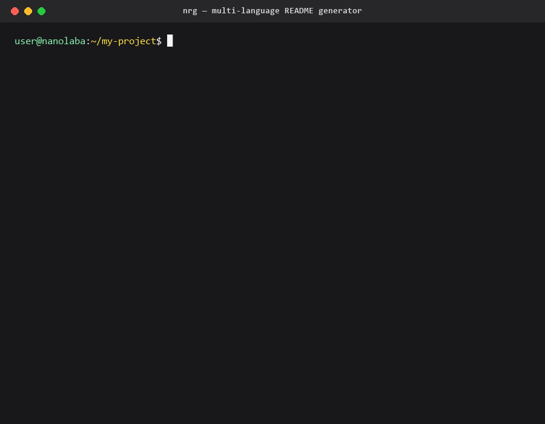

<!-- This file was automatically generated by Nanolaba Readme Generator (NRG) from README.src.md -->
<!-- Do not edit it by hand: change README.src.md and regenerate. See https://github.com/nanolaba/readme-generator -->


[ [en](README.md) | **ru** ]

[](https://github.com/nanolaba/readme-generator/actions/workflows/ci.yml)
[](https://central.sonatype.com/artifact/com.nanolaba/readme-generator)

[](https://www.apache.org/licenses/LICENSE-2.0)
[](https://github.com/nanolaba/readme-generator)

# Nanolaba Readme Generator (NRG): один шаблон для README на всех языках — для ИИ-агентов и CI

**NRG** генерирует `README.md`, `README.ru.md` и файл для каждого другого языка из одного шаблона `README.src.md`.
Перевод стоит на соседней строке с оригиналом, версии читаются из `pom.xml`, `package.json` или `build.gradle`,
а примеры кода импортируются из настоящих исходников. Когда документацию ведёт ИИ-агент, он правит один файл,
а не по файлу на язык: `nrg --validate` называет строку шаблона, которую агент сломал, а с `nrg --check` сборка в CI
падает, если сгенерированный файл разошёлся с шаблоном. В Claude Code хук отклоняет правку сгенерированного файла и называет шаблон, который нужно править.

NRG работает на Java 8+ и поставляется как [CLI](#запуск-из-командной-строки), [Maven-плагин](#использование-как-плагина-для-maven),
[GitHub Action](#использование-в-качестве-github-action) и [Java-библиотека](#использование-в-качестве-java-библиотеки). Шаблон — это Markdown
с языковыми маркерами, переменными `${…}` и виджетами: оглавление, импорт, бейджи, блоки `if`, alert-блоки, формулы и другие.
Этот README и его [английская версия](README.md) сгенерированы из [`README.src.md`](README.src.md).

**Вопросы и отзывы:** [Discussions](https://github.com/nanolaba/readme-generator/discussions) · **ошибки:** [Issues](https://github.com/nanolaba/readme-generator/issues/new/choose) · на русском или английском



## Попробовать

Скачайте `readme-generator-1.4.zip` со [страницы релиза](https://github.com/nanolaba/readme-generator/releases/tag/v1.4) и распакуйте; нужна только Java 8+. Затем напишите `README.src.md`:

```markdown
<!--@nrg.languages=en,ru-->

${widget:languages}

# ${en:'Hello', ru:'Привет'}

Install with `make install`.<!--en-->
Установка: `make install`.<!--ru-->
```

```bash
nrg -f README.src.md
```

NRG запишет рядом с шаблоном `README.md` и `README.ru.md`. Вот `README.md`; `README.ru.md` такой же, но с русскими строками:

```markdown
<!-- This file was automatically generated by Nanolaba Readme Generator (NRG) from README.src.md -->
<!-- Do not edit it by hand: change README.src.md and regenerate. See https://github.com/nanolaba/readme-generator -->

[ **en** | [ru](README.ru.md) ]

# Hello

Install with `make install`.
```

Заголовок называет шаблон, и агент, открывший сначала `README.md`, узнаёт, где делать правку. Если он всё же поправит `README.md` или изменит английскую строку, не тронув русскую, это поймает команда:

```text
$ nrg --check -f README.src.md
--- README.md (on disk)
+++ README.md (generated)
@@ line 8 @@
 
 # Hello
 
-Install with `make install PREFIX=~`.
+Install with `make install`.
 
Regenerate with: nrg -f /home/me/hello/README.src.md

$ nrg --stale-translations HEAD -f README.src.md
README.src.md:7-8: 'en' changed since HEAD, 'ru' did not
    en was: Install with `make install`.
    en now: Install with `make install PREFIX=~`.
Update the other languages, or mark an intentional one-sided edit with <!--nrg.translation.ok-->
```

Обе команды завершаются с кодом `1`, и CI падает на любой из этих ошибок. В Claude Code [плагин](#плагин-для-claude-code-и-навык-nrg) останавливает правку сгенерированного файла ещё до того, как она случится, и отдаёт агенту такое сообщение:

```text
README.ru.md is generated by NRG from README.src.md. Edit README.src.md (or the fragment it imports; nrg --locate README.ru.md:LINE names the line) and regenerate with: nrg -f README.src.md
```

Подробнее — в разделах [«Быстрый старт»](#быстрый-старт) и [«Агентная разработка»](#агентная-разработка).

## Зачем нужен NRG

- **Один файл на правку, а не по файлу на язык.** Все языки лежат в одном `.src.md`, каждый перевод — на соседней строке с оригиналом: агент читает и правит их вместе, а один diff показывает оба. Строки без языкового маркера общие, так что блоки кода, таблицы и ссылки пишутся один раз. См. [«Поддержка нескольких языков»](#поддержка-нескольких-языков).
- **Факты берутся из сборки, а не из памяти.** `${pom.version}`, `${npm.version}` и `${gradle.version}` читаются из дескриптора сборки при каждой генерации, а `${widget:import(path='…', region='…')}` вставляет регион исходника, который компилируется и проходит тесты. Ни один номер версии в README не набирается руками и не пишется по памяти. См. [«Значения из Maven POM»](#значения-из-maven-pom) и [«Виджет 'import'»](#виджет-import).
- **Ручная правка не попадёт в `main`.** `nrg --check` завершается с кодом `1` и печатает unified diff, если сгенерированный файл отличается от того, что даёт шаблон; GitHub Action делает то же с `mode: check`. См. [«Проверка сгенерированных файлов»](#проверка-сгенерированных-файлов-режим-ci).
- **Агент сам проверяет свою работу.** `--validate` ничего не пишет и печатает `ERROR: README.src.md:3: unknown widget 'language'; did you mean 'languages'?`. Код возврата подсказывает следующий шаг: `1` — перегенерировать, `2` — исправить шаблон, `64` — исправить команду. С `--format json` те же диагностики приходят со стабильным `code` и подсказкой `hint`. См. [«Цикл работы агента»](#цикл-работы-агента).
- **Отставшие переводы видны списком.** `nrg --stale-translations origin/main` называет каждое место, где один язык изменился с этой ревизии, а другой нет, со старым и новым текстом — готовый список работы для обновления перевода. См. [«Отставшие переводы»](#отставшие-переводы).
- **Инструкции для агента тоже генерируются.** `nrg --agent-rules --write AGENTS.md` пишет по реальной конфигурации блок, который говорит агенту, какие файлы сгенерированы, какие шаблоны править и какие команды запускать; с `--check` CI следит, чтобы блок не устаревал. См. [«Инструкция для агента»](#инструкция-для-агента).
- **Шаблон — недоверенные данные.** Любой путь, который он называет, остаётся внутри корня проекта, `exec` выполняет команды только с `--allow-exec`, а `--sandbox` скрывает переменные окружения и закрывает сеть — для pull request от незнакомцев и агентов, работающих без присмотра. См. [«Недоверенные шаблоны»](#недоверенные-шаблоны).
- **Двенадцать виджетов.** Оглавление, импорт файла или региона, бейджи, блоки `if`, сворачиваемые секции, alert-блоки, формулы LaTeX, дерево файлов, вывод команды, дата, TODO и переключатель языков. Свой виджет — это один Java-класс. См. [«Виджеты»](#виджеты).
- **Вывод других инструментов переживает перегенерацию.** Замороженная область сохраняет то, что contributors-readme-action, виджет спонсоров или RSS-лента записали в сгенерированный файл. См. [«Замороженные области»](#замороженные-области).
- **Везде одна и та же версия NRG.** Обёртка `nrgw` закрепляет в репозитории релиз и его sha256, как `mvnw` для Maven, и контрибьютор, задача CI и агент в свежей песочнице запускают одну версию, установив только Java. См. [«Обёртка nrgw с закреплённой версией»](#обёртка-nrgw-с-закреплённой-версией).

Чем NRG отличается от multilingual-markdown, doctoc, embedme, cog, markdown-magic и других: [«Похожие проекты»](#похожие-проекты).

Последняя стабильная версия — **1.4**, версия в разработке — **1.5-SNAPSHOT** (см. [«История изменений»](#история-изменений)).


## Содержание
- 1 [Установка](#установка)
- 2 [Быстрый старт](#быстрый-старт)
- 3 [Агентная разработка](#агентная-разработка)
	- 3.1 [Цикл работы агента](#цикл-работы-агента)
	- 3.2 [Инструкция для агента](#инструкция-для-агента)
	- 3.3 [Плагин для Claude Code и навык NRG](#плагин-для-claude-code-и-навык-nrg)
	- 3.4 [Другие агенты](#другие-агенты)
	- 3.5 [Защита сгенерированных файлов хуком](#защита-сгенерированных-файлов-хуком)
	- 3.6 [Один шаблон для всех агентов](#один-шаблон-для-всех-агентов)
	- 3.7 [Проверка переводов при ревью](#проверка-переводов-при-ревью)
	- 3.8 [Запуск без присмотра](#запуск-без-присмотра)
- 4 [Способы запуска программы](#способы-запуска-программы)
	- 4.1 [Запуск из командной строки](#запуск-из-командной-строки)
		- 4.1.1 [Обёртка nrgw с закреплённой версией](#обёртка-nrgw-с-закреплённой-версией)
		- 4.1.2 [Проверка сгенерированных файлов (режим CI)](#проверка-сгенерированных-файлов-режим-ci)
		- 4.1.3 [Валидация исходных шаблонов](#валидация-исходных-шаблонов)
		- 4.1.4 [Отставшие переводы](#отставшие-переводы)
		- 4.1.5 [Вывод в stdout](#вывод-в-stdout)
		- 4.1.6 [Машиночитаемый вывод](#машиночитаемый-вывод)
		- 4.1.7 [Коды возврата](#коды-возврата)
		- 4.1.8 [Что шаблон пишет и читает](#что-шаблон-пишет-и-читает)
		- 4.1.9 [Уровень логирования](#уровень-логирования)
		- 4.1.10 [Настройка имён выходных файлов](#настройка-имён-выходных-файлов)
		- 4.1.11 [Корень проекта](#корень-проекта)
		- 4.1.12 [Недоверенные шаблоны](#недоверенные-шаблоны)
		- 4.1.13 [Перевод строк](#перевод-строк)
		- 4.1.14 [Настройка заголовка](#настройка-заголовка)
		- 4.1.15 [Несколько файлов и glob-паттерны](#несколько-файлов-и-glob-паттерны)
	- 4.2 [Использование как плагина для maven](#использование-как-плагина-для-maven)
	- 4.3 [Использование в качестве GitHub Action](#использование-в-качестве-github-action)
		- 4.3.1 [Быстрый старт](#быстрый-старт)
		- 4.3.2 [Входные параметры](#входные-параметры)
		- 4.3.3 [Выходные значения](#выходные-значения)
		- 4.3.4 [Примеры](#примеры)
			- 4.3.4.1 [Базовая генерация](#базовая-генерация)
			- 4.3.4.2 [Проверка расхождений в PR](#проверка-расхождений-в-pr)
			- 4.3.4.3 [Drift-проверка по подмножеству файлов](#drift-проверка-по-подмножеству-файлов)
		- 4.3.5 [Проекты с несколькими шаблонами](#проекты-с-несколькими-шаблонами)
		- 4.3.6 [Отключение встроенного setup-java](#отключение-встроенного-setup-java)
		- 4.3.7 [Закрепление версии action](#закрепление-версии-action)
		- 4.3.8 [Решение проблем](#решение-проблем)
	- 4.4 [Использование в качестве java-библиотеки](#использование-в-качестве-java-библиотеки)
- 5 [Синтаксис шаблона](#синтаксис-шаблона)
	- 5.1 [Переменные](#переменные)
	- 5.2 [Обратные слэши и экранирование](#обратные-слэши-и-экранирование)
	- 5.3 [Свойства](#свойства)
	- 5.4 [Переопределения для разных языков](#переопределения-для-разных-языков)
	- 5.5 [Переменные окружения](#переменные-окружения)
	- 5.6 [Значения из Maven POM](#значения-из-maven-pom)
	- 5.7 [Значения из package.json](#значения-из-packagejson)
	- 5.8 [Значения из Gradle](#значения-из-gradle)
	- 5.9 [Поддержка нескольких языков](#поддержка-нескольких-языков)
	- 5.10 [Варианты вывода](#варианты-вывода)
	- 5.11 [Игнорирование фрагментов](#игнорирование-фрагментов)
	- 5.12 [Замороженные области](#замороженные-области)
	- 5.13 [Виджеты](#виджеты)
		- 5.13.1 [Виджет 'languages'](#виджет-languages)
		- 5.13.2 [Виджет 'import'](#виджет-import)
		- 5.13.3 [Виджет 'tableOfContents'](#виджет-tableofcontents)
		- 5.13.4 [Виджет 'date'](#виджет-date)
		- 5.13.5 [Виджет 'todo'](#виджет-todo)
		- 5.13.6 [Виджет 'alert'](#виджет-alert)
		- 5.13.7 [Виджет 'badge'](#виджет-badge)
		- 5.13.8 [Виджет 'math'](#виджет-math)
		- 5.13.9 [Виджет 'exec'](#виджет-exec)
		- 5.13.10 [Виджет 'if'](#виджет-if)
		- 5.13.11 [Виджет 'fileTree'](#виджет-filetree)
		- 5.13.12 [Виджет 'details'](#виджет-details)
- 6 [Расширенные возможности](#расширенные-возможности)
	- 6.1 [Создание виджета](#создание-виджета)
- 7 [Похожие проекты](#похожие-проекты)
	- 7.1 [Когда лучше подойдёт другой инструмент](#когда-лучше-подойдёт-другой-инструмент)
- 8 [История изменений](#история-изменений)
- 9 [Участие в разработке](#участие-в-разработке)
- 10 [Лицензия](#лицензия)


## Установка

NRG нужна Java 8 или новее ([скачать](https://adoptium.net/)). Выберите способ по тому, где NRG будет запускаться:

| Где | Как | Подробнее |
|---|---|---|
| Командная строка | распакуйте `readme-generator-1.4.zip` со [страницы релиза](https://github.com/nanolaba/readme-generator/releases/tag/v1.4) и запустите `nrg.sh` / `nrg.bat` | [CLI](#запуск-из-командной-строки) |
| Репозиторий: CI, контрибьюторы, агенты | `nrg --init-wrapper`, затем закоммитьте `nrgw`, `nrgw.cmd` и `.nrg/` | [nrgw](#обёртка-nrgw-с-закреплённой-версией) |
| Сборка Maven | `com.nanolaba:nrg-maven-plugin:1.4`, цель `create-files` | [Maven-плагин](#использование-как-плагина-для-maven) |
| GitHub Actions | `uses: nanolaba/nrg-action@v1` | [GitHub Action](#использование-в-качестве-github-action) |
| Java-код | `com.nanolaba:readme-generator:1.4` | [Java-библиотека](#использование-в-качестве-java-библиотеки) |
| Claude Code | `/plugin marketplace add nanolaba/readme-generator`, затем `/plugin install nrg@nanolaba` | [Плагин](#плагин-для-claude-code-и-навык-nrg) |

## Быстрый старт

**Шаг 1: напишите шаблон (`README.src.md`)**

```markdown
<!--@nrg.languages=en,ru-->

# Hello<!--en-->
# Привет<!--ru-->

English text<!--en-->
Русский текст<!--ru-->

The same line in both files.
```

Строки с `<!--en-->` попадут в `README.md`, строки с `<!--ru-->` — в `README.ru.md`, а строки без маркера — в оба файла.

**Шаг 2: сгенерируйте файлы**

Из командной строки:

```bash
nrg -f README.src.md
```

Или в сборке Maven (полная конфигурация — в разделе [«Использование как плагина для maven»](#использование-как-плагина-для-maven)):

```xml
<plugin>
    <groupId>com.nanolaba</groupId>
    <artifactId>nrg-maven-plugin</artifactId>
    <version>1.4</version>
    <configuration>
        <file><item>README.src.md</item></file>
    </configuration>
    <executions>
        <execution>
            <phase>compile</phase>
            <goals><goal>create-files</goal></goals>
        </execution>
    </executions>
</plugin>
```

Рядом с шаблоном появятся два файла:

<table>
<tr><th><b>README.md</b></th><th><b>README.ru.md</b></th></tr>
<tr><td>

```markdown
# Hello

English text

The same line in both files.
```

</td><td>

```markdown
# Привет

Русский текст

The same line in both files.
```

</td></tr></table>

**Шаг 3: проверка в CI**

Закоммитьте шаблон вместе со сгенерированными файлами и добавьте в CI проверку, которая падает, если кто-то поправил `README.md` руками или забыл перегенерировать:

```yaml
- uses: nanolaba/nrg-action@v1
  with:
    file: README.src.md
    mode: check
```

Вне GitHub Actions та же проверка — `nrg --check -f README.src.md`, см. [«Проверка сгенерированных файлов»](#проверка-сгенерированных-файлов-режим-ci).

**Шаг 4: расскажите о шаблоне агенту**

```bash
nrg --agent-rules --write AGENTS.md
```

Команда добавит в `AGENTS.md` блок, который перечисляет сгенерированные файлы, шаблоны для правки, языки и команды, которые нужно запускать после изменения. Для других агентов укажите `CLAUDE.md`, `GEMINI.md` или `.github/copilot-instructions.md`, см. [«Агентная разработка»](#агентная-разработка).

**Что дальше**

- Переменные, многоязычные конструкции и экранирование: [«Синтаксис шаблона»](#синтаксис-шаблона).
- Готовые виджеты (оглавление, импорт, языки, дата, todo, alert, badge, math, exec, if, fileTree, details): [«Виджеты»](#виджеты).

<details>
<summary><b>Полный пример шаблона (все виджеты)</b></summary>

```markdown
<!--@nrg.languages=en,ru-->
<!--@nrg.defaultLanguage=en-->

<!--@title=**${en:'Hello, World!', ru:'Привет, Мир!'}**-->
<!--@version=1.0-->

${widget:languages}

${widget:badge(type='maven-central', coordinates='com.example:my-project')}

# ${title}<!--toc.ignore-->

Last updated: ${widget:date}

${widget:tableOfContents(title = "${en:'Table of contents', ru:'Содержание'}", ordered = "true")}

## Part 1<!--toc.ignore-->

### Chapter 1<!--toc.ignore-->

English text<!--en-->
Русский текст<!--ru-->

${widget:alert(type='note', text='${en:'Heads up!', ru:'Обратите внимание!'}')}

The area of a circle is ${widget:math(expr='\\pi r^2')}.

${widget:todo(text="${en:'Document the next chapter', ru:'Описать следующую главу'}")}

${widget:if(cond='endsWith(${version}, -SNAPSHOT)')}
This is a development build.
${widget:endIf}

${widget:exec(cmd='git rev-parse --short HEAD', codeblock='text')}

${widget:fileTree(path='src/main/java', depth='2', exclude='target,*.class')}

${widget:import(path='path/to/your/file/another-info.src.md')}

${widget:details(summary='Advanced configuration')}
Hidden inner markdown — ${widget:date(pattern='yyyy')} still works in here.
${widget:endDetails}

${widget:details(summary='Click', content='Short hidden text', open='true')}
```

</details>

<a name="nrg-и-ии-агенты"></a>

## Агентная разработка

Когда документацию ведёт ИИ-агент (Claude Code, Codex, Cursor, Copilot и другие), он ошибается в одном и том же: правит `README.md` и забывает про `README.ru.md`, называет номер версии по памяти, вставляет пример кода, который через неделю перестаёт компилироваться, или «чинит» сгенерированный файл напрямую. С **Nanolaba Readme Generator (NRG)** README становится артефактом сборки: каждая из этих ошибок либо невозможна, либо ловится командой, которую агент запускает сам.

| Что идёт не так | Что с этим делает NRG |
|---|---|
| Один язык обновили, остальные забыли | Все языки лежат в одном `.src.md`, переводы — на соседних строках: агент читает и правит их вместе, а один diff показывает оба. `--stale-translations` перечисляет то, что отстало |
| Версии и координаты названы по памяти | `${pom.version}`, `${npm.version}`, `${gradle.version}` читаются из дескриптора сборки при каждой генерации |
| Примеры кода разошлись с кодом | `${widget:import(path='…', region='…')}` вставляет регион настоящего исходного файла — того, что компилируется и тестируется |
| Сгенерированный файл поправили руками | Заголовок файла называет его шаблон, хук Claude Code отклоняет правку, а `--check` завершается с кодом `1` и печатает unified diff — CI падает |
| Ошибка в синтаксисе шаблона | `--validate` печатает `ERROR: file.src.md:LINE: message` и ничего не пишет |
| Ради одной секции в контекст загружается весь README | Шаблон разбит на фрагменты, соединённые через `import`, и агент открывает только нужный. `--locate README.md:LINE` называет строку шаблона, из которой получилась строка вывода |

Сам репозиторий ведётся так же: [AGENTS.md](AGENTS.md) описывает сборку, инварианты и требования к тестам (JUnit и 100% покрытия мутационными тестами), а CI запускает `--validate` по шаблонам этого README и `--check` по шпаргалке синтаксиса и `llms.txt`.

### Цикл работы агента

Три команды позволяют агенту проверить собственную работу. Каждая завершается кодом возврата и сообщением о том, где искать проблему:

```bash
nrg --validate -f README.src.md   # ошибки шаблона: ERROR: README.src.md:3: unknown widget 'language'; did you mean 'languages'?
nrg -f README.src.md              # перегенерировать все языки
nrg --check -f README.src.md      # код 1 и unified diff, если файлы на диске устарели
```

`--validate`, `--check` и `--stdout` никогда не пишут файлы. Код возврата подсказывает агенту следующий шаг: `1` — перегенерировать, `2` — исправить шаблон, `64` — исправить команду ([«Коды возврата»](#коды-возврата)). С `--format json` файлы и диагностики, у каждой из которых есть стабильный `code` и подсказка `hint`, приходят одним JSON-документом вместо строк лога, см. [«Машиночитаемый вывод»](#машиночитаемый-вывод). Подробнее: [«Валидация исходных шаблонов»](#валидация-исходных-шаблонов), [«Проверка сгенерированных файлов»](#проверка-сгенерированных-файлов-режим-ci).

*1.5-SNAPSHOT:* NRG пишет лог через [nanolog](https://github.com/nanolaba/nanolog). Когда NRG запускает агент, режим агента nanolog добавляет в stderr строку `[NANOLOG]` и сводку запуска и сохраняет полный лог в `target/nanolog/` (вне проекта Maven или Gradle — в `.nanolog/`); `NANOLOG_AGENT=off` это отключает.

### Инструкция для агента

Агент не знает, что `README.md` генерируется, пока ему об этом не скажут. Добавьте в `AGENTS.md`, `CLAUDE.md` или другой файл инструкций, который читает ваш агент:

```markdown
## Documentation

- `README.md` and `README.*.md` are generated by NRG from `README.src.md`. Never edit them by hand.
- Change the `.src.md` template. A line tagged `<!--en-->` has a counterpart for every other
  language right next to it — update all of them.
- After a change run `./nrgw --validate -f README.src.md && ./nrgw -f README.src.md`
  (`nrgw.cmd` on Windows).
- Commit the template together with the regenerated files.
```

Или поручите NRG написать этот блок по реальной конфигурации: какие файлы генерируются, какие шаблоны и фрагменты править, какие исходники встроены в документацию, языки и точные команды:

```bash
nrg --agent-rules --write AGENTS.md            # insert or update the block, keep the rest of the file
nrg --agent-rules --write AGENTS.md --check    # exit 1 and a diff when the block is out of date
```

Для шаблона из раздела [«Попробовать»](#попробовать) блок выглядит так:

```markdown
<!-- nrg:agent-rules:begin -->
## Generated documentation (NRG)

_This block is generated by `nrg --agent-rules`; do not edit it by hand._

- Generated by NRG, never edit by hand: `README.md`, `README.ru.md` (from `README.src.md`).
- Edit the templates instead: `README.src.md`.
- Languages: `en`, `ru`. A line tagged `<!--en-->` has a counterpart for `<!--ru-->` next to it; update all of them, and give every `${en:'...'}` construct an entry for each language.
- After a change: `nrg --validate README.src.md && nrg README.src.md`. Commit the templates together with the regenerated files.
<!-- nrg:agent-rules:end -->
```

Блок стоит между `<!-- nrg:agent-rules:begin -->` и `<!-- nrg:agent-rules:end -->`; без `--write` команда просто печатает его. Запускайте форму с `--check` в CI, и инструкции больше не разойдутся с шаблонами.

`./nrgw` — это [обёртка с закреплённой версией](#обёртка-nrgw-с-закреплённой-версией): закоммитьте её один раз (`nrg --init-wrapper`), и инструкция заработает в любой песочнице с Java, без установленного NRG.

Агента, открывшего сначала `README.md`, к нужному файлу направляет заголовок самого сгенерированного файла. Он называет шаблон и просит перегенерировать файл, а не править его:

```markdown
<!-- This file was automatically generated by Nanolaba Readme Generator (NRG) from README.src.md -->
<!-- Do not edit it by hand: change README.src.md and regenerate. See https://github.com/nanolaba/readme-generator -->
```

Чтобы указать там точную команду, задайте `nrg.headerText` с плейсхолдером `<source>`, см. [«Настройка заголовка»](#настройка-заголовка).

### Плагин для Claude Code и навык NRG

Этот репозиторий — ещё и маркетплейс плагинов Claude Code. Плагин приносит [навык](skills/nrg/SKILL.md) NRG (когда применять NRG, правила, команды и полную [шпаргалку по синтаксису](skills/nrg/SYNTAX.md)) и два хука. Перед `Edit` / `Write` сгенерированного файла первый отклоняет правку и называет шаблон, который нужно править; после изменения шаблона или импортируемого файла второй запускает `--validate`, перегенерирует выходные файлы и возвращает ошибки агенту.

```text
/plugin marketplace add nanolaba/readme-generator
/plugin install nrg@nanolaba
```

Хукам нужен NRG 1.4 или новее: `nrg` из `PATH` или командная строка из переменной окружения `NRG_HOOK_COMMAND` (например, `java -jar /opt/nrg/nrg.jar`). Они срабатывают в каждом открытом проекте, поэтому никогда не запускают ничего, что поставляет сам проект, даже его `./nrgw`: склонированный репозиторий не должен получить возможность выполнить код через установленный плагин. В проекте без файлов `*.src.md` они ничего не делают и не запускают JVM. Ту же шпаргалку для установленной версии без сети печатает `nrg --help syntax`; другие инструменты находят документацию через [llms.txt](llms.txt).

### Другие агенты

Каждый агент читает инструкции из своего файла; `--agent-rules --write` поддерживает блок NRG в любом из них:

| Агент | Файл инструкций | Команда |
|---|---|---|
| Codex, Jules, Aider, Zed | `AGENTS.md` | `nrg --agent-rules --write AGENTS.md` |
| Claude Code | `CLAUDE.md` | `nrg --agent-rules --write CLAUDE.md` |
| GitHub Copilot | `.github/copilot-instructions.md` | `nrg --agent-rules --write .github/copilot-instructions.md` |
| Cursor | `.cursor/rules/nrg.mdc` | `nrg --agent-rules --write .cursor/rules/nrg.mdc` |
| Gemini CLI | `GEMINI.md` | `nrg --agent-rules --write GEMINI.md` |

Для Cursor перед первым `--write` начните файл `.mdc` с front matter (`description`, `globs: "**/*.src.md, **/*.md"`); блок допишется после него и дальше будет обновляться на месте.

### Защита сгенерированных файлов хуком

Агент может пропустить инструкцию, а хук срабатывает на каждой правке. Без плагина те же два хука прописываются в `.claude/settings.json` проекта. `--claude-hook` сам читает событие хука из stdin, так что больше ничего, даже `jq`, не нужно:

```json
{
  "hooks": {
    "PreToolUse": [{
      "matcher": "Edit|Write",
      "hooks": [{"type": "command", "command": "\"$CLAUDE_PROJECT_DIR/nrgw\" --claude-hook pre-edit"}]
    }],
    "PostToolUse": [{
      "matcher": "Edit|Write",
      "hooks": [{"type": "command", "command": "\"$CLAUDE_PROJECT_DIR/nrgw\" --claude-hook post-edit"}]
    }]
  }
}
```

`pre-edit` завершается с кодом `2` для сгенерированного файла: правка блокируется, а агент получает имя шаблона. `post-edit` проверяет шаблоны, читающие изменённый файл, и перегенерирует их; ошибки проверки доходят до агента тем же путём:

```text
NRG: the edit leaves a template invalid; fix it before going on:
ERROR: README.src.md:3: unknown widget 'language'; did you mean 'languages'?
```

Для других сред строительные блоки — `--is-generated` и `nrg $(nrg --affected <file>)`, см. [«Что шаблон пишет и читает»](#что-шаблон-пишет-и-читает).

### Один шаблон для всех агентов

Агенты читают разные файлы — `AGENTS.md`, `CLAUDE.md`, `GEMINI.md`, `.github/copilot-instructions.md`, — а содержимое у них почти одинаковое. Объявите их [вариантами вывода](#варианты-вывода) одного шаблона:

```markdown
<!--@nrg.variants=agents,claude,gemini,copilot-->
<!--@nrg.fileNamePattern=<VARIANT>.md-->
<!--@nrg.variant.copilot.file=.github/copilot-instructions.md-->

# Project rules

${widget:import(path='docs/build.md')}

A note for Claude Code and Gemini CLI.<!--variant:claude,gemini-->
Everyone except Copilot.<!--variant:!copilot-->
```

`nrg -f AGENTS.src.md` запишет все четыре файла: строки без маркера попадут в каждый вариант, строки с маркером — в названные в нём. Через `import` файлы инструкций и README могут использовать общий фрагмент, например команды сборки, и перестанут противоречить друг другу. Варианты сочетаются с языками, так что переведённый `AGENTS.ru.md` — это просто ещё один язык в `nrg.languages`.

### Проверка переводов при ревью

Агент, переписывающий абзац, обычно переписывает его на одном языке. `nrg --stale-translations origin/main` превращает «поддерживай переводы в синхроне» из инструкции, которую агент может забыть, в падающую проверку. Она перечисляет каждую группу и конструкцию, где один язык изменился, а другой нет, со старым и новым текстом — это и нужно, чтобы обновить перевод. См. [«Отставшие переводы»](#отставшие-переводы).

### Запуск без присмотра

Агент запускает команды на шаблонах, которые писал не он: из pull request, из только что склонированного репозитория. **Nanolaba Readme Generator (NRG)** считает шаблон недоверенными данными. Любой путь, который он называет, должен оставаться внутри [корня проекта](#корень-проекта), а команды не выполняются, пока в командной строке нет `--allow-exec`.

Ещё два канала закрывает `--sandbox`: `${env.NAME}` может прочитать любую переменную окружения процесса, а удалённый импорт шаблон может включить себе сам (`nrg.allowRemoteImports`). С `--sandbox` переменные не видны и соединения не открываются, см. [«Недоверенные шаблоны»](#недоверенные-шаблоны). Среда агента может передавать этот флаг при каждом запуске, связанном с pull request.

## Способы запуска программы

### Запуск из командной строки

**Nanolaba Readme Generator (NRG)** написан на Java и требует для запуска версии **Java 8** и выше.
[Установите](https://www.java.com/en/download/) Java, если она отсутствует у вас в системе.

[Скачайте](https://github.com/nanolaba/readme-generator/releases/tag/v1.4) последнюю 
стабильную версию.

Разархивируйте скачанный архив. В Unix-подобных системах сделайте файл `nrg.sh` 
исполняемым:

```bash
chmod +x nrg.sh  
```

Запустите программу, чтобы сгенерировать файлы:

```bash
nrg -f /path/to/README.src.md
```

Чтобы посмотреть список опций, наберите:

```bash
nrg --help
```

#### Обёртка nrgw с закреплённой версией

`nrg --init-wrapper` записывает в текущий каталог три файла: `nrgw`, `nrgw.cmd` и
`.nrg/wrapper.properties` с версией релиза и sha256 его архива. Закоммитьте их, и любой, кто
склонирует репозиторий (контрибьютор, задача CI, ИИ-агент в свежей песочнице), запустит именно
эту версию NRG одной командой, установив только Java. Та же идея, что у `mvnw` / `gradlew`:

```bash
nrg --init-wrapper --wrapper-version 1.4
./nrgw -f README.src.md        # nrgw.cmd -f README.src.md on Windows
```

При первом запуске обёртка скачивает архив релиза с GitHub в `~/.nrg/wrapper/<version>/`
(место переопределяет `NRG_WRAPPER_HOME`), сверяет его с закреплённым sha256 и запускает;
дальнейшие запуски работают без сети. Если нет Java, загрузка не удалась или не совпала контрольная
сумма, обёртка завершается с кодом `69`; иначе — с кодом самого NRG. По умолчанию `--wrapper-version` —
версия запущенного NRG, а контрольная сумма берётся из файла `.sha256`, опубликованного с релизом,
если её не указать через `--wrapper-sha256 <hex>`. Чтобы перейти на другой релиз, запустите `--init-wrapper` ещё раз.

#### Проверка сгенерированных файлов (режим CI)

Флаг `--check` проверяет, что файлы на диске совпадают с тем, что
NRG сгенерировал бы прямо сейчас. Режим предназначен для CI / pre-commit:
файлы не записываются, при отсутствии или расхождении выводится diff
в stderr, процесс завершается с кодом `1`.

В diff попадает сгенерированное содержимое, поэтому всё, что шаблон подтягивает, — включая значения `${env.NAME}` — при провале проверки окажется в логе CI. Не используйте секреты в шаблонах.

```bash
nrg --check -f README.src.md && echo "README is up to date"
```

`--check` проверяет все языки, заявленные в `nrg.languages`, и
несовместим с флагом `--stdout`.

`--check-paths <шаблон>` (повторяемый) ограничивает проверку выходными
файлами, путь которых совпадает с одним из указанных glob-шаблонов.
Синтаксис `glob:` у них тот же, что у glob-паттернов исходных
файлов (`**/` соответствует нулю и более каталогов), а отсчитываются
они от текущего каталога. Выходные файлы, не попавшие ни
под один шаблон, пропускаются и в diff, и в проверке наличия — удобно,
когда часть сгенерированных файлов лежит в git, а остальные регенерирует
бот. Шаблон без совпадений печатает `WARN` в stderr (код выхода всё равно
`0`), чтобы опечатка не отключала проверку молча. `--check-paths`
требует `--check`.

```bash
nrg --check --check-paths README.md -f README.src.md
```

#### Валидация исходных шаблонов

Флаг `--validate` сканирует шаблон (и все импортируемые через
`${widget:import}` шаблоны) на типичные ошибки авторов, ничего не
генерируя. Ошибки:

- незарегистрированные имена виджетов (`${widget:doesNotExist}`),
- параметры, которых нет у встроенного виджета (`${widget:toc(maxDepth='2')}` — параметр называется `max-depth`),
- языковые маркеры `<!--xx-->`, чей код отсутствует в `nrg.languages`,
- пути в `${widget:import(path='...')}`, которых нет на диске или которые выходят за корень проекта,
- несбалансированные пары `<!--nrg.ignore.begin-->` / `<!--nrg.ignore.end-->`,
- незакрытые или одинокие блочные виджеты (`${widget:if(...)}` без `${widget:endIf}`, отдельный `${widget:endDetails}`),
- ссылка `${name}` на необъявленное свойство, отличающаяся на одну-две правки от объявленного (`${stableVerison}`),
- пропущенный перевод: серия строк с языковыми маркерами (пустые строки её не прерывают), где нет строк для одного из языков, или конструкция `${en:'…'}` без записи для языка, в котором выводится строка, либо с записью для необъявленного языка.

Предупреждения (выводятся, но код возврата остаётся `0`):

- переводы с разной структурой: внутри серии строк с маркерами у одного языка есть заголовок, пункт списка, строка таблицы, блок кода или абзац, которого нет у другого (предупреждение, потому что переводы вправе переносить текст по-разному),
- любой другой необъявленный `${name}` — он остаётся в выводе как есть, что правильно для shell-примера вроде `${HOME}` и неправильно для забытого свойства,
- `${pom.…}` / `${npm.…}` / `${gradle.…}` без `:fallback`, которых нет в дескрипторе, — они рендерятся пустыми,
- <code>&lt;!--&#92;@nrg.languages=...--&gt;</code> и другие ключи `nrg.*`, записанные с косметическим экранированием `\@`, — такая строка всё равно объявляет свойство (см. [«Обратные слэши и экранирование»](#обратные-слэши-и-экранирование)); чтобы показать её в примере, пишите <code>&lt;&#92;!--@...--&gt;</code>.

```bash
nrg --validate -f README.src.md && echo "Template is clean"
```

Каждое сообщение печатается в формате `ERROR: file.src.md:LINE: text` или
`WARNING: file.src.md:LINE: text`; если исправление очевидно, сообщение
заканчивается им (`unknown widget 'tocc'; did you mean 'toc'?`). Без
диагностик NRG молча завершается с кодом `0`. Все сообщения печатаются
в stderr; процесс завершается с кодом `2`, если среди них есть хотя бы
одна ошибка. Импорт с `run-generator='false'` проверяется только на
наличие файла: его содержимое — не шаблон. `--validate`
несовместим с `--check` и `--stdout`.

Строку, предназначенную только для одного языка, исключают из проверки переводов
маркером `<!--nrg.parity.ignore-->` (из вывода он удаляется);
`<!--@nrg.validate.parity=false-->` отключает эти проверки для шаблона и импортируемых им файлов.

#### Отставшие переводы

`--validate` замечает пропущенный перевод, но не устаревший: английское предложение переписали,
русская строка рядом осталась прежней, и все проверки зелёные. `--stale-translations <git-ref>`
сравнивает каждый шаблон и импортируемые им фрагменты с их версией в git-ревизии — обычно с
базой pull request — и сообщает о каждой группе переводов и каждой конструкции
`${en:'…', ru:'…'}`, где одни языки изменились, а другие нет, показывая старый и новый текст
изменённой стороны:

```text
$ nrg --stale-translations origin/main -f README.src.md
docs/Overview.src.md:22-25: 'en' changed since origin/main, 'ru' did not
    en was: Fast README generator
    en now: Fast and safe README generator
```

Запуск завершается с кодом `1`, если что-то найдено, поэтому подходит как проверка pull request
(для checkout нужна история: `fetch-depth: 0`). Одностороннюю правку, которой не нужна пара, — например,
исправление опечатки — подтверждают маркером `<!--nrg.translation.ok-->` в строке (из вывода он удаляется).
`--format json` печатает `{"findings": [{"file", "line", "lastLine", "kind", "changed", "unchanged", "old", "new"}]}`.

#### Вывод в stdout

Флаг `--stdout` перенаправляет сгенерированный вывод в stdout,
файлы на диск при этом не создаются. С `--language <код>`
печатается только этот язык; без него выводятся все языки,
и перед каждым стоит строка-разделитель вида `=== README.ru.md ===`,
чтобы вывод можно было разрезать во внешних инструментах. Для шаблона
с [вариантами вывода](#варианты-вывода) `--variant <имя>` печатает только этот вариант;
об имени, которого шаблон не объявляет, NRG сообщает в stderr и пропускает файл.

```bash
nrg --stdout -f README.src.md
nrg --stdout --language en -f README.src.md
nrg --stdout --variant claude -f AGENTS.src.md
```

Флаги `--language` и `--variant` работают только вместе с `--stdout`; без него
NRG выводит предупреждение и игнорирует их.

#### Машиночитаемый вывод

`--format json` превращает запуск в один JSON-документ в stdout — для ИИ-агентов,
хуков и шагов CI, которым нужно знать, что произошло, не разбирая строки лога.
Логирование уходит в stderr (туда же по-прежнему печатается diff `--check`).
Режим работает с генерацией, `--check` и `--validate` и несовместим с `--stdout`.

```bash
nrg --check --format json -f README.src.md
```

```json
{
  "version": "1.5-SNAPSHOT",
  "mode": "check",
  "ok": false,
  "exitCode": 1,
  "files": [
    {"source": "README.src.md", "output": "README.md", "language": "en", "status": "ok"},
    {"source": "README.src.md", "output": "README.ru.md", "language": "ru", "status": "stale"}
  ],
  "diagnostics": [
    {"severity": "error", "code": "unknown-widget", "file": "docs/Widgets.src.md", "line": 12, "message": "unknown widget 'tocc'", "hint": "did you mean 'toc'?"}
  ]
}
```

- `files[].status`: `written` / `unchanged` (генерация), `ok` / `stale` / `missing` (`--check`), `ok` / `invalid` (`--validate`, по записи на исходный файл).
- `diagnostics[].code` стабилен — ориентируйтесь на него, а не на `message`: `unknown-widget`, `unknown-parameter`, `undeclared-language`, `import-not-found`, `import-unreadable`, `import-outside-root`, `unbalanced-ignore`, `unbalanced-block`, `undefined-variable`, `unresolved-reference`, `cosmetic-escape`, `missing-translation`, `language-construct`, `structure-mismatch`, `freeze-block`, `file-name-pattern`, `generation-failed`, `source-not-found`, `check-paths-unmatched`, `config-error`, `descriptor-error`. `hint` — предлагаемое исправление или `null`.
- Пути указаны относительно рабочего каталога, с разделителем `/`.
- При ошибке в аргументах (код `64`) в stdout ничего не пишется; сообщение — в stderr.

`--format github` печатает те же находки как команды GitHub Actions
(`::error file=…,line=…::…`, `::warning …`) — шаг CI показывает их прямо у нужных
строк pull request; устаревший или отсутствующий выходной файл отмечается на нём самом.

```bash
nrg --validate --format github "**/*.src.md"
```

#### Коды возврата

| Код | Значение |
|:-:|---|
| `0` | Успех. Одни лишь предупреждения на него не влияют. |
| `1` | `--check`: сгенерированный файл расходится с шаблоном или отсутствует — перегенерируйте. |
| `2` | Шаблон некорректен (`--validate` нашёл ошибку) или генерация не удалась — исправьте шаблон. |
| `64` | Неверная командная строка: неизвестные или конфликтующие опции, несуществующий исходный файл, паттерны без совпадений. |

При нескольких исходных файлах запуск завершается с наибольшим из их кодов. Неудачный
`--check` в текстовом режиме заканчивается командой, которая всё исправит (`Regenerate with: nrg -f README.src.md`).

#### Что шаблон пишет и читает

Четыре запроса только на чтение отвечают на вопросы, которые инструмент задаёт, прежде чем
править файл:

```bash
nrg --manifest                          # outputs and inputs of every template
nrg --is-generated README.ru.md         # exit 0 and print README.src.md; exit 1 for a file NRG does not write
nrg --affected docs/Overview.src.md     # templates to regenerate after this file changed
nrg --locate README.ru.md:340           # the template line that produces line 340
```

`--locate FILE:LINE` (или `FILE:FIRST-LAST`) рендерит шаблон, из которого получается файл, и для
каждой строки печатает, откуда она взялась, — строку, которую нужно править, и цепочку импортов:

```text
README.ru.md:340: docs/Launching.src.md:45 <- imported at README.src.md:36
README.ru.md:64: README.src.md:32 (widget tableOfContents)
README.ru.md:1: head comment
```

Строка, которую создал виджет и которую дальше не проследить, указывает на строку самого виджета;
строки замороженной области — на её открывающий маркер. `--format json` печатает
`{"lines": [{"line", "text", "origin": {"file", "line", "widget", "note", "importChain"}}]}`.
Номер строки относится к файлу в том виде, в каком NRG сгенерировал бы его сейчас, поэтому устаревший файл сначала перегенерируйте.

- `--manifest` для каждого шаблона перечисляет выходной файл каждого языка и входы: сам шаблон, все импортируемые им файлы (транзитивно), каталоги, которые показывает `fileTree`, и дескрипторы за `${pom.…}` / `${npm.…}` / `${gradle.…}`. То, что нельзя назвать файлом, выводится как `dynamic`: `url:…` (удалённый импорт), `exec:…`, `env:NAME`, `date`. С `--format json` печатается `{"templates": [{"source", "outputs", "inputs", "dynamic"}]}`.
- `--is-generated <file>` завершается с кодом `0` и печатает шаблон, если файл — результат генерации, иначе с кодом `1`.
- `--affected <file>…` печатает шаблоны, которые читают любой из файлов; файл внутри каталога, который показывает `fileTree`, тоже считается. Вывод можно сразу передать NRG: `nrg $(nrg --affected docs/Overview.src.md)`.

Шаблоны — это исходные файлы, переданные через `-f` или аргументами; без них NRG берёт все
`*.src.md` ниже текущего каталога, которые не импортирует другой шаблон (скрытые каталоги,
`node_modules`, `target` и `build` пропускаются).

#### Уровень логирования

`--log-level` задаёт, сколько NRG выводит в консоль. Допустимые значения —
`trace`, `debug`, `info` (по умолчанию), `warn`, `error`; каждый уровень
подавляет сообщения ниже по важности. Если флаг не задан, используется
переменная окружения `NRG_LOG_LEVEL` — удобно для CI и Maven-плагина.
С неизвестным значением NRG завершается и печатает ошибку в stderr.

```bash
nrg --log-level warn -f /path/to/README.src.md
NRG_LOG_LEVEL=warn nrg -f /path/to/README.src.md
```

#### Настройка имён выходных файлов

Флаг `--file-name-pattern <PATTERN>` переопределяет схему имени выходного
файла. Плейсхолдеры: `<base>` (имя исходного файла без `.src.md`), `<lang>`
(код языка как есть), `<LANG>` (в верхнем регистре). Паттерн может содержать
`/` — недостающие каталоги создаются автоматически. Эквивалент свойства
`<!--@nrg.fileNamePattern=PATTERN-->`; приоритет у CLI-флага.
Флаг `--default-language-file-name-pattern <PATTERN>` переопределяет только
язык по умолчанию (аналог `<!--@nrg.defaultLanguageFileNamePattern=PATTERN-->`).
Переопределения для отдельных языков (`<!--@nrg.fileNamePattern.<lang>=...-->`)
доступны только в шаблоне.

```bash
nrg --file-name-pattern '<base>_<LANG>.md' -f README.src.md
nrg --file-name-pattern 'docs/<lang>/<base>.md' --default-language-file-name-pattern '<base>.md' -f README.src.md
```

#### Корень проекта

Шаблон ограничен **корнем проекта**: любой путь, который он называет, должен оставаться внутри этого каталога — выходные файлы, импортируемые файлы (`import`), перечисляемые каталоги (`fileTree`) и дескрипторы, стоящие за `${pom.*}` / `${npm.*}` / `${gradle.*}` (`nrg.pom.path`, `nrg.npm.path`, `nrg.gradle.path`).
Корень — ближайший предок исходного файла, содержащий `.git`, а если такого нет — каталог самого исходного файла. Из шаблона корень задать нельзя.
Путь, выводящий за пределы корня (например, `../../somewhere/<base>.md` в паттерне имени файла или `path='../../other-project/file.md'` в импорте), останавливает запуск с ошибкой: оттуда ничего не читается и туда ничего не записывается. `--validate` сообщает о таких импортах как об ошибках, не открывая файлы.
Именно это не даёт чужому шаблону — из pull request или только что склонированного репозитория — скопировать ваши файлы в README или перезаписать файлы на вашей машине. С переменными окружения иначе: `${env.NAME}` читает любую переменную процесса — недоверенные шаблоны запускайте с `--sandbox` (см. [«Недоверенные шаблоны»](#недоверенные-шаблоны)).
Если структуре проекта действительно нужен более широкий корень, задайте его явно: `--root <dir>` (Maven-плагин: `<root>`, GitHub Action: `root`).

```bash
nrg --root /path/to/workspace -f docs/README.src.md
```

#### Недоверенные шаблоны

Корень проекта не подпускает шаблон к вашим файлам. Два переключателя, задаваемые только в
командной строке — никакое свойство шаблона их не отключит, — закрывают оставшиеся каналы, когда
NRG запускается на шаблоне, который писали не вы, например из pull request:

- `--no-env` — шаблоны не видят переменные окружения: каждый `${env.NAME}` выводит свой fallback или ничего. `--env-allow NAME,PREFIX_*` открывает только перечисленные переменные.
- `--offline` — удалённый импорт отклоняется, даже если шаблон задаёт `nrg.allowRemoteImports=true`; URL, закреплённый по `sha256`, чьи байты уже лежат в кэше и совпадают, по-прежнему берётся из кэша.
- `--sandbox` — оба режима сразу; несовместим с `--allow-exec`.

```bash
nrg --check --sandbox -f README.src.md
nrg --env-allow 'CI,GITHUB_*' -f README.src.md
```

Maven-плагин: `<sandbox>`, `<noEnv>`, `<envAllow>`, `<offline>`; GitHub Action: `sandbox: true`.

#### Перевод строк

`--line-ending=auto|lf|crlf` управляет переводом строк в сгенерированном
выводе. По умолчанию `auto` сохраняет переводы строк уже лежащего на диске
файла (CRLF останется CRLF, LF — LF), а при первой генерации берёт принятые
в системе. Значения `lf` и `crlf` жёстко фиксируют формат —
полезно, например, когда репозиторий с LF перегенерируют
на Windows, и наоборот.

```bash
nrg --line-ending lf -f README.src.md
nrg --line-ending crlf -f README.src.md
```

В режиме `--check` со значением `auto` различия с файлом на диске только
в переводах строк не считаются ошибкой (повторная генерация и так
сохранила бы прежний формат), поэтому контрибьюторы с разных
ОС не валят CI. Явные `lf` / `crlf` о таком несовпадении сообщают:
этот формат пользователь задал сам.

#### Настройка заголовка

По умолчанию каждый сгенерированный файл начинается с двух строк HTML-
комментария: они называют шаблон, из которого сгенерирован файл, и просят
не редактировать его руками:

```markdown
<!-- This file was automatically generated by Nanolaba Readme Generator (NRG) from README.src.md -->
<!-- Do not edit it by hand: change README.src.md and regenerate. See https://github.com/nanolaba/readme-generator -->
```

Путь к шаблону указан относительно сгенерированного файла (`../../README.src.md`
для `docs/ru/README.md`): читатель — или ИИ-агент, — открывший сначала результат,
сразу попадает в файл, который нужно править. Версии NRG в заголовке по умолчанию
нет, поэтому обновление NRG не меняет все сгенерированные файлы.

Два флага переопределяют заголовок: `--no-header` полностью убирает
комментарий, `--header-text "..."` заменяет его произвольным текстом
(используйте `\n` для переноса строки, также `\r`, `\t`, `\\`). В тексте можно
использовать плейсхолдеры `<source>` (путь к шаблону, как выше), `<lang>` (код
языка) и `<version>` (версия NRG). Флаги взаимно исключающие. Свойства
шаблона `<!--@nrg.noHeader=true-->` и `<!--@nrg.headerText=...-->`
делают то же самое; если заданы оба, приоритет у CLI-флага.

```bash
nrg --no-header -f README.src.md
nrg --header-text '<!-- Generated from <source> by NRG <version> -->\n<!-- See /wiki for editing rules -->' -f README.src.md
```

Маркер свойства заканчивается на первом `-->`, поэтому заголовок в виде
HTML-комментария записывается в шаблоне с экранированием обоих концов —
<code>&lt;&#92;!--</code> и <code>--&#92;&gt;</code>:

<code>&lt;!--@nrg.headerText=&lt;&#92;!-- Generated from &lt;source&gt;; edit the template, not this file --&#92;&gt;--&gt;</code>

#### Несколько файлов и glob-паттерны

В одну команду можно передать несколько исходных файлов — либо явным
списком, либо glob-паттернами:

```bash
nrg README.src.md docs/Guide.src.md
nrg "docs/**/*.src.md"
```

Glob-паттерн раскрывается через `java.nio.file.PathMatcher`
с синтаксисом `glob:` — поведение одинаково на Windows, Linux и macOS
независимо от командной оболочки. Заключайте паттерн в кавычки, чтобы
сначала его не раскрыл сам шелл. Флаг `-f <file>` задаёт ровно один файл, без
раскрытия glob-паттернов, и несовместим с позиционными аргументами:
если передать и то и другое, NRG выводит ошибку и завершается с кодом `64`.

По умолчанию каждый файл обрабатывается независимо: ошибка на одном
логируется, но NRG продолжает с остальными, а общий код возврата —
самый серьёзный из кодов всех файлов (см. [«Коды возврата»](#коды-возврата)). Флаг `--fail-fast` останавливает
обработку на первом ненулевом результате.

```bash
nrg --fail-fast "docs/**/*.src.md"
```

На паттерн без совпадений NRG выводит предупреждение. Если не нашлось
ни одного файла, программа завершается с кодом `64` и сообщением
`No source files matched any of the supplied patterns`.

### Использование как плагина для maven

Добавьте следующий код в ваш `pom.xml`:

```xml

<plugins>
    <plugin>
        <groupId>com.nanolaba</groupId>
        <artifactId>nrg-maven-plugin</artifactId>
        <version>1.4</version>
        <configuration>
            <file>
                <item>README.src.md</item>
                <item>another-file.src.md</item>
            </file>
            <logLevel>warn</logLevel>
            <widgets>
                <widget>com.example.MyWidget</widget>
                <widget>com.example.OtherWidget</widget>
            </widgets>
            <check>false</check>
            <failFast>false</failFast>
            <lineEnding>auto</lineEnding>
            <noHeader>false</noHeader>
        </configuration>
        <dependencies>
            <dependency>
                <groupId>com.example</groupId>
                <artifactId>my-widgets</artifactId>
                <version>1.0.0</version>
            </dependency>
        </dependencies>
        <executions>
            <execution>
                <phase>compile</phase>
                <goals>
                    <goal>create-files</goal>
                </goals>
            </execution>
        </executions>
    </plugin>
</plugins>
```

Каждый элемент `<file>` может быть как явным путём, так и glob-паттерном
(тот же синтаксис `glob:`, что и в CLI). Многодокументные проекты могут
заменить длинный список одним `<file>**/*.src.md</file>`, NRG раскроет
паттерн сам. Параметр `<failFast>true</failFast>` (или `-DfailFast=true`)
прерывает обработку на первом ненулевом результате; со значением по умолчанию
`false` диагностики собираются по всем найденным файлам.

`<noHeader>true</noHeader>` (или `-DnoHeader=true`) убирает автоматический
двухстрочный комментарий-заголовок из каждого выходного файла;
`<headerText>...</headerText>` (или `-DheaderText="..."`) заменяет его
произвольным текстом. Используйте `\n` для перевода строк. Параметры
взаимно исключающие: если задать оба, сборка падает с ошибкой
разбора аргументов CLI.


> [!NOTE]
> **Многомодульные (aggregator) проекты:** цель `create-files` объявлена с
> `inheritByDefault = false`, поэтому дочерние модули агрегатора с
> `<packaging>pom</packaging>` не перезапускают NRG в собственном каталоге
> по умолчанию (где `README.src.md` обычно отсутствует). Объявите плагин один
> раз в родительском POM, и цель отработает только в корне. Если дочернему
> модулю всё же нужен свой README, включите цель через
> `<inherited>true</inherited>` в его POM.

Элементы `<widgets>` должны указывать на публичные классы, реализующие
`NRGWidget` и имеющие публичный конструктор без аргументов; их артефакт
нужно подключить через `<dependencies>` самого плагина, чтобы
Maven мог их найти. При совпадении имён виджеты из POM имеют приоритет
над объявленными через свойство шаблона `nrg.widgets`.

Параметр `<check>true</check>` (или `-Dcheck=true` из командной строки)
переключает плагин в режим проверки: файлы не записываются, при
расхождении сборка падает с `MojoExecutionException` и выводом diff
в лог. Удобно для шага `mvn verify` в CI, чтобы не пропустить устаревший
README.

Параметр `<validate>true</validate>` (или `-Dvalidate=true`) сканирует
шаблоны на типичные ошибки авторов (проверки перечислены в разделе
[«Валидация исходных шаблонов»](#валидация-исходных-шаблонов)) без генерации
файлов. Сборка падает с `MojoExecutionException`, если найдена ошибка;
предупреждения только выводятся в лог. Несовместим с `<check>`.

`<format>json</format>` (или `-Dformat=json`) передаёт `--format` — см.
[«Машиночитаемый вывод»](#машиночитаемый-вывод). Сборка падает на кодах `1`
(`<check>`), `2` и `64`, и сообщение называет, какой из них вернулся.

Параметры `<fileNamePattern>` и `<defaultLanguageFileNamePattern>` (либо
`-DfileNamePattern=...` / `-DdefaultLanguageFileNamePattern=...`) дублируют
CLI-флаги `--file-name-pattern` / `--default-language-file-name-pattern` и
переопределяют свойства шаблона `nrg.fileNamePattern` /
`nrg.defaultLanguageFileNamePattern`, если заданы.

Чтобы использовать SNAPSHOT-версии, добавьте в `pom.xml` ещё и этот код:

```xml

<pluginRepositories>
    <pluginRepository>
        <id>central.sonatype.com-snapshot</id>
        <url>https://central.sonatype.com/repository/maven-snapshots</url>
        <releases>
            <enabled>false</enabled>
        </releases>
        <snapshots>
            <enabled>true</enabled>
            <updatePolicy>always</updatePolicy>
        </snapshots>
    </pluginRepository>
</pluginRepositories>
```

### Использование в качестве GitHub Action

NRG доступен как composite GitHub Action: любой репозиторий может
перегенерировать многоязычные README прямо в CI, не устанавливая Maven или
Java локально. Action при необходимости ставит Java, скачивает нужный релиз
NRG, распаковывает `nrg.jar` и запускает его для перечисленных шаблонов.

#### Быстрый старт

```yaml
- uses: actions/checkout@v4
- uses: nanolaba/nrg-action@v1
  with:
    file: README.src.md
```

#### Входные параметры

| Имя | Описание | По умолчанию |
|---|---|---|
| `file` | Путь к `.src.md`-шаблону (относительно `working-directory`). Для нескольких файлов используйте `files`. | — |
| `files` | Многострочный список шаблонов (по одному на строку). Несовместим с `file`. | — |
| `charset` | Кодировка исходных файлов. | `UTF-8` |
| `mode` | Режим работы: `generate`, `check` или `validate`. | `generate` |
| `check-paths` | Многострочный список glob-шаблонов (по одному на строку), ограничивающий, какие сгенерированные файлы `mode: check` сравнивает с файлами на диске. Требует `mode: check`. | — |
| `root` | Каталог, за пределы которого шаблоны выйти не могут, — см. [Корень проекта](#корень-проекта). Требует NRG `v1.3` или новее. | ближайший предок с `.git` |
| `stale-translations-base` | Git-ревизия для сравнения шаблонов (например, `${{ github.event.pull_request.base.sha }}`); шаг падает, если с тех пор одни языки изменились, а другие нет, — см. [«Отставшие переводы»](#отставшие-переводы). Нужны `fetch-depth: 0` при checkout и NRG `v1.4` или новее. | |
| `sandbox` | `"true"` для шаблонов, которым вы не доверяете, например на `pull_request` из форков: без переменных окружения и удалённого импорта — см. [«Недоверенные шаблоны»](#недоверенные-шаблоны). Требует NRG `v1.4` или новее. | `false` |
| `nrg-version` | Тег релиза NRG (например, `v1.0`) или `latest`. | `latest` |
| `nrg-sha256` | Ожидаемый sha256 скачиваемого релизного zip; несовпадение завершает запуск до исполнения jar. Используйте вместе с фиксированным `nrg-version`. | — |
| `java-version` | Версия JDK для `actions/setup-java`. Игнорируется при `setup-java=false`. | `17` |
| `java-distribution` | Дистрибутив JDK для `actions/setup-java`. | `temurin` |
| `setup-java` | Должен ли action сам устанавливать Java. Передайте `"false"`, если Java уже установлена в предыдущем шаге job-а. | `true` |
| `log-level` | Уровень логирования NRG: `trace`, `debug`, `info`, `warn` или `error`. | `info` |
| `working-directory` | Рабочий каталог, в котором запускается NRG. | `.` |

Семантика режима (`mode`):

- `generate` записывает `README.md`, `README.ru.md`, … на диск (по умолчанию).
- `check` — проверка без записи: если файлы на диске расходятся с тем, что сгенерировал бы NRG, action завершается с ненулевым кодом и печатает unified diff. Удобен для pull request-ов.
- `validate` ищет в шаблоне ошибки (неизвестные виджеты и их параметры, необъявленные языковые маркеры, отсутствующие импорты, несбалансированные ignore-блоки и блочные виджеты, опечатки в переменных — см. [«Валидация исходных шаблонов»](#валидация-исходных-шаблонов)). Падает на ошибках, но не на предупреждениях. Файлы не записываются.

#### Выходные значения

| Имя | Описание |
|---|---|
| `version` | Итоговая версия NRG (например, `v1.0`). Полезно при `nrg-version=latest`. |
| `changed-files` | Список файлов, созданных или изменённых NRG, по одному на строку. |

#### Примеры

##### Базовая генерация

Регенерация README при каждом push в `main`:

```yaml
name: Regenerate README
on:
  push:
    branches: [main]
permissions:
  contents: read
jobs:
  regenerate:
    runs-on: ubuntu-latest
    steps:
      - uses: actions/checkout@v4
      - uses: nanolaba/nrg-action@v1
        with:
          file: README.src.md
```

##### Проверка расхождений в PR

Завершать сборку с ошибкой, если автор изменил `README.md` напрямую, вместо того чтобы перегенерировать его из `README.src.md`:

```yaml
name: README drift check
on:
  pull_request:
    paths: ['**/*.src.md', '**/*.md']
permissions:
  contents: read
jobs:
  check:
    runs-on: ubuntu-latest
    steps:
      - uses: actions/checkout@v4
      - uses: nanolaba/nrg-action@v1
        with:
          file: README.src.md
          mode: check
```

##### Drift-проверка по подмножеству файлов

Когда в git лежит только часть сгенерированных файлов (например, коммитится только канонический `README.md`, а переводы регенерируются ботом), `check-paths` сужает сравнение до перечисленных. Шаблоны — `glob:`-маски относительно рабочего каталога (`**/` соответствует нулю и более каталогов). Если ни один сгенерированный файл под них не подходит, NRG печатает `WARN` в stderr, чтобы опечатка не отключала проверку молча; код выхода остаётся `0`:

```yaml
- uses: nanolaba/nrg-action@v1
  with:
    file: README.src.md
    mode: check
    check-paths: |
      README.md
      docs/canonical/*.md
```

Рецепт «авто-коммит через PR» лежит в каталоге [`nrg-action/examples`](https://github.com/nanolaba/readme-generator/tree/main/nrg-action/examples) этого репозитория.

#### Проекты с несколькими шаблонами

Передайте многострочный список в параметр `files:` (по одному пути на строку). Все файлы обрабатываются за один вызов action-а, jar скачивается ровно один раз. `file` и `files` несовместимы — задавайте только один из них.

```yaml
- uses: nanolaba/nrg-action@v1
  with:
    files: |
      README.src.md
      docs/CONTRIBUTING.src.md
```

#### Отключение встроенного setup-java

Если workflow уже устанавливает Java (например, для Maven-сборки), встроенный шаг `actions/setup-java` можно отключить. Параметры composite action-а — строки, поэтому используйте `"false"` в кавычках, а не булево значение YAML:

```yaml
- uses: actions/setup-java@v4
  with:
    distribution: temurin
    java-version: '21'
- uses: nanolaba/nrg-action@v1
  with:
    file: README.src.md
    setup-java: 'false'
```

#### Закрепление версии action

`@v1` — автообновления в пределах major-версии v1 (рекомендуется); `@v1.0` — жёсткая фиксация minor-версии; `@<full-sha>` — привязка к конкретному коммиту (наиболее безопасный вариант; этого требуют некоторые политики безопасности цепочки поставок).

Закрепление action не закрепляет скачиваемый им jar NRG. Для этого зафиксируйте `nrg-version` на теге релиза и передайте ожидаемую контрольную сумму релизного zip в `nrg-sha256` — любое другое содержимое завершит запуск до исполнения jar:

```yaml
- uses: nanolaba/nrg-action@v1
  with:
    file: README.src.md
    nrg-version: v1.4
    nrg-sha256: ff9ccd7efee599299c4d02f847a36bb3c3471720722837b0d87a56f039aff38a
```

Без `nrg-sha256` action сверяет загрузку с файлом `.sha256`, опубликованным вместе с релизом (NRG `v1.3` и новее); для более старых релизов он печатает контрольную сумму скачанного, чтобы её можно было закрепить.

#### Решение проблем

Большинство сбоев в CI делятся на три группы: проблемы скачивания (проверьте, что `nrg-version` есть на странице [Releases](https://github.com/nanolaba/readme-generator/releases)), изменения структуры zip-архива (заведите issue, если появляется `nrg.jar not found inside …`) и платформенные особенности. Самая частая особенность — расхождение переводов строк на `windows-latest`: `mode: check` показывает diff, которого нет локально.

- **Расхождение переводов строк на Windows-раннерах** — добавьте в `.gitattributes` строку `* text=auto eol=lf` и закоммитьте сгенерированные файлы заново.
- **Windows: `unzip: command not found`** — git-bash на `windows-latest` обычно содержит `unzip`; в редких образах добавьте предыдущим шагом `choco install unzip`.

Action опубликован как отдельный репозиторий [`nanolaba/nrg-action`](https://github.com/nanolaba/nrg-action) (теги `v1.0` и плавающий `v1`) — именно по этому адресу пользователи подключают его через `uses:`. В подкаталоге `nrg-action/` этого репозитория лежат исходники и регрессионные тесты action; релизы зеркалируются в отдельный репозиторий. В GitHub Marketplace action пока не опубликован.


### Использование в качестве java-библиотеки

**Maven (pom.xml)**

```xml

<dependency>
    <groupId>com.nanolaba</groupId>
    <artifactId>readme-generator</artifactId>
    <version>1.4</version>
</dependency>  
```

**Gradle (build.gradle)**

```groovy
implementation 'com.nanolaba:readme-generator:1.4'
```

**Скачивание вручную**

Скачайте JAR из [Maven Central](https://repo1.maven.org/maven2/com/nanolaba/readme-generator/1.4)
и добавьте его в classpath проекта.

После этого NRG можно вызывать из своего кода 
с теми же аргументами, что и в командной строке, например:

```java
int exitCode = NRG.run("-f", "path-to-file", "--charset", "UTF-8");
```

`NRG.run` возвращает [код возврата](#коды-возврата). Не вызывайте из приложения `NRG.main`: как и командная строка, при неудаче он завершает JVM через `System.exit`.

Больше возможностей для настройки 
даёт класс `Generator`:

```java
package com.nanolaba.nrg.examples;

import com.nanolaba.nrg.core.GenerationResult;
import com.nanolaba.nrg.core.Generator;
import org.apache.commons.io.FileUtils;

import java.io.File;
import java.io.IOException;
import java.nio.charset.StandardCharsets;

public class GeneratorExample {

    public static void main(String[] args) throws IOException {

        Generator generator = new Generator(new File("template.md"), StandardCharsets.UTF_8);

        for (GenerationResult generationResult : generator.getResults()) {

            FileUtils.write(
                    new File("result." + generationResult.getLanguage() + ".md"),
                    generationResult.getContent(),
                    StandardCharsets.UTF_8);
        }
    }
}

```

## Синтаксис шаблона

### Переменные

Переменная задаётся так:

```markdown
<!--@variable_name=variable value-->
```

Значение переменной выводится так:

```markdown
${variable_name}
```

Чтобы вывести в файл конструкцию вида *${...}*, не заменяя ее значением
переменной, поставьте перед ней '\\':

```markdown
\${variable_name}
```

<table>
<tr><th>Пример использования</th><th>Результат</th></tr>
<tr><td>

```markdown
<!--@app_name=My Application-->
<!--@app_version=**1.0.1**-->
<!--@app_descr=This is *${app_name}* version ${app_version}-->
${app_name} version ${app_version}
${app_descr}
\${app_descr}
```

</td><td>

```markdown
My Application version **1.0.1**
This is *My Application* version **1.0.1**
${app_descr}
```

</td></tr>
</table>

### Обратные слэши и экранирование

После того как все подстановки и виджеты отработали, корневой генератор делает один финальный
проход и убирает обратный слэш только в этих трёх случаях; любая другая последовательность
`\\X` остаётся в выводе как есть.

| В шаблоне | В выводе | Зачем нужно |
|---|---|---|
| <code>&#92;$</code>        | <code>$</code>        | подавить любую ссылку `\${…}` (свойство / язык / env / pom / npm / gradle / widget). Срабатывает на **любое** `\$`, не только на `\${…}`. |
| <code>&lt;&#92;!--</code>  | <code>&lt;!--</code>  | подавить любой HTML-маркер — языковой тег, `nrg.ignore`, `nrg.freeze`, объявление свойства. Используется, чтобы вывести литерал `<!--…-->`. |
| <code>&lt;!--&#92;@</code> | <code>&lt;!--@</code> | красиво вывести `<!--@key=value-->` в примере — **только косметика**, **не** мешает NRG разобрать строку как настоящее объявление свойства. Чтобы подавить разбор, экранируйте открытие комментария по правилу 2: <code>&lt;&#92;!--@key=value--&gt;</code>. |

Экранирующие последовательности самого Markdown (`\(`, `\)`, `\_`, `\*`, `\\`, `` \` `` и т. п.) в этот список
не входят — NRG передаёт их рендереру Markdown без изменений.


> [!TIP]
> Правило 1 убирает обратный слэш у **любой** последовательности `\$`, не только у `\${…}`.
> Чтобы оставить в выводе литерал `\$` (например, для `[\$]` в markdown-ссылке без подстановки),
> пишите в шаблоне `\\$` — замыкающий `\$` превратится в `$`, ведущий `\` останется на месте.

### Свойства

Тем же синтаксисом задаются свойства приложения, например:

```markdown
<!--@nrg.languages=en,ru-->
<!--@nrg.defaultLanguage=en-->
```

**Свойства приложения:**

***nrg.languages***

Языки, для которых генерируются файлы.
Для каждого языка, кроме языка по умолчанию, создаётся файл
*source.language.md*, где source — имя исходного файла, language — код
языка. Значение этого свойства по умолчанию — "en".

***nrg.defaultLanguage***

Язык главного файла документации. Он должен входить в *nrg.languages*.
Значение этого свойства по умолчанию — первый элемент *nrg.languages*.

***nrg.widgets***

Перечисленные через запятую полные имена классов-реализаций `NRGWidget`,
которые нужно зарегистрировать дополнительно к встроенным виджетам. Каждый класс должен быть
доступен на runtime-classpath и иметь публичный конструктор без аргументов.
Эквивалентно CLI-флагу `--widgets <FQCN,FQCN,...>` и параметру `<widgets>` Maven-плагина.

***nrg.pom.path***

Переопределяет путь к `pom.xml`, используемый подстановкой `${pom.NAME}`.
Относительные пути разрешаются относительно каталога исходного файла; абсолютные
используются как есть. По умолчанию — `pom.xml` рядом с исходным файлом.
Учитывается, только когда в шаблоне есть ссылки `${pom.…}`.

***nrg.npm.path***

Переопределяет путь к `package.json`, используемый подстановкой `${npm.NAME}`.
Относительные пути разрешаются относительно каталога исходного файла; абсолютные
используются как есть. По умолчанию — `package.json` рядом с исходным файлом.
Учитывается, только когда в шаблоне есть ссылки `${npm.…}`.

***nrg.gradle.path***

Переопределяет расположение Gradle, используемое подстановкой `${gradle.NAME}`.
Может указывать либо на каталог (с `gradle.properties` и/или `build.gradle{,.kts}`),
либо на конкретный build-скрипт. Относительные пути разрешаются относительно
каталога исходного файла; абсолютные используются как есть. По умолчанию —
каталог исходного файла. Учитывается, только когда в шаблоне есть ссылки `${gradle.…}`.

***nrg.fileNamePattern***

Шаблон имени выходного файла для всех языков. Плейсхолдеры: `<base>` (имя исходного
файла без `.src.md`), `<lang>` (код языка как есть), `<LANG>` (код языка в верхнем
регистре). Может содержать `/` — недостающие каталоги создаются автоматически.
По умолчанию — `<base>.md` для языка по умолчанию и `<base>.<lang>.md` для остальных.
Примеры: `<base>_<LANG>.md`, `<base>-<lang>.md`, `docs/<lang>/<base>.md`.

***nrg.defaultLanguageFileNamePattern***

Переопределяет `nrg.fileNamePattern` только для языка по умолчанию. Удобно, когда
основной язык должен лежать как `README.md`, а остальные — с суффиксом:
`nrg.fileNamePattern=<base>_<LANG>.md` + `nrg.defaultLanguageFileNamePattern=<base>.md`.

***nrg.fileNamePattern.&lt;lang&gt;***

Переопределение для конкретного языка (например `nrg.fileNamePattern.zh-CN=README_<LANG>.md`).
Имеет приоритет и над `nrg.fileNamePattern`, и над `nrg.defaultLanguageFileNamePattern`
для указанного языка. Порядок разрешения: для языка → для языка по умолчанию → общий → встроенный.
Если два объявленных языка попадают в один и тот же файл, генерация прерывается.

### Переопределения для разных языков

Любое свойство можно переопределить для одного языка, добавив к имени суффикс `.<lang>`.
При рендере шаблона на конкретный язык `${name}` сначала ищет значение `name.<lang>`,
а если его нет — ключ `name` без суффикса. Если ни то, ни другое не задано, в выводе остаётся литерал `${name}`.

```markdown
<!--@nrg.languages=en,ru,ja-->
<!--@screenshot.en=./public/show-en.png-->
<!--@screenshot.ru=./public/show-ru.png-->
<!--@screenshot=./public/show.png-->


```

Результат для `en`: ``<br>
Результат для `ru`: ``<br>
Результат для `ja` (нет переопределения): ``

Так же устроены встроенные свойства NRG, например `nrg.fileNamePattern.<lang>`.

### Переменные окружения

Внутри любой ссылки `${…}` зарезервированное пространство имён `env.` подставляет
значение из переменных окружения процесса. Такие ссылки подставляются раньше языковых
конструкций и обычных свойств, поэтому `${env.NAME}` работает и в обычном тексте,
и в значениях `<!--@key=value-->`, и в параметрах виджетов.

```markdown
${env.BUILD_NUMBER}
${env.RELEASE_URL:https://github.com/nanolaba/readme-generator/releases}
<!--@buildNumber=${env.BUILD}-->
${widget:badge(type='custom', label='build', message='${env.BUILD_NUMBER:unknown}', color='blue')}
```


Поведение:

- `${env.NAME}` — подставляет значение переменной `NAME`. Если переменная не задана, выводит одно предупреждение на каждое уникальное имя за прогон и подставляет пустую строку.
- `${env.NAME:default}` — подставляет значение из окружения, если переменная задана (даже пустой строкой), иначе — литерал после первого `:`.
- Имена должны соответствовать POSIX-идентификатору `[A-Za-z_][A-Za-z0-9_]*`. Имена с точкой, например `${env.app.version}`, разрешаются как обычные свойства.
- Экранирование обратным слэшем работает так же, как для любой другой конструкции `${…}`: `\\${env.NAME}` выводится как литерал.


> [!WARNING]
> Подстановка читает то, что отдаёт `System.getenv()`. На общих CI-машинах
> считайте, что сгенерированный README раскрывает любую переменную, на
> которую он ссылается — не вставляйте `${env.AWS_SECRET_…}` в публичные
> документы.

### Значения из Maven POM

Зарезервированное пространство имён `pom.` внутри `${…}` читает
значения из `pom.xml` проекта. Такие ссылки подставляются
после `env.`, но до языковых конструкций и обычных свойств,
поэтому одна и та же `${pom.…}`-ссылка работает и в основном тексте,
и в значениях `<!--@key=value-->`, и в параметрах виджетов.

```markdown
${pom.version}
${pom.groupId}:${pom.artifactId}:${pom.version}
${pom.scm.url}
${pom.parent.version}
${pom.properties.java.version}
${pom.version:0.0.0-SNAPSHOT}
<!--@coords=${pom.groupId}:${pom.artifactId}-->
```


Поведение:

- Путь интерпретируется как обход дерева от неявного корня `<project>`: `pom.X` — `<X>`, `pom.X.Y` — `<X><Y>` и так далее.
- `pom.properties.KEY` — плоский поиск по ключу: остаток пути после `properties.` используется как имя дочернего элемента `<properties>` (поэтому ключи с точками вроде `java.version` работают).
- `pom.parent.X` читает локальный блок `<parent>`. Сам файл родительского POM NRG не читает.
- Для беспрефиксных `pom.groupId`, `pom.version` и `pom.name`: если элемент отсутствует в `<project>`, значение берётся из `<project><parent>` (стандартное Maven-наследование).
- Значения POM сами могут содержать `${prop}`, `${project.X}` и `${env.NAME}` / `${env.NAME:default}` — NRG разрешает их одним проходом по тому же POM и через тот же env-провайдер.
- `${pom.path:default}` подставляет литерал после первого `:`, если путь отсутствует. Без default подставляется пустая строка и логируется по одному предупреждению на каждый уникальный путь.
- Экранирование обратным слэшем работает так же, как для любой другой конструкции `${…}`: `\\${pom.version}` выводится как литерал.
- Расположение `pom.xml` по умолчанию — каталог исходного файла; переопределяется через `<!--@nrg.pom.path=relative/or/absolute/pom.xml-->`.

### Значения из package.json

Зарезервированное пространство имён `npm.` внутри `${…}` читает значения
из `package.json` проекта. Такие ссылки подставляются после
`pom.`, но до языковых конструкций и обычных свойств, поэтому
одна и та же `${npm.…}`-ссылка работает и в основном тексте, и в значениях
`<!--@key=value-->`, и в параметрах виджетов.

```markdown
${npm.version}
${npm.name}
${npm.dependencies.lodash}
${npm.version:0.0.0-SNAPSHOT}
<!--@coords=${npm.name}@${npm.version}-->
```


Поведение:

- Путь интерпретируется как обход JSON-дерева: `npm.X` читает поле верхнего уровня, `npm.X.Y` спускается во вложенный объект и так далее.
- Строковые, числовые и булевы значения приводятся к строке. Объекты, массивы и `null` подставляются как пустая строка (с предупреждением).
- `${npm.path:default}` подставляет литерал после первого `:`, если путь отсутствует. Без default подставляется пустая строка и логируется по одному предупреждению на каждый уникальный путь.
- Экранирование обратным слэшем работает так же, как для любой другой конструкции `${…}`: `\\${npm.version}` выводится как литерал.
- Расположение `package.json` по умолчанию — каталог исходного файла; переопределяется через `<!--@nrg.npm.path=relative/or/absolute/package.json-->`.

### Значения из Gradle

Зарезервированное пространство имён `gradle.` внутри `${…}` читает значения
из `gradle.properties` (плоский поиск по ключу), а если ключа там нет, извлекает регулярным выражением
`version` / `group` из `build.gradle` или `build.gradle.kts`. Такие ссылки
подставляются после `npm.`, но до языковых конструкций и обычных свойств.

```markdown
${gradle.version}
${gradle.group}
${gradle.kotlin.version}
${gradle.version:0.0.0-SNAPSHOT}
```


Поведение:

- `gradle.X` сначала ищет ключ `X` в `gradle.properties`. Если ключ не найден и `X` — это `version` или `group`, NRG извлекает `X = '...'` из build-скрипта регулярным выражением (работает и для Groovy DSL, и для Kotlin DSL).
- Прочие конструкции Gradle DSL намеренно не разбираются — определяйте значения в `gradle.properties`, если они нужны в README.
- `${gradle.path:default}`, экранирование обратным слэшем и одно предупреждение на каждый отсутствующий путь работают так же, как у `${pom.…}` и `${npm.…}`.
- Переопределяйте расположение Gradle через `<!--@nrg.gradle.path=core/-->` (каталог) или `<!--@nrg.gradle.path=core/build.gradle.kts-->` (конкретный файл).

### Поддержка нескольких языков

Текст на разных языках можно задать двумя способами.
Первый — комментарий в конце строки, например:

```markdown
Some text<!--en-->
Некоторый текст<!--ru-->
```

Второй — специальная конструкция:

```markdown
${en:"Some text", ru:"Некоторый текст"}
${en:'Some text', ru:'Некоторый текст'} 
```

Чтобы экранировать кавычку, удвойте её, например:

- `${en:'It''s working'}` → `It's working`
- `${en:"Text with ""quotes"""}` → `Text with "quotes"`

`--validate` проверяет, что языки не расходятся (см. [«Валидация исходных шаблонов»](#валидация-исходных-шаблонов)): у каждой серии строк с языковыми маркерами должны быть строки для каждого языка из `nrg.languages`, а каждая конструкция `${en:…, ru:…}` должна содержать все языки, в которых строка выводится. Строку, предназначенную только для одного языка, помечают `<!--nrg.parity.ignore-->` (маркер удаляется из вывода); `<!--@nrg.validate.parity=false-->` отключает эти проверки для шаблона.

### Варианты вывода

Языки — одна ось шаблона; `nrg.variants` добавляет вторую — несколько документов с почти общим
текстом, например файлы инструкций для разных ИИ-агентов или версии руководства для пользователей
и для разработчиков. Шаблон генерируется по разу для каждого варианта, и каждый раз на всех языках:

```markdown
<!--@nrg.variants=user,dev-->

Shown in every variant.
Only in the dev edition.<!--variant:dev-->
Everywhere but the dev edition.<!--variant:!dev-->
This is the ${nrg.variant} edition.
```

- `<!--variant:a,b-->` оставляет строку в вариантах `a` и `b`; `<!--variant:!c-->` — везде, кроме `c`. Маркеры удаляются из вывода и работают и в импортируемых фрагментах.
- `${nrg.variant}` — генерируемый сейчас вариант, в том числе в условиях: `${widget:if(cond='${nrg.variant} == dev')}`.
- Имена файлов: без паттерна — `<base>.<variant>.md` и `<base>.<variant>.<lang>.md`; паттерны имён понимают `<variant>` / `<VARIANT>`; `<!--@nrg.variant.<name>.file=path-->` задаёт файл одного варианта. Если два варианта пишут в один файл, запуск останавливается.
- `--stdout --variant <name>` печатает один вариант; `--validate` сообщает о маркерах с необъявленным вариантом; `--manifest` перечисляет выходные файлы всех вариантов.

### Игнорирование фрагментов

Чтобы пометить фрагмент как авторскую заметку, которая не должна попасть ни в один
сгенерированный файл, используйте маркеры `nrg.ignore`. Они работают как в основном
шаблоне, так и внутри импортированных файлов.

- `<!--nrg.ignore-->` — удаляет всю строку, в которой встретился маркер.
- `<!--nrg.ignore.begin-->` ... `<!--nrg.ignore.end-->` — удаляет все строки блока, включая сами маркеры.

Если у `<!--nrg.ignore.begin-->` нет парного `<!--nrg.ignore.end-->`, выводится ошибка
в лог, а все строки от открывающего маркера до конца файла отбрасываются. Одиночный
`<!--nrg.ignore.end-->` без открывающего тоже логируется как ошибка и удаляется
из вывода.

<table>
<tr><th>Пример использования</th><th>Результат</th></tr>
<tr><td>

```markdown
Visible line.
This is a TODO<!--nrg.ignore-->
<!--nrg.ignore.begin-->
Author notes that should not leak
into the generated README.
<!--nrg.ignore.end-->
Another visible line.
```

</td><td>

```markdown
Visible line.
Another visible line.
```

</td></tr>
</table>

### Замороженные области

Замороженные области позволяют файлам, сгенерированным NRG, сосуществовать со
сторонними инструментами, которые правят **сгенерированный** файл напрямую — например,
[`akhilmhdh/contributors-readme-action`](https://github.com/akhilmhdh/contributors-readme-action),
виджетами GitHub Sponsors или RSS-эмбеддерами. При перегенерации NRG копирует
текущее содержимое с диска между маркерами заморозки в свежесгенерированный
вывод вместо того, что стоит на этом месте в шаблоне.

```markdown
## Contributors

<!--nrg.freeze id="contributors"-->
<!-- readme: contributors -start -->
<!-- contents managed by akhilmhdh/contributors-readme-action -->
<!-- readme: contributors -end -->
<!--/nrg.freeze-->
```

Содержимое блока в шаблоне — это **bootstrap-плейсхолдер**: оно попадает в вывод
только при первой генерации (когда выходного файла ещё нет на диске). При каждом
следующем запуске NRG читает существующий выходной файл, находит совпадающий
`id` и подставляет его текущее содержимое в новый вывод — поэтому любые
правки внешнего инструмента внутри блока сохраняются при перегенерации. Правки
*вне* блока перезаписываются как обычно.

**Атрибуты:**

***id*** — обязательный, непустой, должен быть уникален в пределах шаблона.

***source-lang*** — ${en:'optional. Names a single language declared in `nrg.languages`. When present, the block content for *every* language is sourced from that one language\\'s output file.', ru:'необязательный. Указывает один язык из `nrg.languages`. Когда указан, содержимое блока для *каждого* языка берётся из выходного файла этого языка.'}

Режим `source-lang` нужен для частого случая, когда внешний инструмент пишет
только в один языковой файл (например, contributors-action знает только про
`README.md`), но получившееся содержимое (HTML-таблица аватарок и т.п.)
от языка не зависит и должно появиться во всех языковых файлах:

```markdown
<!--nrg.freeze id="contributors" source-lang="en"-->
placeholder
<!--/nrg.freeze-->
```

**Режимы:**

| Атрибуты              | Поведение |
|------------------------------------------------|----------------------------------|
| `id="X"`                                       | Каждый языковой файл независим: при сборке `README.md` NRG читает содержимое заморозки из `README.md`, при сборке `README.ru.md` — из `README.ru.md`. |
| `id="X" source-lang="en"`                      | Блок появляется в каждом языковом файле, но содержимое для всех берётся из вывода языка `en` (`README.md`). |

**Ограничение заморозки одним языком:**

У `<!--nrg.freeze-->` нет атрибута `lang`. Чтобы заморозка появлялась только
в одном языке, оберните её в блок `${widget:if}`, управляемый свойством,
переопределённым для языка:

```markdown
<!--@onlyEn.en=1-->

${widget:if(cond='${onlyEn}')}
<!--nrg.freeze id="en-only-block"-->
placeholder
<!--/nrg.freeze-->
${widget:endIf}
```

При сборке `README.md` (`en`) `${onlyEn}` даёт `1` (truthy), блок
остаётся. При сборке `README.ru.md` `${onlyEn}` даёт пустую строку
(falsy), и весь блок выбрасывается ещё до того, как NRG видит маркеры
заморозки.

**Особенности:**

- Открывающий и закрывающий маркеры должны быть каждый на своей строке.
- Маркеры нельзя вкладывать друг в друга. Вложенность — ошибка валидации.
- Содержимое с диска для NRG непрозрачно: ссылки `${...}` и объявления `<!--@key=value-->` *внутри* содержимого блока, прочитанного с диска, не интерпретируются. Через рендеринг проходит только bootstrap-плейсхолдер в шаблоне (один раз, при первой генерации).
- Сами маркеры выводятся в файл как есть, с исходными пробелами — они должны там быть, чтобы следующая перегенерация нашла блок.
- Заморозки работают и через `${widget:import(...)}`: маркеры из импортированных файлов попадают в корневой вывод и разрешаются по корневому выходному файлу.

**Валидация:**

Это **ошибки автора шаблона** — генерация с ними завершается с кодом 2, и `--validate`
о них сообщает:

- отсутствующий или пустой `id`;
- дубль `id` в одном шаблоне;
- несбалансированные маркеры (открытие без закрытия или одиночное закрытие);
- вложенные блоки заморозки;
- `source-lang` ссылается на язык, не объявленный в `nrg.languages`;
- неизвестные атрибуты (разрешены только `id` и `source-lang`).

Это **аномалии файла на диске**, вызванные внешним инструментом или ручными правками —
NRG один раз пишет `LOG.warn` и берёт bootstrap-плейсхолдер, генерация
не прерывается:

- `id`, объявленный в шаблоне, не найден в файле на диске;
- битый блок на диске (например, отсутствует закрытие);
- дубль `id` на диске — побеждает первое вхождение;
- файл, на который указывает `source-lang`, ещё не существует на диске (трактуется как bootstrap).

### Виджеты

Виджеты вставляют в документ программно сгенерированный текст.
Если вы используете **Nanolaba Readme Generator (NRG)** как Java-библиотеку, вы можете написать свой виджет — см. раздел [Расширенные возможности](#расширенные-возможности).

Параметры виджета записываются парами `name='value'` через запятую (пробел после запятой необязателен); значение берётся в кавычки `'` или `"`. Всё, что стоит между кавычками, относится к значению — в том числе круглые скобки и кавычка другого вида: `cond='endsWith(${version}, -SNAPSHOT)'`, `text="it's done (really)"`.

Если виджет с многострочным выводом (`import`, `alert`, `fileTree`, `exec`, `tableOfContents`, …) стоит первым в строке с отступом, тот же отступ получает каждая строка его вывода — так вывод остаётся внутри элемента списка. Пустые строки остаются пустыми. Если перед виджетом в строке есть другой текст, ничего не добавляется.

#### Виджет 'languages'

Этот компонент формирует ссылки на версии документа на других языках.

<table>
<tr>
<th>Пример использования</th>
<th>Результат</th>
<th>Отображаемый результат</th>
</tr>
<tr><td>

```markdown
${widget:languages} 
```

</td><td>

```markdown
[ [en](README.md) | **ru** ]
```

</td>
<td>

[ [en](README.md) | **ru** ]

</td>
</tr>
</table>

---

#### Виджет 'import'

Этот компонент импортирует текст из другого документа, файла с кодом или шаблона.
Он может выбрать фрагмент по диапазону строк или именованному региону и обернуть результат в кодовый блок.

<table>
<tr><th>Базовый пример использования</th></tr>
<tr><td>

``` 
${widget:import(path='path/to/your/file/document.txt')} 
${widget:import(path='path/to/your/file/document.txt', charset='windows-1251')} 
${widget:import(path='path/to/your/file/template.src.md')} 
${widget:import(path='path/to/your/file/template.src.md', run-generator='false')}
```

</td></tr>
</table>

<table>
<tr><th>Пример импорта кода</th></tr>
<tr><td>

``` 
${widget:import(path='Foo.java', region='example', wrap='true')} 
${widget:import(path='Foo.java', lines='10-20', wrap='true')} 
${widget:import(path='Foo.java', lines='10-20,30-35', wrap='true')} 
${widget:import(path='Foo.java', lang='go', wrap='true')} 
${widget:import(path='Foo.java', region='example', wrap='true', dedent='false')}
```

</td></tr>
</table>

Свойства виджета:

| Наименование | Описание                                                                                                                                            | Значение по умолчанию |
|:-------------------------------:|-------------------------------------------------------------------------------------------------------------------------------------------------------------------------------|:-------------------------------------------------:|
|              path               | Путь к импортируемому файлу относительно импортирующего файла. Должен лежать внутри [корня проекта](#корень-проекта) |                                                   |
|             charset             | Кодировка, в которой написан файл                                                                                                                 |                      `UTF-8`                      |
|          run-generator          | Обрабатывать ли импортированный текст как шаблон                          |                      `true`                       |
|              lines              | Диапазон(ы) строк для извлечения: например `10-20`, `10-`, `-20`, `15`, `10-20,30-35` |                                                   |
|             region              | Имя региона, помеченного маркерами в исходном файле                                                                  |                                                   |
|              wrap               | Оборачивать ли вывод в кодовый блок: `true`, `false`                                                               |                      `false`                      |
|              lang               | Язык кодового блока; `auto` определяет по расширению файла                                       |                      `auto`                       |
|             dedent              | Удалять общий отступ: `auto`, `true`, `false`                                                          |                      `auto`                       |
|         heading-offset          | Сдвинуть уровни ATX-заголовков на указанное число (с ограничением до 1..6); нельзя сочетать с wrap='true' |                       `0`                         |
|               url               | HTTP(S) URL для загрузки (нельзя сочетать с `path`); требуется `nrg.allowRemoteImports=true` |                                                   |
|              cache              | TTL кэша: `<int>{s,m,h,d}` или `none` (например `1h`, `7d`)                                             |                      `none`                       |
|             timeout             | HTTP-тайм-аут: `<int>{s,m,h,d}` (не может быть `none`)                                                        |                      `60s`                        |
|             sha256              | 64 шестнадцатеричных символа; проверяет загруженные данные; рекомендуется для воспроизводимости |                                                   |

Импортированный шаблон обрабатывается с переменными, объявленными в родительском файле,
поэтому переменные из корневого файла доступны во всех импортированных шаблонах.

**Оборачивание в кодовый блок**

По умолчанию (`wrap='false'`) виджет выводит выбранный фрагмент без изменений.
Чтобы обернуть фрагмент кода в кодовый блок, задайте `wrap='true'`. Язык блока берётся из `lang`, либо определяется по расширению файла при `lang='auto'` (по умолчанию).

Виджет можно ставить в строку с отступом, например внутри элемента списка: каждая выводимая строка — обе ограды и код между ними — получает отступ строки виджета, и блок остаётся внутри элемента.

**Автоматическое удаление отступа**

Когда `dedent='auto'` (по умолчанию), общий отступ удаляется, если задан `lines` или `region`, и сохраняется в остальных случаях.
Используйте `dedent='true'` или `dedent='false'`, чтобы задать поведение явно.

**Маркеры регионов**

Пометьте регион в исходном файле с помощью токенов `nrg:begin:NAME` и `nrg:end:NAME` внутри любого комментария.
Синтаксис комментария может быть любым:

<table>
<tr><th>Примеры стилей комментариев</th></tr>
<tr><td>

```
// nrg:begin:example          (Java, JavaScript, Kotlin, Go, Rust, C, C++, C#)
<!-- nrg:begin:example -->    (HTML, XML, Markdown)
/* nrg:begin:example */       (CSS, C-style block comments)
-- nrg:begin:example          (SQL, Lua, Haskell)
# nrg:begin:example           (Python, Ruby, Bash, YAML, TOML)
```

</td></tr>
</table>

Имена регионов соответствуют шаблону `[A-Za-z0-9_-]+`. Строки-маркеры регионов исключаются из вывода.
Вложенные регионы поддерживаются — при извлечении внешнего региона маркеры внутренних регионов также удаляются из вывода.

**Сдвиг уровней заголовков**

`heading-offset='N'` сдвигает каждый ATX-заголовок (`#`, `##`, …, `######`) в импортируемом содержимом на `N` уровней — это полезно, когда у импортируемого `.src.md` собственная иерархия заголовков, но он включается в раздел родителя.
Уровни ограничиваются диапазоном `[1, 6]`; если импорт ограничил хотя бы один заголовок, в журнал пишется одно предупреждение.
Строки внутри блоков кода (```` ``` ```` или `~~~`) не сдвигаются, поэтому `# bash-комментарий` внутри блока кода остаётся `# bash-комментарием`. Строка-ограда может нести языковой маркер (`` ```<!--en--> ``); при сопоставлении оград он не учитывается.
Setext-заголовки (`====` / `----`) и блоки кода с отступом 4 пробела не распознаются — в импортах с этим параметром используйте ATX-заголовки и ограждённые кодовые блоки.
Сочетание `heading-offset` с ненулевым значением и `wrap='true'` приводит к ошибке сборки.

**Удалённый импорт**

Параметр `url` загружает содержимое по HTTP(S); вместе с `path` его задавать нельзя.
Удалённый импорт включается явно: в шаблоне должно быть задано свойство `nrg.allowRemoteImports=true`, иначе любой вызов с `url=` завершает сборку ошибкой.

Каталог кэша по умолчанию — `~/.nrg/cache`; другой путь задаёт свойство шаблона `nrg.cacheDir`.
Параметр `cache` задаёт TTL в формате `<int>{s,m,h,d}` (или `none` для отключения кэша), а `timeout` принимает тот же формат, но не может быть `none` (по умолчанию `60s`).

Параметр `sha256` (64 шестнадцатеричных символа) рекомендуется: он фиксирует загруженные данные, поэтому сборка воспроизводима, а если содержимое на сервере изменится, она завершится ошибкой.
Если `sha256` не указан, NRG выводит в журнал INFO-строку с фактическим хэшем, чтобы его можно было скопировать в вызов виджета.
Для CI-проверок задайте системное свойство `-Dnrg.requireSha256ForRemote=true` (по умолчанию `false`) — после этого удалённые импорты без `sha256` будут завершать сборку с ошибкой.

**Удалённый шаблон** — особый случай: если загруженный текст рендерится как шаблон (`run-generator='true'`; это значение по умолчанию для URL, оканчивающихся на `.src.md`), параметр `sha256` обязателен. Шаблон может импортировать ваши файлы, читать дескрипторы проекта и переменные окружения, поэтому без закрепления тот, кто контролирует URL или соединение, решал бы, что попадёт в ваш README. Либо добавьте `sha256`, либо передайте `run-generator='false'`, чтобы вставить удалённый текст как есть. Виджет `exec` внутри удалённого шаблона не выполняется никогда.

Сама загрузка ограничена: `timeout` покрывает весь обмен (соединение, редиректы и тело), ответ больше 16 МиБ отклоняется, редирект может вести только на другой `http(s)`-адрес и никогда — с `https` на `http`. При загрузке по обычному `http://` без `sha256` в журнал пишется предупреждение.

Если сеть недоступна, но в кэше есть запись, NRG использует её (даже если она устарела относительно `cache` TTL) и выводит предупреждение; если записи в кэше нет, сборка завершается ошибкой.

<table>
<tr><th>Пример безопасного удалённого импорта</th></tr>
<tr><td>

```
${widget:import(url='https://raw.githubusercontent.com/myorg/shared-docs/main/CONTRIBUTING.md',
                 cache='1h',
                 sha256='abc123...')}
```

</td></tr>
</table>

**Семантика ошибок**

Все ошибки импорта — как локального, так и удалённого — завершают сборку с ненулевым кодом возврата.
В предыдущих версиях NRG ошибка локального импорта молча давала пустое содержимое.
В двух случаях выводится только предупреждение: сеть недоступна, а в кэше есть устаревшая запись (NRG использует её), или запись кэша не удаётся прочитать либо записать (NRG обходится без кэша и загружает файл).

---

#### Виджет 'tableOfContents'

Этот компонент строит оглавление документа.
В него попадают заголовки, размеченные знаком решётки (`#`).
Заголовки выше виджета не учитываются.

Короткое имя `${widget:toc(...)}` работает так же.

Чтобы исключить заголовок из оглавления,
пометьте его комментарием `<!--toc.ignore-->`.

Строки, выглядящие как заголовки, но входящие в огороженный блок кода (открываемый тремя или более обратными апострофами или тильдами), в блок кода с отступом (4+ ведущих пробела), во встроенный код или в экранированный обратной косой чертой заголовок, не считаются заголовками и не попадают в оглавление. Строка-ограда может нести языковой маркер (`` ```<!--en--> `` или `import` с `wrap='true'` в строке с таким маркером): при сопоставлении оград маркер не учитывается — так же, как в сгенерированном файле.

<table>
<tr><th>Пример использования (README.src.md)</th></tr>
<tr><td>

```markdown
# Title of the document

## Abstract

${widget:tableOfContents(title = "${en:'Table of contents', ru:'Содержание'}", ordered = "true")}

## Part 1

### Chapter 1

### Chapter 2

### Chapter 3

### Ignored Chapter<!--toc.ignore-->

## Part 2

## Part 3
```

</td></tr>
<tr><th>Результат (README.md)</th></tr>
<tr><td>

```markdown 
# Title of the document

## Abstract

## Table of contents

1. [Part 1](#part-1)
    1. [Chapter 1](#chapter-1)
    2. [Chapter 2](#chapter-2)
    3. [Chapter 3](#chapter-3)
2. [Part 2](#part-2)
3. [Part 3](#part-3)

## Part 1

### Chapter 1

### Chapter 2

### Chapter 3

### Ignored Chapter

## Part 2

## Part 3
```

</td></tr>
</table>


Свойства виджета:

| Наименование | Описание                                                                                                                                                                                                                                                                                                                                                                                                                                                                                                                                    | Значение по умолчанию |
|:-------------------------------:|-----------------------------------------------------------------------------------------------------------------------------------------------------------------------------------------------------------------------------------------------------------------------------------------------------------------------------------------------------------------------------------------------------------------------------------------------------------------------------------------------------------------------------------------------------------------------|:-------------------------------------------------:|
|              title              | Заглавие оглавления                                                                                                                                                                                                                                                                                                                                                                                                                                                                                                      |                                                   |
|             ordered             | Нумеровать ли пункты оглавления                                                                                                                                                                                                                                                                                                                                                                                                                                                    |                      `false`                      |
|            min-depth            | Минимальный уровень заголовка (1–6). Заголовки с меньшим номером уровня исключаются. Значение 1 включает заголовки верхнего уровня `#`.                                                                                                                                                                                                                                                                                                |                        `2`                        |
|            max-depth            | Максимальный уровень заголовка (1–6). Заголовки более глубокого уровня исключаются.                                                                                                                                                                                                                                                                                                                                                                                      |                        `6`                        |
|            min-items            | Минимальное число заголовков (после фильтров по глубине и `<!--toc.ignore-->`), при котором виджет выводит оглавление. При меньшем числе виджет не выводит ничего (ни заголовка, ни пунктов).                                                                                                                                                                        |                        `1`                        |
|          anchor-style           | Стиль формирования якорей: `github` (по умолчанию), `gitlab` или `bitbucket`. GitLab сохраняет подчёркивания и не схлопывает подряд идущие дефисы; Bitbucket добавляет префикс `markdown-header-`. При неизвестном значении в лог пишется ошибка и виджет ничего не выводит. |                     `github`                      |
|         numbering-style         | Стиль префикса-счётчика при `ordered=true`: `default` (обычные маркеры `1.`, тот же вывод, что и без параметра), иерархические `dotted` (`1`, `1.1`, `1.1.1`), `legal` (`1.`, `1.1.`, `1.1.1.`), `appendix` (`A`, `A.1`, `A.1.1`) или плоские глобальные счётчики `arabic` / `roman` / `roman-upper` / `alpha` / `alpha-upper`. При неизвестном значении в лог пишется ошибка и используется `default`. Не действует при `ordered=false`.                                                                                                                                                                                                                                                                                                                                                                                                                                                                                                                                                                                                                                                                                                                              |                     `default`                     |
|              start              | Первое значение счётчика верхнего уровня. Тип соответствует `numbering-style`: цифры для `dotted` / `legal` / `arabic`, римское число для `roman` / `roman-upper`, одна буква для `alpha` / `alpha-upper` / `appendix`. При недопустимом значении в лог пишется ошибка и используется естественное первое значение. Игнорируется при `numbering-style=default`.                                                                                                                                                                                                                                                                                                                                                                                                                                                                                                                                                                                                                                                                                                                                                                              |                                                   |

Стили нумерации:

Задайте `numbering-style=...` (вместе с `ordered="true"`), чтобы выбрать форму счётчика — иерархическую для ссылок-«разделов» или плоскую для коротких списков.

<table>
<tr><th>Использование — `numbering-style="dotted"` (README.src.md)</th></tr>
<tr><td>

```markdown
${widget:tableOfContents(ordered = "true", numbering-style = "dotted", min-depth = "1")}

# Introduction

## Setup

## Usage
```

</td></tr>
<tr><th>Результат (README.md)</th></tr>
<tr><td>

```markdown
- 1 [Introduction](#introduction)
    - 1.1 [Setup](#setup)
    - 1.2 [Usage](#usage)
```

</td></tr>
<tr><th>Использование — `numbering-style="legal"` (README.src.md)</th></tr>
<tr><td>

```markdown
${widget:tableOfContents(ordered = "true", numbering-style = "legal", min-depth = "1")}

# Introduction

## Setup

## Usage
```

</td></tr>
<tr><th>Результат (README.md)</th></tr>
<tr><td>

```markdown
- 1. [Introduction](#introduction)
    - 1.1. [Setup](#setup)
    - 1.2. [Usage](#usage)
```

</td></tr>
<tr><th>Использование — `numbering-style="appendix"` (README.src.md)</th></tr>
<tr><td>

```markdown
${widget:tableOfContents(ordered = "true", numbering-style = "appendix", min-depth = "1")}

# Appendix One

## Tables

# Appendix Two
```

</td></tr>
<tr><th>Результат (README.md)</th></tr>
<tr><td>

```markdown
- A [Appendix One](#appendix-one)
    - A.1 [Tables](#tables)
- B [Appendix Two](#appendix-two)
```

</td></tr>
<tr><th>Использование — `numbering-style="arabic"` (README.src.md)</th></tr>
<tr><td>

```markdown
${widget:tableOfContents(ordered = "true", numbering-style = "arabic")}

## Introduction

## Setup

## Usage
```

</td></tr>
<tr><th>Результат (README.md)</th></tr>
<tr><td>

```markdown
- 1 [Introduction](#introduction)
- 2 [Setup](#setup)
- 3 [Usage](#usage)
```

</td></tr>
</table>

---

#### Виджет 'date'

Этот компонент вставляет в документ текущую дату.

<table>
<tr><th>Пример использования</th><th>Результат</th></tr>
<tr><td>

```markdown
Last updated: ${widget:date}
```

</td><td>

```markdown
Last updated: 22.11.2026 14:56:14
```

</td></tr>
<tr><td>

```markdown
${widget:date(pattern = 'dd.MM.yyyy')}
```

</td><td>

```markdown
22.11.2026
```

</td></tr>
</table>

Свойства виджета:

| Наименование | Описание                                                                                              | Значение по умолчанию |
|:-------------------------------:|---------------------------------------------------------------------------------------------------------------------------------|:-------------------------------------------------:|
|             pattern             | Шаблон, по которому форматируется дата                                         |               `dd.MM.yyyy HH:mm:ss`               |

Подробнее о синтаксисе шаблона даты можно прочитать в 
[документации языка Java](https://docs.oracle.com/javase/8/docs/api/java/text/SimpleDateFormat.html).

---

#### Виджет 'todo'

Этот компонент вставляет в документ ярко выделенный текст —
пометку о том, что фрагмент ещё не готов.


<table>
<tr><th>Пример использования</th></tr>
<tr><td>

```markdown
${widget:todo(text="${en:'Example message', ru:'Пример сообщения'}")}
```

</td></tr>
<tr><th>Результат</th></tr>
<tr><td>

```markdown
<pre>📌 ⌛ Пример сообщения</pre>
```

</td></tr>
<tr><th>Отображаемый результат</th></tr>
<tr><td>
<pre>📌 ⌛ Пример сообщения</pre>
</td></tr>
</table>


Свойства виджета:

| Наименование | Описание              | Значение по умолчанию |
|:-------------------------------:|-------------------------------------------------|:-------------------------------------------------:|
|              text               | Отображаемый текст |                 `Not done yet...`                 |

#### Виджет 'alert'

Этот компонент формирует «alert-блок» в стиле GitHub
(`> [!NOTE]`, `> [!WARNING]` и т. п.), чтобы не приходилось
вручную писать синтаксис blockquote в исходных шаблонах.

<table>
<tr><th>Пример использования</th><th>Результат</th></tr>
<tr><td>

```markdown
${widget:alert(type = 'note', text = 'Hello')}
```

</td><td>

```markdown
> [!NOTE]
> Hello
```

</td></tr>
<tr><td>

```markdown
${widget:alert(type = 'warning', text = 'Line 1\nLine 2')}
```

</td><td>

```markdown
> [!WARNING]
> Line 1
> Line 2
```

</td></tr>
</table>

Свойства виджета:

| Наименование | Описание                                                                                                                                                                                                                                                                                                                                                                                                                       | Значение по умолчанию |
|:-------------------------------:|----------------------------------------------------------------------------------------------------------------------------------------------------------------------------------------------------------------------------------------------------------------------------------------------------------------------------------------------------------------------------------------------------------------------------------------------------------|:-------------------------------------------------:|
|              type               | Тип блока: `note`, `tip`, `important`, `warning` или `caution` (регистр не важен). Неизвестное значение приводит к ошибке и пустому выводу.                                                                                                                                                      |                                                   |
|              text               | Текст блока. Используйте `\n` для перевода строки и `\\` для литерального обратного слэша. Языковые конструкции внешнего шаблона раскрываются до запуска виджета — перевод текста работает как обычно.           |                       `''`                        |

---

#### Виджет 'badge'

Этот компонент формирует markdown-ссылки с картинкой для
shields.io-бейджей типовых видов (Maven Central, лицензия,
GitHub релиз / звёзды / workflow) и произвольного бейджа `custom`.

Пример использования:

```markdown
${widget:badge(type = 'maven-central', coordinates = 'com.nanolaba:readme-generator')}
```

Результат:

[](https://central.sonatype.com/artifact/com.nanolaba/readme-generator)

Поддерживаемые типы и их параметры:

|       type        | Обязательные параметры                                                                                                                                                                                           | Необязательные параметры                                                                                                                                                                                                        |
|:-----------------:|----------------------------------------------------------------------------------------------------------------------------------------------------------------------------------------------------------------------------------------------------|-------------------------------------------------------------------------------------------------------------------------------------------------------------------------------------------------------------------------------------------------------------------|
|  `maven-central`  | `coordinates` — координаты Maven `groupId:artifactId`.                                                                                                                                       | `alt` — переопределить alt-текст по умолчанию `Maven Central`.                                                                                                                                      |
|     `license`     | `value` — идентификатор лицензии (например, `Apache-2.0`).                                                                                                                                   | `url` — целевая ссылка; без неё бейдж не кликабелен.  `alt` — переопределить alt-текст по умолчанию `License: <value>`.      |
| `github-release`  | `repo` — репозиторий `owner/name`.                                                                                                                                                                          | `alt` — переопределить alt-текст по умолчанию `GitHub release`.                                                                                                                                    |
|  `github-stars`   | `repo` — репозиторий `owner/name`.                                                                                                                                                                          | `alt` — переопределить alt-текст по умолчанию `GitHub stars`.                                                                                                                                        |
| `github-workflow` | `repo` — репозиторий `owner/name`;  `workflow` — имя файла workflow (например, `ci.yml`).                                                                 | `name` — alt-текст; по умолчанию — имя файла без расширения.  `branch` — фильтр по ветке, добавляется как `?branch=...`.  `alt` — переопределить alt-текст (приоритетнее `name`). |
|     `custom`      | `label` — левая часть бейджа;  `message` — правая часть бейджа;  `color` — цвет (ключевое слово shields.io или hex). | `url` — целевая ссылка; без неё бейдж не кликабелен.  `alt` — переопределить alt-текст (по умолчанию равен `label`).      |

Необязательный параметр `alt` задаёт alt-текст markdown-изображения,
не затрагивая видимую надпись на бейдже от shields.io. Поисковики
и скринридеры увидят фразу вида
`NRG continuous integration build status` вместо короткой метки `CI`.
С пустым `alt=''` используется значение по умолчанию.

Неизвестные значения `type` и отсутствие обязательных параметров
приводят к ошибке в логе и пустому выводу.

---

#### Виджет 'math'

Этот компонент отображает формулы LaTeX. Встроенная поддержка
`$…$` / `$$…$$` в GitHub иногда капризничает с `\text`,
знаками пунктуации и содержимым таблиц — в таких случаях
переключайтесь на SVG-рендерер, который вставляет картинку,
отрисованную LaTeX-to-SVG сервисом.

Формула LaTeX внутри строки через стандартный native-рендерер:

```markdown
${widget:math(expr = '\\pi r^2')}
```

---

Блочная формула LaTeX (`display = 'block'` оборачивает в `$$…$$`):

```markdown
${widget:math(expr = '\\sum_{i=0}^{n} x_i', display = 'block')}
```

---

Запасной SVG-рендерер (`renderer = 'svg'`) для случаев, когда встроенный в GitHub MathJax неправильно разбирает формулу. Полное нестационарное уравнение Шрёдингера со вложенными дробями, частными производными и греческими буквами выводится одной картинкой, которую GitHub показывает прямо в тексте:

```markdown
${widget:math(expr = 'i\\hbar\\,\\frac{\\partial\\Psi}{\\partial t}=-\\frac{\\hbar^2}{2m}\\,\\nabla^2\\Psi+V\\Psi', renderer = 'svg', display = 'block')}
```

Отображение:


Свойства виджета:

| Наименование | Описание                                                                                                                                                                                                                                                                                                                                                                                                                             | Значение по умолчанию |
|:-------------------------------:|----------------------------------------------------------------------------------------------------------------------------------------------------------------------------------------------------------------------------------------------------------------------------------------------------------------------------------------------------------------------------------------------------------------------------------------------------------------|:-------------------------------------------------:|
|              expr               | Исходник LaTeX. Каждый обратный слэш удваивается (`\\pi` даёт `\pi`, `\\sum` даёт `\sum` и т. д.). Отсутствующее или пустое значение приводит к ошибке и пустому выводу.                                                                                      |                                                   |
|             display             | `inline` формирует `$…$`; `block` — `$$…$$` для native либо добавляет `\\displaystyle` перед выражением для svg. Неизвестные значения приводят к ошибке и пустому выводу.                                                                                         |                     `inline`                      |
|            renderer             | `native` использует разделители GitHub MathJax. `svg` формирует Markdown-картинку через LaTeX-to-SVG сервис — удобен, когда native неправильно разбирает формулу. Неизвестные значения приводят к ошибке и пустому выводу. |                     `native`                      |
|               alt               | Alt-текст для svg-рендерера. По умолчанию — само выражение.                                                                                                                                                                                                                                                                                                                   |                      `expr`                       |
|             service             | URL-префикс LaTeX-to-SVG сервиса; закодированное выражение дописывается в конец. Используется только svg-рендерером.                                                                                                                                                                                                       |      `https://latex.codecogs.com/svg.image?`      |


Подсказки и ограничения:

- Фигурные скобки `{` / `}` внутри `expr` работают как в LaTeX (подстрочные/надстрочные индексы, `\\text`, `\\frac` и т. п.).
- Круглые скобки `(` / `)` внутри значения `expr` в кавычках — часть значения: `f(x) = (a + b)^2` пишется как есть. (До версии 1.2 включительно первая `)` обрывала тег виджета, и группировать можно было только через `\\left(` / `\\right)`.)
- svg-рендерер зависит от внешнего сервиса — если сервис исчезнет, картинки перестанут отображаться. Если документация должна прожить долго, поднимите собственный сервис или укажите в `service` проверенный URL.
- Предварительная отрисовка, вывод MathML и проверка синтаксиса LaTeX не поддерживаются.

---

#### Виджет 'exec'

Этот компонент запускает внешнюю программу и вставляет её stdout
в итоговый документ — удобно для `--help`, вывода версии,
баннера CLI и всего, что печатает инструмент сборки.


> [!WARNING]
> По умолчанию выполнение запрещено.
> Виджет запускает команды, только если это явно разрешено при вызове NRG:
> CLI-флагом `--allow-exec` (либо
> `<allowExec>true</allowExec>` в Maven-плагине). Запуск `nrg`
> над недоверенным шаблоном без этого флага безопасен: каждый
> вызов `${widget:exec(...)}` логирует ошибку и возвращает пустой вывод.

<table>
<tr><th>Пример использования</th><th>Поведение</th></tr>
<tr><td>

```markdown
${widget:exec(cmd = 'java -jar nrg.jar --help')}
```

</td><td>

Выполняет `java -jar nrg.jar --help`, вставляет stdout как есть (с обрезанными хвостовыми пробелами).

</td></tr>
<tr><td>

```markdown
${widget:exec(cmd = 'git rev-parse --short HEAD', codeblock = 'text')}
```

</td><td>

Выполняет команду и оборачивает stdout в блок кода с тегом `text`.

</td></tr>
<tr><td>

```markdown
${widget:exec(cmd = './scripts/list-langs.sh', cwd = 'docs', timeout = '5')}
```

</td><td>

Запускает скрипт из каталога `docs/` рядом с исходным файлом и завершает его, если он работает дольше 5 секунд.

</td></tr>
</table>

Свойства виджета:

| Наименование | Описание                                                                                                                                                                                                                                                                                                                                                                                                                |      Значение по умолчанию       |
|:-------------------------------:|---------------------------------------------------------------------------------------------------------------------------------------------------------------------------------------------------------------------------------------------------------------------------------------------------------------------------------------------------------------------------------------------------------------------------------------------------|:------------------------------------------------------------:|
|               cmd               | Командная строка. Разбивается по пробелам на argv; **интерполяция shell не выполняется**, поэтому конвейеры, перенаправления и подстановка переменных не работают. Отсутствующее или пустое значение приводит к ошибке и пустому выводу. |                                                              |
|               cwd               | Рабочий каталог. Относительные пути разрешаются от каталога исходного файла; абсолютные — используются как есть. Отсутствующий каталог приводит к ошибке и пустому выводу.                                                                                 | каталог исходного файла  |
|             timeout             | Максимальная длительность в секундах (положительное целое). При превышении процесс принудительно завершается с предупреждением; вывод пустой.                                                                                                                                                   |                             `30`                             |
|              trim               | `true` удаляет хвостовые пробелы и переводы строк из stdout; `false` сохраняет их как есть.                                                                                                                                                                                                                                                         |                            `true`                            |
|            codeblock            | Если указан, оборачивает stdout в блок кода с этим тегом языка (`codeblock=""` — без тега). Если параметр отсутствует, stdout вставляется как есть.                                                                                                                          | отсутствует (без обёртки) |


Как включить выполнение:

- CLI: передайте флаг `--allow-exec` команде `nrg`.
- Maven: добавьте `<allowExec>true</allowExec>` в конфигурацию плагина `nrg-maven-plugin` (или задайте свойство `-DallowExec=true`).
- Библиотека: вызовите `generator.getConfig().setExecAllowed(true)` до первого вызова `getResult(...)`.

Разрешение действует на шаблон, на котором запущен NRG, и на все **локальные** файлы, которые он импортирует. На шаблон, загруженный через `import(url=…)`, оно не распространяется никогда: `exec` внутри удалённого содержимого отклоняется, даже если импорт закреплён по `sha256`. Команда выполняется один раз на каждый генерируемый язык — в том числе когда в документе есть оглавление.

Обработка ошибок:

- Ненулевой код возврата → ошибка в логе (с кодом и фрагментом stderr) + пустой вывод.
- Команда не найдена / ошибка ввода-вывода → ошибка в логе + пустой вывод.
- Превышение `timeout` → предупреждение в логе + пустой вывод.
- Некорректные `timeout` или `trim` → ошибка в логе + пустой вывод (команда не запускается).

---

#### Виджет 'if'

Этот виджет оставляет или убирает содержимое в зависимости от условия. Форм две:
**блочная** — открывающий тег `${widget:if(cond='…')}` и парный
`${widget:endIf}`; строки между ними попадают в вывод только при истинном условии. При
ложном весь блок, включая вложенные виджеты, отбрасывается до построчной обработки,
поэтому виджеты в мёртвой ветке не выполняются никогда. **Однотеговая** форма
`${widget:if(cond='…', text='…')}` выдаёт `text` одной строкой при истинном условии
или пустую строку при ложном.

Блок остаётся, если `${devVersion}` оканчивается на `-SNAPSHOT`; иначе блок полностью удаляется вместе с маркерами:

```markdown
${widget:if(cond='endsWith(${devVersion}, -SNAPSHOT)')}
> Snapshot build — expect breaking changes.
${widget:endIf}
```

Сочетает `&&` с `!=` и `!` — если левая часть `&&` ложна, правая даже не вычисляется:

```markdown
${widget:if(cond='${env.CI}!=true && !${dryRun}')}
This message only appears outside CI and outside dry runs.
${widget:endIf}
```

`startsWith` / `endsWith` учитывают регистр; с пустой искомой строкой результат всегда истинен:

```markdown
${widget:if(cond='startsWith(${repoUrl}, https://github.com/) || startsWith(${repoUrl}, git@github.com:)')}
Hosted on GitHub.
${widget:endIf}
```

Однотеговая форма — короткая условная вставка в одну строку:

```markdown
${widget:if(cond='endsWith(${devVersion}, -SNAPSHOT)', text='Snapshot build — expect breaking changes.')}
```

`\n` и `\\` внутри `text=` интерпретируются (`\n` → реальный перевод строки, `\\` → одиночный обратный слэш). Подстановка свойств и языковых конструкций внешнего шаблона выполняется до запуска виджета, поэтому `${var}` и языковые конструкции внутри `text=` работают как обычно.

Грамматика условия (приоритет от низкого к высокому):

| Форма | Смысл                                                                                                                    |
|--------------------------|------------------------------------------------------------------------------------------------------------------------------------------------|
| `X`                      | truthy — истина, если `X.trim()` не пуст                                               |
| `!X`                     | falsy — истина, если `X.trim()` пуст                                                        |
| `X == Y`                 | равенство (пробелы по краям каждой стороны отбрасываются; строки в кавычках их сохраняют) |
| `X != Y`                 | неравенство                                                                                                           |
| `A && B`                 | и (по короткой схеме)                                                                                            |
| `A \|\| B`               | или (по короткой схеме)                                                                                           |
| `(expr)`                 | группировка                                                                                                             |
| `startsWith(h, n)`       | истина, если `h.startsWith(n)`; с учётом регистра                                        |
| `endsWith(h, n)`         | истина, если `h.endsWith(n)`; с учётом регистра                                            |

Операнды — это плейсхолдеры (`${…}`), строки в кавычках (`'…'` или `"…"`, кавычка внутри удваивается) или строки без кавычек. Строки в кавычках сохраняют пробелы и защищают символы операторов; плейсхолдеры внутри них всё равно подставляются.


Правила типов:

- Каждое значение — строка; ни чисел, ни булевых, ни null.
- `${msg}` со значением `a && b` остаётся просто текстом — операторы внутри значений *не* трактуются как булевы.
- Регистр и числа неявно не приводятся: `${env.CI}==True` не совпадёт со значением переменной окружения `true`. Нормализуйте на стороне источника.


Ошибки:

- О незакрытом блоке `${widget:if}` сообщается через `LOG.error`, а всё от внешнего открывающего маркера до EOF удаляется из вывода.
- Об одиночном `${widget:endIf}` (без пары) сообщается через `LOG.error`, строка-маркер удаляется.
- О некорректном условии (несбалансированные скобки, висящие операторы, неизвестные функции) сообщается через `LOG.error`, а блок считается ложным.

Не поддерживаются: числовые сравнения (`>`, `<`, …), регулярные выражения, `else`/`elif`, скриптовые движки, подстановка `${…}` внутри *default*-части `${env.X:default}` в правой части `==`.

---

#### Виджет 'fileTree'

Этот компонент выводит листинг каталога в стиле `tree -L` с
Unicode-символами рамок. Так README всегда показывает актуальную
структуру папок, и поддерживать ASCII-арт вручную не нужно.

Выводит содержимое каталога на один уровень, обёрнутое в блок кода:

```markdown
${widget:fileTree(path = 'nrg/src/main/java/com/nanolaba/nrg/widgets', depth = '1')}
```

Двухуровневый листинг без артефактов сборки и каталогов IDE; glob-шаблоны перечислены через запятую:

```markdown
${widget:fileTree(path = '.', depth = '2', exclude = 'target,.idea,.git,*.class')}
```

Трёхуровневая структура только из каталогов, без блока кода:

```markdown
${widget:fileTree(path = 'nrg/src', depth = '3', dirsOnly = 'true', codeblock = 'false')}
```

Живой пример — `${widget:fileTree(path='../../nrg/src/', dirsOnly = 'true', depth='3')}`:

```
src
├── main
│   ├── assembly
│   ├── java
│   │   └── com
│   ├── resources
│   └── wrapper
└── test
    ├── java
    │   └── com
    └── resources
        ├── ImportWidgetTest
        ├── LanguagesWidgetTest
        └── fixtures
```

Свойства виджета:

| Наименование | Описание                                                                                                                                                                                                                                                                                                                                                          | Значение по умолчанию |
|:-------------------------------:|---------------------------------------------------------------------------------------------------------------------------------------------------------------------------------------------------------------------------------------------------------------------------------------------------------------------------------------------------------------------------------------------|:-------------------------------------------------:|
|              path               | Каталог для листинга. Относительные пути разрешаются относительно каталога исходного файла; абсолютные — используются как есть. Каталог должен лежать внутри [корня проекта](#корень-проекта), иначе запуск завершается ошибкой. Отсутствующий путь или путь не к каталогу приводит к ошибке и пустому выводу. |                                                   |
|              depth              | Лимит рекурсии (положительное целое). `1` выводит только прямых потомков; `2` — на уровень глубже, и т. д.                                                                                                                                                  |                       `2`                         |
|             exclude             | Glob-шаблоны через запятую. Каждый шаблон сопоставляется и с именем элемента, и с его путём относительно `path` — поэтому `target` пропускает папку `target` на любой глубине, а `sub/drop.txt` — конкретный файл. |                  (нет)      |
|            dirsOnly             | `true` показывает только каталоги; файлы скрываются.                                                                                                                                                                                                                                                                          |                     `false`                       |
|            codeblock            | `true` оборачивает вывод в блок кода; `false` — без обёртки.                                                                                                                                                                                                                                          |                      `true`                       |


Поведение:

- Записи сортируются: сначала каталоги, потом файлы; внутри групп — по алфавиту. Поэтому вывод побайтно стабилен и проходит `--check`.
- Синтаксис glob — `java.nio.file.PathMatcher` (`*`, `?`, `**`, `{a,b}`, `[abc]`).
- Символические ссылки трактуются как обычные каталоги или файлы; циклы не отслеживаются — задавайте конечный `depth`.

---

#### Виджет 'details'

Этот компонент формирует сворачиваемый блок
(`<details><summary>…</summary>…</details>`): громоздкие
таблицы, длинные примеры и разделы о решении проблем открываются по клику, а писать
HTML вручную не нужно. Поддерживаются две формы: **блочная** с парными маркерами вокруг
внутреннего markdown (он проходит обычную обработку — вложенные
виджеты, переменные и языковые теги внутри работают), и **однотеговая** для
однострочных вставок, где тело помещается в параметр `content=`.

<table>
<tr><th>Пример использования</th><th>Результат</th></tr>
<tr><td>

```markdown
${widget:details(summary='Advanced')}
inner *markdown* and ${widget:date}
${widget:endDetails}
```

</td><td>

```markdown
<details>
<summary>Advanced</summary>

inner *markdown* and 22.11.2026 14:56:14

</details>
```

</td></tr>
<tr><td>

```markdown
${widget:details(summary='Click', content='Hidden', open='true')}
```

</td><td>

```markdown
<details open><summary>Click</summary>Hidden</details>
```

</td></tr>
</table>

Свойства виджета:

| Наименование | Описание                                                                                                                                                                                                                                                                                                                                                                                                                                                                                                                                                              | Значение по умолчанию |
|:-------------------------------:|-----------------------------------------------------------------------------------------------------------------------------------------------------------------------------------------------------------------------------------------------------------------------------------------------------------------------------------------------------------------------------------------------------------------------------------------------------------------------------------------------------------------------------------------------------------------------------------------------|:-------------------------------------------------:|
|             summary             | Всегда видимый заголовок. Подстановка `${var}` работает в обеих формах.                                                                                                                                                                                                                                                                                                                                                                                                                              |                                                   |
|              open               | Начальное состояние. `'true'` даёт `<details open>`; любое другое значение (включая `'false'`, пустое, отсутствие) даёт обычный `<details>`. Парсится через `Boolean.parseBoolean`.                                                                                                                                                                                                                   |                      `false`                      |
|             content             | Только однотеговая форма. Тело блока. Если параметр задан, виджет работает в однотеговой форме, поэтому в блочной форме (с `${widget:endDetails}`) его задавать нельзя. `\n` и `\\` интерпретируются (другие обратные слэши сохраняются). |                                                   |

---


## Расширенные возможности

### Создание виджета

Чтобы создать виджет, реализуйте интерфейс `NRGWidget` или унаследуйте
существующий виджет, например `DefaultWidget`:

```java
public class ExampleWidget extends DefaultWidget {

    @Override
    public String getName() {
        return "exampleWidget";
    }

    @Override
    public String getBody(WidgetTag widgetTag, GeneratorConfig config, String language) {
        String parameters = widgetTag.getParameters();
        Map<String, String> map = NRGUtil.parseParametersLine(parameters);

        return "Hello, " + map.get("name") + "!";
    }
}
```

Теперь этот виджет можно использовать в шаблоне:

```markdown
${widget:exampleWidget(name='World')}
```

Прежде чем запускать генерацию, виджет нужно зарегистрировать в NRG. Это можно сделать тремя способами:

**Вариант 1:** через статический метод `NRG.addWidget`:

```java
NRG.addWidget(new ExampleWidget());
NRG.run("--charset", "UTF-8", "-f", "/path/to/your/file.src.md");
```

**Вариант 2:** через конструктор класса `Generator`, принимающий список виджетов:

```java
import com.nanolaba.nrg.core.GenerationResult;
import com.nanolaba.nrg.core.Generator;

import java.io.File;
import java.nio.charset.StandardCharsets;
import java.util.Collection;
import java.util.Collections;

Generator generator = new Generator(
        new File("README.src.md"),
        StandardCharsets.UTF_8,
        Collections.singletonList(new ExampleWidget()));

Collection<GenerationResult> results = generator.getResults();
```

**Вариант 3:** регистрация виджетов прямо из шаблона при помощи свойства `nrg.widgets` либо из CLI через `--widgets` (при необходимости добавив JAR-файлы через `--classpath`):

```markdown
<!--@nrg.widgets=com.acme.widgets.Tag,com.acme.widgets.Banner-->
```

```bash
nrg --classpath my-widgets.jar --widgets com.acme.widgets.Tag,com.acme.widgets.Banner -f README.src.md
```

Каждый класс-виджет должен быть публичным и иметь публичный конструктор
без аргументов. Если класс не найден, не реализует `NRGWidget` или выбрасывает
исключение при создании, NRG выводит сообщение об ошибке в консоль.

Чтобы `--validate` находил опечатки в параметрах вашего виджета, переопределите
`getParameterNames()` и верните имена, которые он понимает
(`NRGWidget.parameterNames("name", "greeting")`; пустое множество — для виджета
без параметров). Значение по умолчанию `null` отключает проверку для этого виджета.

## Похожие проекты

Другие инструменты, которые генерируют или обновляют Markdown. ✅ — поддерживается, ➖ — частично, ❌ — нет.

| Возможность | **NRG** | [ml-md][ml-md] | [doctoc][doctoc] | [embedme][embedme] | [cog][cog] | [gitdown][gitdown] | [md-magic][md-magic] | [remark][remark] |
|---|:-:|:-:|:-:|:-:|:-:|:-:|:-:|:-:|
| Стек | Java 8 | Python | Node | Node | Python | Node | Node | Node |
| Многоязычный вывод¹ | ✅ | ✅ | ❌ | ❌ | ❌ | ❌ | ❌ | ❌ |
| Импорт файлов | ✅ | ❌ | ❌ | ✅ | ✅ | ✅ | ✅ | ➖ |
| Авто-TOC | ✅ | ❌ | ✅ | ❌ | ❌ | ✅ | ✅ | ➖ |
| Переменные | ✅ | ➖ | ❌ | ❌ | ✅ | ✅ | ✅ | ➖ |
| Свои виджеты | ✅ | ❌ | ❌ | ❌ | ✅² | ✅ | ✅ | ✅ |
| Maven-плагин | ✅ | ❌ | ❌ | ❌ | ❌ | ❌ | ❌ | ❌ |
| GitHub Action | ✅ | ❌ | ❌ | ❌ | ❌ | ❌ | ❌ | ❌ |
| Замороженные регионы³ | ✅ | ❌ | ❌ | ❌ | ❌ | ❌ | ➖ | ❌ |

¹ один исходник → несколько файлов на разных языках (`README.md`, `README.ru.md`, …).<br>
² cog исполняет произвольный Python — расширяем по определению, но без widget-API.<br>
³ сохранять содержимое, записанное внешними инструментами (contributors-readme-action, sponsors-виджеты, RSS), между перегенерациями.

### Когда лучше подойдёт другой инструмент

- **README на одном языке, которому нужно только оглавление.** doctoc обновляет оглавление прямо в `README.md`, без шаблона и второго файла.
- **Вы хотите и дальше править сам `README.md`.** embedme, cog и markdown-magic перегенерируют размеченные блоки внутри того же файла, и `.src.md` не нужен. NRG держит исходник и результат в разных файлах, и на этом построены `--check` и хук правок.
- **В окружении нет JVM.** NRG нужна Java 8+. multilingual-markdown на Python тоже собирает по файлу на язык из одного исходника.
- **Линтинг и форматирование Markdown.** remark работает с синтаксическим деревом и подключает плагины для правил линтинга и форматирования; NRG только генерирует.

[ml-md]: https://github.com/ryul1206/multilingual-markdown "multilingual-markdown"
[doctoc]: https://github.com/thlorenz/doctoc "doctoc"
[embedme]: https://github.com/zakhenry/embedme "embedme"
[cog]: https://github.com/nedbat/cog "cog"
[gitdown]: https://github.com/gajus/gitdown "gitdown"
[md-magic]: https://github.com/DavidWells/markdown-magic "markdown-magic"
[remark]: https://github.com/remarkjs/remark "remark + remark-toc + remark-include"

## История изменений

В разделе перечислены основные пользовательские изменения в каждой версии. Подробности — в истории коммитов.

### В разработке (1.5-SNAPSHOT)

- **Обновлены runtime-зависимости**: `nanolog` 1.1 → 1.5-SNAPSHOT, `commons-lang3` 3.21.0 → 3.22.0. Вывод лога, `--log-level` / `NRG_LOG_LEVEL` и логирование только в stderr при `--format json` не изменились. Когда NRG запускает ИИ-агент (переменные `AI_AGENT`, `CLAUDECODE` и подобные), режим агента nanolog добавляет в stderr строку `[NANOLOG]` и сводку запуска и ведёт журнал запуска в `target/nanolog/` (вне проекта Maven или Gradle — в `.nanolog/`); `NANOLOG_AGENT=off` его отключает. `--claude-hook` отключает его сам, так что вывод хука, который Claude Code показывает агенту, не меняется.
- **`--validate` сообщает, почему шаблон не читается**: корневой шаблон без права на чтение сообщался как `cannot read the template configuration: null`; теперь сообщение — `cannot read README.src.md: access denied` (код `config-error`, как и раньше). Импортируемый шаблон, который нельзя прочитать, раньше молча пропускался: `--validate` проходил, а генерация потом падала; теперь это ошибка `import-unreadable` в строке импорта. Закрывает [#85](https://github.com/nanolaba/readme-generator/issues/85).
- **Ошибки блочных виджетов печатают маркер так, как он пишется**: ошибки `if`, `details` и пользовательских наследников `BlockWidget` показывали маркер с удвоенными фигурными скобками — `unmatched stray ${{widget:endIf}} at line 3`, — а такого синтаксиса в NRG нет, и скопировать его обратно в шаблон нельзя. Теперь они печатают `${widget:endIf}`. Закрывает [#84](https://github.com/nanolaba/readme-generator/issues/84).
- **Каталог выходного файла, который не удалось создать, проваливает запуск**: если каталог выходного файла не удавалось создать, NRG писал ошибку в лог и добавлял диагностику `generation-failed`, но завершался с кодом `0`, а `--format json` сообщал `"ok": true` рядом с этой ошибкой. Теперь запуск завершается с кодом `2`, как при любой другой ошибке записи; файлы остальных языков по-прежнему записываются. Закрывает [#82](https://github.com/nanolaba/readme-generator/issues/82).
- **Неверный glob-шаблон — ошибка в аргументах**: некорректный шаблон в `--check-paths` (или `<checkPaths>`) или среди аргументов с исходными файлами, например незакрытая `[` или `{`, ронял NRG со стектрейсом `PatternSyntaxException` и кодом выхода `1` — тем же, которым `--check` сообщает об устаревших файлах. Теперь это сообщение `Incorrect command line arguments: invalid --check-paths pattern '[': Missing ']'` и код выхода `64`. Закрывает [#83](https://github.com/nanolaba/readme-generator/issues/83).

### 1.4

- **Заголовок сгенерированного файла называет шаблон**: комментарий по умолчанию в начале каждого выходного файла теперь звучит как `This file was automatically generated by Nanolaba Readme Generator (NRG) from README.src.md` и `Do not edit it by hand: change README.src.md and regenerate`, путь к шаблону указан относительно выходного файла. Тот, кто открыл сгенерированный файл первым, — контрибьютор или ИИ-агент, — сразу узнаёт, какой файл править. Версии NRG в заголовке по умолчанию больше нет: обновление NRG больше не меняет все сгенерированные файлы и не валит `--check`. `--header-text` / `nrg.headerText` / `<headerText>` понимают плейсхолдеры `<source>`, `<lang>` и `<version>`, а `--\>` в тексте заголовка даёт `-->`, так что шаблон может задать заголовок, который сам является HTML-комментарием. **Изменение поведения:** первые две строки каждого сгенерированного файла один раз меняются — перегенерируйте файлы после обновления. Закрывает [#68](https://github.com/nanolaba/readme-generator/issues/68).
- **`--validate` ловит синтаксис «почти правильно»**: новые ошибки — параметр, которого нет у встроенного виджета (`${widget:toc(maxDepth='2')}`), незакрытый блок `${widget:if(...)}` / `${widget:details(...)}` или одинокий закрывающий тег, необъявленный `${name}`, отличающийся на одну-две правки от объявленного свойства (`${stableVerison}`). Новые предупреждения, не валящие запуск, — прочие необъявленные `${name}` (остаются в выводе как есть), ссылки `${pom.…}` / `${npm.…}` / `${gradle.…}`, которые рендерятся пустыми, и примеры вида <code>&lt;!--&#92;@nrg.languages=…--&gt;</code>, которые на самом деле объявляют свойство. К неизвестным именам виджетов, параметрам и языковым маркерам добавлена подсказка «did you mean …?». `--validate` теперь знает виджеты, переданные через `--widgets`, а импорт с `run-generator='false'` больше не проверяется как шаблон. Пользовательские виджеты включают проверку параметров, переопределив новый метод `NRGWidget.getParameterNames()`. Закрывает [#69](https://github.com/nanolaba/readme-generator/issues/69).
- **`--validate` проверяет, что переводы не расходятся**: серия строк с языковыми маркерами (пустые строки её не прерывают), в которой нет строк для одного из языков `nrg.languages`, — ошибка; ошибка и конструкция `${en:'…'}` без записи для языка, в котором выводится строка (там она рендерится пустой), или с записью для необъявленного языка (тогда вся конструкция остаётся в выводе как есть). Если внутри такой серии у языков различается последовательность заголовков, пунктов списка, строк таблицы, блоков кода или абзацев, выводится предупреждение. Строку, предназначенную только для одного языка, помечают новым маркером `<!--nrg.parity.ignore-->` (из вывода он удаляется); `nrg.validate.parity=false` отключает проверки. **Изменение поведения:** шаблоны с текстом только на одном языке теперь не проходят `--validate`, пока его не переведут или не пометят. Закрывает [#70](https://github.com/nanolaba/readme-generator/issues/70).
- **`--format json` и `--format github`**: `--format json` печатает в stdout один JSON-документ — файлы, которые запуск записал или проверил, с их статусом (`written` / `unchanged` / `ok` / `stale` / `missing` / `invalid`), и все диагностики со стабильным `code` и отдельной подсказкой `hint`, — а логирование переносит в stderr, так что агентам, хукам и шагам CI больше не нужно разбирать строки лога. `--format github` печатает те же находки как аннотации GitHub Actions `::error` / `::warning`. Maven-плагин: `<format>`. Закрывает [#71](https://github.com/nanolaba/readme-generator/issues/71).
- **Раздельные коды возврата**: `1` теперь означает только, что `--check` нашёл устаревший или отсутствующий файл; `2` — шаблон некорректен (`--validate`) или генерация не удалась; `64` — неверная командная строка (неизвестные или конфликтующие опции, несуществующий исходный файл, паттерны без совпадений). Пакетный запуск завершается с наибольшим кодом. Исключение при рендеринге (например, импорт за пределами корня проекта) больше не вылетает из `NRG.run` — файл завершается с кодом `2`. Неудачный `--check` в текстовом режиме заканчивается строкой `Regenerate with: nrg -f …`. **Изменение поведения** для скриптов, которые проверяют именно код `1`.
- **Обёртка `nrgw`**: `nrg --init-wrapper [--wrapper-version X] [--wrapper-sha256 HEX]` записывает `nrgw`, `nrgw.cmd` и `.nrg/wrapper.properties` (версия релиза и sha256 его архива, взятый из опубликованной с релизом контрольной суммы). Закоммиченная в репозиторий, `./nrgw` один раз скачивает этот релиз в `~/.nrg/wrapper/`, проверяет и запускает его — одна и та же команда для контрибьютора, задачи CI и ИИ-агента в свежей песочнице, где установлена только Java. Код `69`, если обёртка не может предоставить NRG. Закрывает [#72](https://github.com/nanolaba/readme-generator/issues/72).
- **`--manifest`, `--is-generated`, `--affected`**: запросы только на чтение, которые без генерации отвечают, что шаблон пишет и что читает. `--manifest` перечисляет для каждого шаблона выходной файл каждого языка и входы — импортируемые файлы (транзитивно), каталоги `fileTree`, дескрипторы за `${pom.…}` / `${npm.…}` / `${gradle.…}`, — а также `dynamic`-источники (удалённый импорт, `exec`, переменные окружения, дата); для инструментов — `--format json`. `--is-generated <file>` завершается с кодом `0` и называет шаблон, если файл сгенерирован (хук может запретить его правку), `--affected <file>…` печатает шаблоны, которые нужно перегенерировать. Без исходников используются все `*.src.md`, которые не импортирует другой шаблон. Закрывает [#73](https://github.com/nanolaba/readme-generator/issues/73).
- **`--locate FILE:LINE[-LAST]`**: называет строку шаблона, из которой получается строка сгенерированного файла, и цепочку импортов, которая к ней ведёт, — `README.ru.md:340: docs/Launching.src.md:45 <- imported at README.src.md:36`, — сквозь ignore-блоки, блоки `if` / `details`, импорты с `lines=` / `region=` / `wrap=` / `heading-offset=` и замороженные области; вывод виджета, который дальше не проследить, указывает на строку виджета. Для агентов — `--format json`. Пользователи библиотеки получают ту же карту через `GeneratorConfig.setCollectSourceMap(true)` и `GenerationResult.getSourceMap()`; без этого ничего не собирается и вывод не меняется. Закрывает [#74](https://github.com/nanolaba/readme-generator/issues/74).
- **`--agent-rules`**: печатает блок инструкций для `AGENTS.md` / `CLAUDE.md`, вычисленный по шаблонам, — сгенерированные файлы и их шаблоны, фрагменты для правки, исходники, встроенные в документацию, языки и точные команды проверки и генерации (`./nrgw`, если есть обёртка). `--write AGENTS.md` вставляет или заменяет блок между `<!-- nrg:agent-rules:begin -->` / `<!-- nrg:agent-rules:end -->`, не трогая остальной файл; с `--check` завершается с кодом `1` и печатает diff, если блок устарел. Закрывает [#75](https://github.com/nanolaba/readme-generator/issues/75).
- **Плагин для Claude Code, Agent Skill, шпаргалка по синтаксису и `llms.txt`**: репозиторий теперь ещё и маркетплейс плагинов Claude Code (`/plugin marketplace add nanolaba/readme-generator`, `/plugin install nrg@nanolaba`). Плагин содержит навык NRG (`skills/nrg/SKILL.md`) с одностраничной шпаргалкой (`skills/nrg/SYNTAX.md`, генерируется NRG из документации виджетов и потому не отстаёт от README) и хуки на основе новой опции `--claude-hook pre-edit|post-edit`: правка сгенерированного файла отклоняется с указанием его шаблона, а изменённый шаблон проверяется и перегенерируется. `nrg --help syntax` печатает шпаргалку, вложенную в установленную версию; `llms.txt` указывает языковым моделям путь к документации. Закрывает [#76](https://github.com/nanolaba/readme-generator/issues/76).
- **`--sandbox`, `--no-env`, `--env-allow`, `--offline`** для шаблонов, которым вы не доверяете: `--no-env` скрывает от `${env.NAME}` все переменные окружения (и в значениях свойств; fallback-значения работают), `--env-allow NAME,PREFIX_*` открывает только перечисленные, `--offline` отклоняет удалённый импорт, даже если шаблон задаёт `nrg.allowRemoteImports=true` (URL, закреплённый по `sha256` и уже лежащий в кэше, работает), а `--sandbox` включает оба режима и отклоняет `--allow-exec`. Их задаёт только вызывающая сторона — никакое свойство шаблона их не снимет. Maven-плагин: `<sandbox>`, `<noEnv>`, `<envAllow>`, `<offline>`; GitHub Action: вход `sandbox`. Закрывает [#77](https://github.com/nanolaba/readme-generator/issues/77).
- **Варианты вывода**: `<!--@nrg.variants=agents,claude,copilot-->` генерирует шаблон по разу для каждого варианта и каждого языка — `AGENTS.md`, `CLAUDE.md` и `.github/copilot-instructions.md` из одного источника или версии руководства для пользователей и разработчиков. `<!--variant:a,b-->` / `<!--variant:!c-->` отбирают строки, `${nrg.variant}` называет текущий вариант, паттерны имён файлов понимают `<variant>` / `<VARIANT>`, `nrg.variant.<name>.file` задаёт файл одного варианта, а если два варианта пишут в один файл, запуск останавливается. Варианты поддерживают `--stdout --variant <name>`, `--validate`, `--manifest`, `--is-generated` и `--locate`. Закрывает [#78](https://github.com/nanolaba/readme-generator/issues/78).
- **`--stale-translations <git-ref>`**: сравнивает каждый шаблон и импортируемые им фрагменты с их версией в git-ревизии (через `git show`) и сообщает о каждой группе переводов и каждой конструкции `${en:'…', ru:'…'}`, где одни языки изменились, а другие нет, со старым и новым текстом изменённой стороны; код возврата `1`, если что-то найдено, для агентов — `--format json`. `<!--nrg.translation.ok-->` подтверждает намеренную одностороннюю правку. GitHub Action: вход `stale-translations-base`. Закрывает [#79](https://github.com/nanolaba/readme-generator/issues/79).

- **Обновлены runtime-зависимости**: `commons-cli` 1.9.0 → 1.11.0, `commons-lang3` 3.18.0 → 3.21.0, `commons-text` 1.12.0 → 1.15.0, `commons-io` 2.17.0 → 2.22.0, `nanolog` 1.0 → 1.1. Минимальной версией Java остаётся 8, а `nrg-maven-plugin` по-прежнему работает на Maven 3.9.9 и новее.
- **GitHub Action устанавливает Java через `actions/setup-java` 6.2.0** (было 4.9.1): в запусках больше нет предупреждений `Node.js 20 is deprecated` и `setup-java v4 is deprecated`. До пользователей дойдёт с выпуском action, сопровождающим NRG 1.4.

### 1.3

- **Виджет `details` — сворачиваемые блоки `<details>`**: новый блочный виджет `${widget:details(summary='…')}` … `${widget:endDetails}` превращает парные маркеры в GitHub-совместимый блок `<details><summary>…</summary>…</details>`, при этом внутренний markdown по-прежнему проходит через основной пайплайн — вложенные виджеты, подстановка `${var}` и языковые теги внутри продолжают работать. Однотеговый сокращённый вариант `${widget:details(summary='…', content='…')}` рендерит компактный inline-HTML для коротких вставок; `open='true'` даёт `<details open>` в обеих формах. Снимает необходимость руками писать HTML в шаблонах для типового сценария «длинная таблица / подробный troubleshooting / FAQ-секция». Одинокий `endDetails` и незакрытый открывающий тег восстанавливаются по той же схеме, что у `if`/`endIf`. Закрывает [#31](https://github.com/nanolaba/readme-generator/issues/31).
- **Виджет `if` — новая однотеговая форма**: `${widget:if(cond='…', text='…')}` выдаёт `text` одной строкой при истинном условии, либо пустую строку — удобно для коротких условных вставок, когда полноценная блочная форма (`${widget:if(cond='…')}` … `${widget:endIf}`) избыточна. `\n` и `\\` внутри `text=` интерпретируются, подстановка переменных и языковых конструкций внешнего шаблона выполняется до запуска виджета. Блочная форма не изменилась. Внутренне обе формы теперь живут на едином базовом классе `BlockWidget`, общем с `details`; standalone-классы `IfBlockProcessor` / `DetailsBlockProcessor` удалены (без user-visible эффекта — внутренний рефакторинг).
- **Короткий алиас `toc` для `tableOfContents`**: `${widget:toc(...)}` теперь работает как синоним `${widget:tableOfContents(...)}` — генерация якорей, параметры и итоговый вывод побайтно совпадают. Основным именем остаётся `tableOfContents`. Алиасы — общая возможность системы виджетов: сторонние виджеты могут декларировать свои через новый default-метод `NRGWidget.getAliases()`.
- **Круглые скобки внутри параметров виджета в кавычках**: `)` внутри значения параметра в кавычках больше не обрывает тег виджета. Описанные в документации условия `${widget:if(cond='endsWith(${devVersion}, -SNAPSHOT)')}` / `startsWith(...)` и группировка `(…)` теперь работают и в блочной, и в однотеговой форме — раньше открывающий тег оставался в выводе как текст, тело блока рендерилось всегда, а каждый `${widget:endIf}` считался одиноким. То же исправление позволяет писать `expr='f(x) = (a + b)^2'` в `math`, `summary='Advanced (optional)'` в `details` и делает такие теги видимыми для `--validate`. Закрывает [#55](https://github.com/nanolaba/readme-generator/issues/55).
- **`tableOfContents` больше не теряет заголовки после строки-ограды с языковым маркером**: закрывающая ограда блока кода, за которой идёт языковой маркер — написанная вручную (`` ```<!--en--> ``) или порождённая `${widget:import(..., wrap='true')}` в строке с `<!--en-->` / `<!--ru-->`, — не распознавалась как закрывающая, из-за чего следующая ограда переворачивала состояние и все последующие заголовки молча пропадали из оглавления. Теперь ограды сопоставляются по строке в том виде, в каком она попадёт в сгенерированный файл. Закрывает [#56](https://github.com/nanolaba/readme-generator/issues/56).
- **Многострочный вывод виджета сохраняет отступ строки виджета**: у виджета в строке с отступом (обычно внутри элемента списка) отступ получала только первая строка вывода — для `${widget:import(..., wrap='true')}` это давало открывающую ограду с отступом, а код и закрывающую ограду с нулевой колонки, что ломало список в Markdown-рендерерах. Теперь каждая непустая строка вывода получает ведущие пробелы / табы строки виджета; это относится ко всем виджетам (`import`, `alert`, `fileTree`, `exec`, `tableOfContents`, пользовательские). Вывод меняется только у шаблонов, где многострочный виджет уже стоял в строке с отступом. Закрывает [#57](https://github.com/nanolaba/readme-generator/issues/57).
- **`import` с `heading-offset` больше не ошибается после строки-ограды с языковым маркером**: то же исправление сопоставления оград, что и для `tableOfContents` — в импортируемом `.src.md` закрывающая ограда вида `` ```<!--en--> `` не распознавалась, из-за чего заголовки после неё не сдвигались, а строки с `#` внутри следующего блока кода, наоборот, сдвигались.
- **Безопасность: шаблон больше не может писать файлы за пределами проекта**: `nrg.fileNamePattern` (и его варианты для отдельного языка / языка по умолчанию) принимал `../`, поэтому шаблон мог создать или перезаписать любой файл, доступный процессу на запись, — а с `nrg.noHeader` содержимое полностью задавалось шаблоном, что равносильно запуску кода без `--allow-exec`. Теперь выходные файлы должны оставаться внутри **корня проекта**: ближайшего предка исходного файла, содержащего `.git`, либо каталога исходного файла, если такого предка нет. Паттерн, выводящий за корень, завершает запуск ошибкой (в том числе в `--check` и `--stdout`), и ничего не записывается. Новая CLI-опция `--root <dir>`, параметр `<root>` Maven-плагина и вход `root` GitHub Action расширяют корень для раскладок, которым это нужно; из шаблона корень задать нельзя.
- **Безопасность: при чтении POM больше не раскрываются внешние XML-сущности**: файл, из которого берутся `${pom.*}`, выбирается шаблоном (`nrg.pom.path`), а разбирался он с настройками JDK по умолчанию — внешняя сущность могла подтянуть в вывод содержимое любого локального файла или открыть сетевое соединение без `nrg.allowRemoteImports`. Документ с объявлением `DOCTYPE` теперь отклоняется целиком (`pom reader: failed to parse …`, все `${pom.*}` рендерятся пустыми). Обычные `pom.xml` не содержат `DOCTYPE`, и их это не затрагивает.
- **Безопасность: шаблон больше не может читать файлы за пределами проекта**: `${widget:import(path='../../…')}`, `${widget:fileTree(path=…)}` (включая абсолютные пути) и свойства `nrg.pom.path` / `nrg.npm.path` / `nrg.gradle.path` дотягивались до любого файла, доступного процессу на чтение, и копировали его в сгенерированный вывод — например, пароли подписи из `gradle.properties` вне репозитория. Теперь для этих путей действует тот же корень проекта, что и для выходных файлов: путь за его пределами завершает запуск ошибкой, а `--validate` сообщает о таком импорте как об ошибке, не открывая файл. **Изменение поведения:** шаблон, лежащий *не* в git-репозитории, больше не может импортировать из родительского каталога, пока `--root` не задаст более широкий корень; внутри git-репозитория `../` работает как прежде, пока путь остаётся в репозитории.
- **Безопасность: удалённый шаблон должен быть закреплён**: `${widget:import(url='…')}` рендерит загруженный текст как шаблон при `run-generator='true'` — это значение по умолчанию для URL, оканчивающихся на `.src.md`, — а шаблон может импортировать локальные файлы, читать дескрипторы и переменные окружения. Без закрепления по `sha256` тот, кто контролировал URL или соединение, контролировал и то, что читается с машины сборки в README. Теперь такой импорт завершается ошибкой с просьбой указать `sha256='…'` или `run-generator='false'` (вставка как обычного текста). **Изменение поведения** для шаблонов, импортирующих удалённый `.src.md` без `sha256`.
- **Усиленный HTTP-клиент удалённого импорта**: редирект на адрес не по `http(s)` отклоняется с понятной ошибкой (раньше падал с `ClassCastException`), как и редирект с `https` на `http`; ответ больше 16 МиБ отклоняется, а не буферизуется без ограничений; `timeout` теперь ограничивает весь обмен, так что сервер, отдающий данные по капле, не может удерживать сборку бесконечно; `timeout='30d'` и другие значения больше ~24 дней больше не падают с `timeouts can't be negative`; загрузка по обычному `http://` без `sha256` сопровождается предупреждением.
- **Длинный текст внутри `${en:'…', ru:'…'}` больше не роняет генерацию**: текст в кавычках длиной примерно от двух тысяч символов завершал запуск ошибкой `StackOverflowError`. Теперь работает любая длина, как и любое число удвоенных кавычек.
- **Комментарий-свойство больше не съедает остаток строки**: `<!--@key=value-->` удалялся из вывода вместе со всем, что стояло до *последнего* `-->` в строке, поэтому в `A <!--@p=1--> text <!-- note --> tail` слово `text` и заметка молча пропадали; а строка, начинавшаяся с комментария-свойства, выбрасывалась целиком, если после текста шёл второй комментарий — или если в тексте не было ни одной ASCII-буквы, то есть для любого нелатинского языка (`<!--@p=1--> Привет` не давал ничего). Теперь каждый комментарий-свойство удаляется сам по себе, а строка пропускается, только если на ней нет ничего, кроме определений свойств.
- **Циклические импорты обнаруживаются**: шаблон, импортирующий сам себя — напрямую или через другие файлы, — раньше рекурсивно разворачивался до переполнения стека; ошибка писалась в журнал, а запуск всё равно завершался с кодом 0, оставляя испорченный выходной файл. Теперь он сразу завершается ошибкой `import: circular import: a.src.md -> b.src.md -> a.src.md`. Импортировать один и тот же файл дважды или регион самого импортирующего файла по-прежнему можно.
- **Экстремальные входные данные — злонамеренные или случайные — больше не роняют и не подвешивают генерацию**: условие `if` с вложенностью глубже 64 уровней и `package.json` с вложенностью глубже 512 сообщаются как обычные ошибки, а не завершают запуск с `StackOverflowError`; очень длинный параметр виджета (сотни килобайт в одной строке) разбирается за линейное время вместо минут; то же касается строки с тысячами незакрытых маркеров `<!--@`.
- **GitHub Action проверяет скачиваемый релиз NRG**: новый вход `nrg-sha256` закрепляет ожидаемую контрольную сумму релизного zip — несовпадение завершает запуск до исполнения jar. Без него action сверяет загрузку с файлом `.sha256`, который теперь публикуется с каждым релизом, а для более старых релизов печатает контрольную сумму, чтобы её можно было закрепить.
- **Виджет `exec` больше не уходит в таймаут на большом выводе**: вывод команды читался только после завершения процесса, но процесс, пишущий больше буфера канала операционной системы (несколько килобайт), блокируется, пока его не прочитают, — поэтому любая команда с объёмным stdout или stderr висела до таймаута и не давала ничего. Теперь оба потока читаются во время работы команды, а стандартный ввод команды закрыт, так что программа, ожидающая ввода, завершается сразу, а не зависает.
- **Импортируемые файлы и оглавление теперь видят то же, что и основной шаблон**: пользовательский виджет, зарегистрированный через `--widgets`, `<widgets>`, `NRG.addWidget(...)` или `nrg.widgets` корневого шаблона, был неизвестен внутри импортируемого файла (тег оставался в выводе как текст); `exec` внутри импортируемого локального файла отклонялся даже с `--allow-exec`; а документ с оглавлением писал в журнал `Unknown widget name` и `exec widget: execution is disabled` для исправно работающих виджетов — потому что оглавление сканирует документ вторым проходом, которому всё это не передавалось. Теперь передаётся. `tableOfContents` внутри импортируемого файла больше не падает с `NullPointerException` для языков, кроме первого, а `exec` в сканирующем проходе вообще не запускается.
- **Параметрам виджета больше не нужен пробел после запятой**: в `${widget:tableOfContents(title="T",ordered="true")}` оба параметра молча игнорировались, потому что всё до последнего `=` — `title="T",ordered` — читалось как одно имя параметра. Теперь имя заканчивается на запятой, `=` или кавычке, поэтому `a='1',b='2'` означает то же, что `a='1', b='2'`. Списки параметров, записанные с пробелами, разбираются в точности как раньше.

### 1.2

- **Ограничение `--check` отдельными файлами**: новый CLI-флаг `--check-paths`, парный параметр `<checkPaths>` Maven-плагина и вход `check-paths` GitHub-action-а сужают drift-проверку до выходных файлов, попадающих под указанные `glob:`-шаблоны (литералы или маски, повторяемый). Полезно для сценария «в git лежит только канонический README, а переводы регенерируются ботом» — сейчас выбор стоит между «коммитить все сгенерированные файлы» (drift-check работает) и «не коммитить ничего» (drift-check бесполезен). Шаблоны разрешаются относительно cwd, поддерживают ту же семантику `**/`, что и мульти-файловые исходные glob-ы, а опечатка в пути, не совпавшая ни с одним выходом, печатает WARN в stderr — тихая мисконфигурация становится видимой. `--check-paths` требует `--check`; без фильтра проверяется каждый объявленный язык, как и раньше. Закрывает [#53](https://github.com/nanolaba/readme-generator/issues/53).
- **Настраиваемый head-комментарий**: новый CLI-флаг `--no-header` (и парный параметр `<noHeader>true</noHeader>` Maven-плагина) убирает автоматический двухстрочный блок `<!-- This file was automatically generated... -->` из каждого выходного файла; `--header-text "..."` (`<headerText>...</headerText>`) заменяет его произвольным текстом — `\n`, `\r`, `\t`, `\\` интерпретируются, так что многострочный кастомный заголовок задаётся одним флагом. Флаги взаимно исключающие. Эквивалентные свойства шаблона `<!--@nrg.noHeader=true-->` и `<!--@nrg.headerText=...-->` работают аналогично; значения из CLI / Maven побеждают при конфликте. Позволяет мейнтейнерам, использующим собственный auto-doc (например, по-файловые `@LastEditTime` HTML-комментарии), отказаться от подписи NRG без форка шага генерации. Закрывает [#51](https://github.com/nanolaba/readme-generator/issues/51).
- **Виджет `badge` — необязательный параметр `alt=`**: каждый тип (`maven-central`, `license`, `github-release`, `github-stars`, `github-workflow`, `custom`) теперь принимает опциональный `alt='...'`, переопределяющий автоматический alt-текст markdown-изображения без изменения видимой надписи на бейдже от shields.io. Полезно для SEO и доступности — фраза вроде `NRG continuous integration build status` несёт смысловую нагрузку, в отличие от короткой метки `CI`. Пустое `alt=''` приводит к значению по умолчанию. Закрывает [#52](https://github.com/nanolaba/readme-generator/issues/52).
- **Сохранение оригинальных переводов строк при перегенерации**: NRG определяет конвенцию CRLF/LF существующего на диске выходного файла и записывает свежий результат в той же конвенции, а не всегда платформенным `System.lineSeparator()`. Файлы со смешанными переводами нормализуются в LF. Новый CLI-флаг `--line-ending=auto|lf|crlf` (по умолчанию `auto`) и парный параметр `<lineEnding>` Maven-плагина переопределяют автодетект. В режиме `--check` `auto` игнорирует расхождения только по переводам строк — рассинхрон CRLF/LF между контрибьюторами больше не валит CI; явные `lf` / `crlf` по-прежнему отмечают несовпадение (это явно затребованный инвариант). Закрывает [#48](https://github.com/nanolaba/readme-generator/issues/48).
- **`nrg-maven-plugin` больше не наследует `create-files` в дочерние модули по умолчанию**: цель объявлена с `inheritByDefault = false`, и в многомодульных (aggregator) сборках генерация README выполняется только в корневом POM, где лежит `README.src.md` — дочерние модули больше не вызывают NRG в своём каталоге и не сыпят предупреждения (или падают) из-за отсутствующего исходника. Мягкое breaking-изменение только для проектов, сознательно полагавшихся на повторный запуск в каждом модуле; верните прежнее поведение через `<inherited>true</inherited>` в POM-е модуля. Закрывает [#49](https://github.com/nanolaba/readme-generator/issues/49).
- **Виджет `tableOfContents` — параметры `numbering-style` и `start`**: при `ordered='true'` выбирается форма счётчика из девяти значений — `default` (текущие маркеры `1.`, побайтно совпадает с пропуском параметра), иерархические `dotted` (`1`, `1.1`, `1.1.1`), `legal` (`1.`, `1.1.`, `1.1.1.`), `appendix` (`A`, `A.1`, `A.1.1`) или плоские глобальные счётчики `arabic` / `roman` / `roman-upper` / `alpha` / `alpha-upper`. Опциональный `start='3'` (или `'C'` для буквенных стилей) задаёт начальное значение верхнего уровня — удобно для приложений, идущих после нумерованного основного раздела. Отсечение по `min-depth` перенумеровывает с видимой вершины, так что отбрасывание неглубоких уровней не оставляет «висячих» подсчётчиков. При неизвестном значении в лог пишется ошибка и используется `default` — опечатка не обнуляет TOC. Закрывает [#43](https://github.com/nanolaba/readme-generator/issues/43).

### 1.1

- **Множественный ввод исходных файлов**: CLI принимает несколько позиционных аргументов и `glob:`-паттернов (`nrg "docs/**/*.src.md" A.src.md B.src.md`); `-f` остаётся синонимом для одиночного файла и отклоняется при смешении с позиционными аргументами. Каждый файл получает собственный `Generator`. Новый флаг `--fail-fast` прерывает обработку на первом ненулевом результате; по умолчанию диагностики всех файлов выводятся в одном прогоне. В режиме `--stdout` появляются разделители между файлами, если выводов больше одного. Пустое сопоставление отдельного паттерна логируется как warning; общий ноль совпадений — выход `1`. Записи `<file>` Maven-плагина принимают тот же glob-синтаксис; добавлен параметр `<failFast>` (по умолчанию `false`), отображаемый на `--fail-fast`. Закрывает [#32](https://github.com/nanolaba/readme-generator/issues/32).
- **Замороженные регионы**: блочные маркеры `<!--nrg.freeze id="..."-->` … `<!--/nrg.freeze-->` сохраняют содержимое, записанное внешними инструментами (contributors-action, sponsors-виджеты, RSS-вставки) в сгенерированный readme, между перегенерациями NRG. Тело шаблона между маркерами — одноразовый bootstrap-плейсхолдер, используемый только когда файла на диске ещё нет; последующие перегенерации вставляют обратно содержимое с диска. Необязательный атрибут `source-lang="X"` перенаправляет содержимое frozen-блока для всех языков в выходной файл одного исходного языка. Ошибки автора (отсутствующий/дублирующийся id, несбалансированные или вложенные маркеры, `source-lang` вне `nrg.languages`, неизвестные атрибуты) прерывают сборку с кодом `1` и сообщаются `--validate`. Аномалии на диске (битые блоки, отсутствующие id) логируются как WARN однократно, далее используется bootstrap-плейсхолдер. Закрывает [#41](https://github.com/nanolaba/readme-generator/issues/41).
- Исправлено: виджет `tableOfContents` больше не считает строки с префиксом `#` внутри fenced-блоков кода (` ``` ` / `~~~`), inline-кода, indented-блоков и backslash-escaped заголовков настоящими заголовками — нумерация ordered-list и `getPreviousHeader()` больше не ломаются bash-комментариями внутри примеров кода. Закрывает [#46](https://github.com/nanolaba/readme-generator/issues/46).
- **Переопределения переменных для разных языков**: для любого свойства `<!--@name=value-->` теперь можно объявить родственное `<!--@name.<lang>=value-->`; `${name}` при рендере на этот язык сначала возьмёт значение с суффиксом `.<lang>`, и только при его отсутствии — голый ключ. Закрывает кейс из issue #42 (per-language пути к изображениям) без введения нового виджета. Мягкое breaking-изменение только для шаблонов, которые сознательно использовали `name` и `name.<lang>` как независимые свойства.
- **Подстановки `${npm.NAME}` / `${gradle.NAME}`**: чтение значений непосредственно из `package.json` (dotted-path, например `${npm.version}` или `${npm.dependencies.lodash}`) и из `gradle.properties` + `build.gradle{,.kts}` (`${gradle.version}`, `${gradle.group}`, плюс произвольные ключи из `gradle.properties`). Семантика повторяет `${pom.NAME}`: shell-стиль умолчаний, warn-once-per-missing-path, эскейп обратным слэшем. Расположение файлов по умолчанию — каталог исходного файла; переопределяется через `<!--@nrg.npm.path=...-->` / `<!--@nrg.gradle.path=...-->`.
- **Настраиваемые имена выходных файлов**: `<!--@nrg.fileNamePattern=PATTERN-->` управляет схемой имени через плейсхолдеры `<base>`, `<lang>`, `<LANG>`. Паттерны могут содержать `/` (`docs/<lang>/<base>.md`) — недостающие каталоги создаются автоматически. `<!--@nrg.defaultLanguageFileNamePattern=PATTERN-->` переопределяет только язык по умолчанию; пер-языковые переопределения `<!--@nrg.fileNamePattern.<lang>=PATTERN-->` имеют наивысший приоритет. Дублируются CLI-флагами `--file-name-pattern` / `--default-language-file-name-pattern` и параметрами `<fileNamePattern>` / `<defaultLanguageFileNamePattern>` Maven-плагина. Генерация прерывается, если два языка попадают в один и тот же файл. Виджет `languages` теперь формирует относительные ссылки, так что cross-directory раскладки работают.
- **Виджет `import` — параметр `heading-offset`**: сдвигает уровни ATX-заголовков в импортируемом содержимом на указанное число (с ограничением `[1, 6]`), позволяя импортируемому `.src.md` корректно размещаться под разделом-родителем без правки исходника. Не затрагивает блоки кода; нельзя сочетать с `wrap='true'`. Закрывает [#35](https://github.com/nanolaba/readme-generator/issues/35).

### 1.0

- **Виджет `import`**: добавлены параметры `lines`, `region`, `wrap`, `lang` и `dedent` для точного включения фрагментов файлов.
- Добавлены маркеры `<!--nrg.ignore-->` и парные `<!--nrg.ignore.begin-->` / `<!--nrg.ignore.end-->` для исключения авторских заметок из результирующих файлов (в т.ч. внутри импортированных файлов).
- **Виджет `tableOfContents`**: добавлены параметры `min-depth` и `max-depth` для ограничения уровней заголовков, попадающих в оглавление.
- **Виджет `tableOfContents`**: добавлен параметр `min-items` — если после всех фильтров остаётся меньше заголовков, виджет не рендерится совсем (включая заглавие).
- **Виджет `tableOfContents`**: добавлен параметр `anchor-style` (`github` | `gitlab` | `bitbucket`) для соответствия правилам формирования якорей на целевой платформе хостинга.
- **Уровни логирования**: добавлен флаг CLI `--log-level` (`trace|debug|info|warn|error`, по умолчанию `info`), резервная переменная окружения `NRG_LOG_LEVEL` и соответствующий параметр `<logLevel>` в Maven-плагине.
- **Флаг `--stdout`**: новый CLI-флаг, выводящий сгенерированный результат в stdout вместо записи файлов; в паре с `--language <код>` печатает только один языковой вариант.
- **Пользовательские виджеты в CLI и шаблонах**: свойство шаблона `nrg.widgets` и флаги CLI `--widgets` / `--classpath` позволяют регистрировать собственные реализации `NRGWidget` без необходимости писать свой лаунчер.
- **Пользовательские виджеты в Maven-плагине**: в `nrg-maven-plugin` добавлен параметр `<widgets>`; некорректные записи прерывают сборку с понятным `MojoExecutionException`. Виджеты из POM имеют приоритет над объявленными через свойство шаблона при совпадении имён.
- При совпадении имён поиск виджета теперь возвращает последний зарегистрированный, что позволяет пользовательским виджетам перекрывать встроенные.
- **Флаг `--check`**: режим проверки для CI, сравнивает сгенерированный вывод с файлами на диске, выводит diff в stderr при расхождении и завершается с кодом `1`. `nrg-maven-plugin` предоставляет соответствующий параметр `<check>` и падает с `MojoExecutionException`.
- **Виджет `alert`**: формирует alert-блоки в стиле GitHub (`> [!NOTE]`, `> [!WARNING]`, `> [!TIP]`, `> [!IMPORTANT]`, `> [!CAUTION]`) одним вызовом `${widget:alert(type='...', text='...')}`, поддерживает `\n` для многострочного текста.
- **Виджет `badge`**: формирует shields.io-бейджи для `maven-central`, `license`, `github-release`, `github-stars` и свободного `custom`-варианта — URL-адреса больше не нужно собирать вручную.
- **Виджет `math`**: рендерит формулы LaTeX через встроенные разделители GitHub `$…$` / `$$…$$` либо как ``-картинку через LaTeX-to-SVG сервис (по умолчанию `latex.codecogs.com`).
- **Виджет `exec` (opt-in)**: выполняет внешнюю команду и вставляет её stdout. По умолчанию выключен; включается через `--allow-exec` (CLI) или `<allowExec>true</allowExec>` (Maven-плагин). Поддерживает параметры `cwd`, `timeout`, `trim` и `codeblock`.
- **Подстановка `${env.NAME}`**: чтение переменных окружения из любой позиции в шаблоне, со shell-стилем умолчаний (`${env.NAME:fallback}`). Работает в основном тексте, в значениях `<!--@key=value-->` и в параметрах виджетов. Отсутствующие переменные логируются как warning и подставляют пустую строку.
- **Подстановка `${pom.NAME}`**: чтение значений из проектного `pom.xml` по Maven-стилю dotted-path (`${pom.version}`, `${pom.groupId}:${pom.artifactId}`, `${pom.parent.version}`, `${pom.properties.java.version}`). Поддерживает shell-стиль умолчаний, parent-наследование для `groupId` / `version` / `name`, и одноуровневую интерполяцию внутри POM-значений для `${prop}`, `${project.*}` и `${env.NAME}`. Путь к POM по умолчанию — каталог исходного файла; переопределяется через `<!--@nrg.pom.path=...-->`.
- **Блочный виджет `if`**: `${widget:if(cond='…')}` … `${widget:endIf}` условно отбрасывает блок строк из вывода. Поддерживает компактный string-only DSL: truthy / falsy, `==` / `!=`, `&&` / `||`, `!`, скобки, `startsWith` / `endsWith`. Two-phase evaluation (parse-then-resolve) делает `${…}`-значения opaque, исключая operator-injection. Виджеты внутри отброшенных веток не выполняются.
- **Флаг `--validate`**: сканирует исходный шаблон и все импортируемые через `${widget:import}` файлы на типичные ошибки авторов (неизвестные виджеты, незаявленные языковые маркеры, отсутствующие пути импорта, несбалансированные пары `<!--nrg.ignore.begin-->` / `<!--nrg.ignore.end-->`) без генерации файлов. Чистый шаблон — выход `0` молча; иначе `1` со списком `file:line: message`. Несовместим с `--check` и `--stdout`. В Maven-плагине доступен как `<validate>true</validate>`; при наличии диагностик сборка падает с `MojoExecutionException`.
- **Виджет `fileTree`**: формирует листинг каталога в стиле `tree -L` с Unicode-рамками. Поддерживает параметры `depth`, comma-separated `exclude`-globs (сопоставляются и с именем элемента, и с путём относительно `path`), `dirsOnly` и `codeblock`. Записи сортируются: сначала каталоги, потом файлы; внутри групп — по алфавиту, что даёт стабильный byte-exact вывод.
- В параметрах виджетов теперь разрешены `{` и `}` (удобно для LaTeX); регулярка тега разделяет параметры скобками `(` / `)` вместо `}`.
- Исправлено: виджет `languages` теперь правильно формирует ссылки при использовании внутри импортированного фрагмента.

### 0.3

- Опубликовано под лицензией с открытым исходным кодом.
- **Оглавление**: переработан механизм генерации якорей — теперь он соответствует правилам GitHub и корректно работает с Unicode.
- Исправлено: ломались ссылки в оглавлении для заголовков с двоеточиями и запятыми.
- Убран лишний вывод в консоль из виджета `tableOfContents`.

### 0.2

- Добавлен виджет **`import`** для подключения внешних `*.src.md`-файлов в шаблон.
- Добавлен `ExampleWidget` в тестовые исходники — как пример реализации пользовательского виджета.

### 0.1

Первый публичный выпуск.

- Базовый движок шаблонов с поддержкой свойств (`<!--@key=value-->`) и подстановок `${var}`.
- Многоязычный вывод через конструкции `${en:'…', ru:'…'}` и строки с языковыми тегами (`<!--en-->`, `<!--ru-->`).
- Встроенные виджеты: `languages`, `tableOfContents`, `date`, `todo`.
- Маркер `<!--toc.ignore-->` для исключения заголовков из оглавления.
- Поддержка экранирования символов в переменных и параметрах виджетов, включая удвоение кавычек.
- CLI с флагами `-f`, `--charset`, `--version`, `-h`; скрипты запуска `nrg.sh` / `nrg.bat`; сборка jar-with-dependencies.
- Maven-плагин (`nrg-maven-plugin`) с целью `create-files`.
- Совместимость с Java 8 и публикация в Maven Central.

## Участие в разработке

- **Вопросы и идеи:** [Discussions](https://github.com/nanolaba/readme-generator/discussions) · **ошибки и запросы функций:** [Issues](https://github.com/nanolaba/readme-generator/issues/new/choose) · на русском или английском. Сначала поищите среди [существующих issues](https://github.com/nanolaba/readme-generator/issues).
- Сборка, тесты, правка кода и документации: [CONTRIBUTING.ru.md](CONTRIBUTING.ru.md). Правила сообщества: [CODE_OF_CONDUCT.ru.md](CODE_OF_CONDUCT.ru.md).
- Об уязвимостях сообщают закрыто, письмом с `[SECURITY]` в теме: см. [SECURITY.ru.md](SECURITY.ru.md).
- По остальным вопросам: nrg@nanolaba.com.

Если **Nanolaba Readme Generator (NRG)** держит ваши README в синхроне, поставьте ему звезду на [GitHub](https://github.com/nanolaba/readme-generator): так его найдёт следующий мейнтейнер с той же задачей.

## Лицензия

[Apache License 2.0](LICENSE).


---
*Дата последнего обновления: 22.11.2026*
