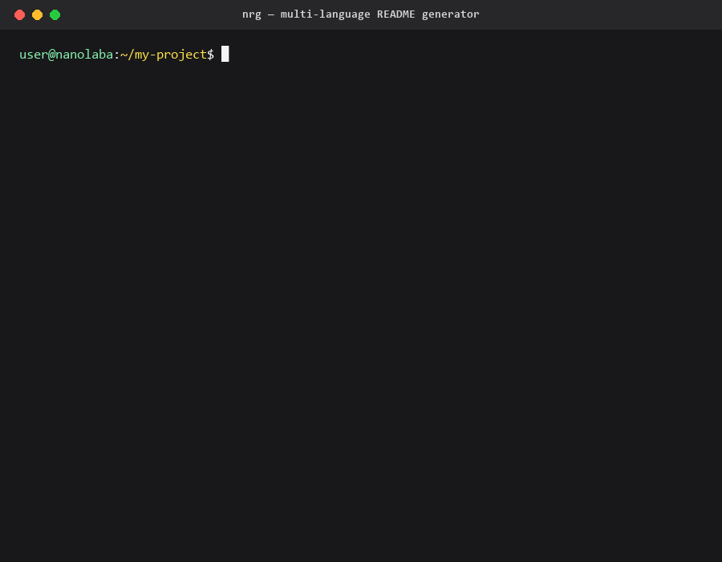

<!--@nrg.languages=en,ru-->
<!--@nrg.defaultLanguage=en-->

<!--@nrg.pom.path=pom.xml-->

<!--@name=**Nanolaba Readme Generator (NRG)**-->
<!--@stableVersion=${pom.properties.stableVersion}-->
<!--@devVersion=${pom.version}-->
<!--@projectRootLink=#project-root-->
<!--@projectRootLink.ru=#корень-проекта-->

${widget:languages}

${widget:badge(type='github-workflow', repo='nanolaba/readme-generator', workflow='ci.yml', name='CI', alt='NRG continuous integration build status')}
${widget:badge(type='maven-central', coordinates='com.nanolaba:readme-generator', alt='NRG release on Maven Central')}
${widget:badge(type='custom', label='Java', message='8+', color='orange', alt='Built with Java 8+')}
${widget:badge(type='license', value='Apache 2.0', url='https://www.apache.org/licenses/LICENSE-2.0', alt='NRG is open source under the Apache 2.0 license')}
${widget:badge(type='github-stars', repo='nanolaba/readme-generator')}

# Nanolaba Readme Generator (NRG): ${en:'one template for README in every language, for AI coding agents and CI', ru:'один шаблон для README на всех языках — для ИИ-агентов и CI'}

**NRG** generates `README.md`, `README.ru.md` and a file for every other language from one `README.src.md` template.<!--en-->
A translation sits on the line next to its original, versions are read from `pom.xml`, `package.json` or `build.gradle`,<!--en-->
and code samples are imported from real source files. When an AI coding agent maintains the docs, it edits one file<!--en-->
instead of one per language: `nrg --validate` names the template line it broke, and `nrg --check` fails CI when a generated<!--en-->
file differs from what its template produces. Under Claude Code a hook refuses an edit of a generated file and names the template to change.<!--en-->
**NRG** генерирует `README.md`, `README.ru.md` и файл для каждого другого языка из одного шаблона `README.src.md`.<!--ru-->
Перевод стоит на соседней строке с оригиналом, версии читаются из `pom.xml`, `package.json` или `build.gradle`,<!--ru-->
а примеры кода импортируются из настоящих исходников. Когда документацию ведёт ИИ-агент, он правит один файл,<!--ru-->
а не по файлу на язык: `nrg --validate` называет строку шаблона, которую агент сломал, а с `nrg --check` сборка в CI<!--ru-->
падает, если сгенерированный файл разошёлся с шаблоном. В Claude Code хук отклоняет правку сгенерированного файла и называет шаблон, который нужно править.<!--ru-->

NRG runs on Java 8+ and ships as a [CLI](#using-the-command-line-interface), a [Maven plugin](#use-as-maven-plugin),<!--en-->
a [GitHub Action](#use-as-a-github-action) and a [Java library](#use-as-a-java-library). A template is Markdown with<!--en-->
language markers, `\${…}` variables and widgets: table of contents, import, badges, `if` blocks, alerts, math and others.<!--en-->
This README and its [Russian translation](README.ru.md) are generated from [`README.src.md`](README.src.md).<!--en-->
NRG работает на Java 8+ и поставляется как [CLI](#запуск-из-командной-строки), [Maven-плагин](#использование-как-плагина-для-maven),<!--ru-->
[GitHub Action](#использование-в-качестве-github-action) и [Java-библиотека](#использование-в-качестве-java-библиотеки). Шаблон — это Markdown<!--ru-->
с языковыми маркерами, переменными `\${…}` и виджетами: оглавление, импорт, бейджи, блоки `if`, alert-блоки, формулы и другие.<!--ru-->
Этот README и его [английская версия](README.md) сгенерированы из [`README.src.md`](README.src.md).<!--ru-->

**${en:'Questions and feedback', ru:'Вопросы и отзывы'}:** [Discussions](https://github.com/nanolaba/readme-generator/discussions) · **${en:'bugs', ru:'ошибки'}:** [Issues](https://github.com/nanolaba/readme-generator/issues/new/choose) · ${en:'English or Russian', ru:'на русском или английском'}

${widget:import(path='docs/Overview.src.md')}

${widget:tableOfContents(title = "${en:'Table of contents', ru:'Содержание'}", ordered = "true", numbering-style = "dotted")}

${widget:import(path='docs/QuickStart.src.md')}
${widget:import(path='docs/Agents.src.md')}
${widget:import(path='docs/Launching.src.md')}
${widget:import(path='docs/TemplateSyntax.src.md')}
${widget:import(path='docs/Widgets.src.md')}
${widget:import(path='docs/Advanced.src.md')}
${widget:import(path='docs/RelatedProjects.src.md')}
${widget:import(path='docs/Changelog.src.md')}
${widget:import(path='docs/Feedback.src.md')}

---
*${en:'Last updated:', ru:'Дата последнего обновления:'} ${widget:date(pattern= 'dd.MM.yyyy')}*
